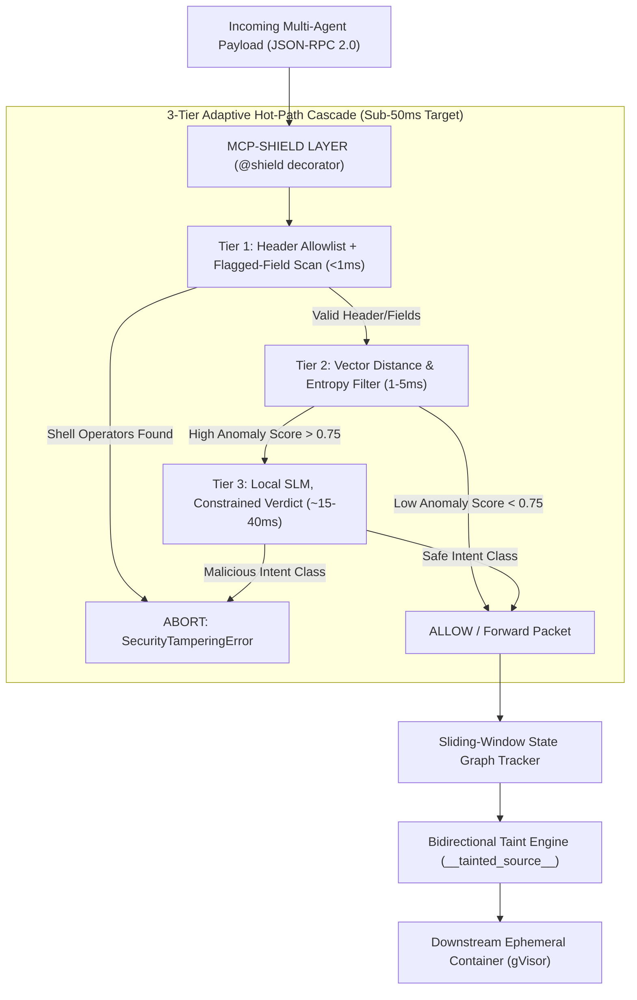

# MCP-Shield: Semantic LLM Firewall for Model Context Protocol in Agent Networks

> **Project Title**: MCP-Shield: An Autonomous Inline Multi-Agent Firewall for Protocol-Level Safety and Real-Time Indirect Prompt Injection Defense **Domain**: Agentic AI, Protocol-Level AI Safety, Inter-Agent Access Control, Real-Time Injection Defense **Target Package**: `pip install mcp-shield-llm` (`@shield` decorator interface) **Target SLA**: Sub-50ms Hot-Path Decision Latency (target, pending hardware benchmark — optimized for the 2026-07-28 Stateless MCP Spec)

---

## 1. Executive Summary & Product Scope Boundaries

### What MCP-Shield IS:

- **A Security Middleware Layer**: An inline Python package (`pip install mcp-shield-llm`) with a single `@shield` decorator.
- **A Real-Time Semantic Firewall**: Intercepts JSON-RPC 2.0 traffic between agents and tools to detect Indirect Prompt Injections, Tool Poisoning, and Confused Deputy attacks in under **20–50 milliseconds**.

### What MCP-Shield IS NOT:

- **NOT an AI Agent**: We are not building new LLM agents (e.g. coding agents, web search bots). We are building the **security guard layer** that protects _any_ existing AI agent or MCP server tool.

---

## 2. The 2026 Stateless MCP Update & Security Gaps

### What Changed in the MCP Spec?

In July 2026, the Model Context Protocol moved from a stateful connection core to a **Stateless Request/Response Model**:

|Architectural Dimension|Stateful MCP (Legacy Spec)|Stateless MCP (2026 Spec)|
|:--|:--|:--|
|**Transport Model**|Long-lived persistent streams (STDIO / held-open SSE).|Standard HTTP Request / Response payloads.|
|**Session State**|Mandatory `initialize` handshake pinned to `Mcp-Session-Id`.|**No handshake required**. Self-contained requests carrying metadata in `_meta`.|
|**Server Scaling**|Requires sticky sessions (Requests must hit the same server).|**Horizontal scaling**. Round-robin load balancing across serverless pods.|
|**Routing Headers**|Requires parsing full JSON-RPC body to know tool name.|Native HTTP headers (`Mcp-Method: tools/call`, `Mcp-Name: read_file`).|

### Does the Stateless Update Fix Prompt Injection Security?

**NO.** The stateless spec is a **network infrastructure and load-balancing upgrade**. It standardizes how HTTP packets are transmitted, but **it does not inspect the natural language instructions inside the packet**. Indirect Prompt Injections and Confused Deputy attacks remain 100% active.

### How the Stateless Update Accelerates MCP-Shield (Toward the Sub-50ms Target)

The stateless update allows MCP-Shield to run **more than 2x faster**:

1. **Header Micro-Interception (sub-millisecond Tier 1 check)**: Tier 1 inspects `Mcp-Method` and `Mcp-Name` HTTP headers to validate the requested tool against an allowlist, in well under 1ms, without parsing the full JSON body. A separate, still-cheap pattern scan over a small set of flagged argument fields (not the whole payload) catches obvious shell-injection attempts in the same tier.
2. **Zero Session Lock Contention**: Removing session state locks enables parallel async handling on Python `asyncio` — `uvloop` on Linux/Mac, `winloop` on Windows (`uvloop` itself does not support Windows).
3. **Lock-Free Vector Caching (`ttlMs`)**: Leveraging spec `ttlMs` metadata allows Tier 2 to cache clean embedding scores in a lock-free memory cache (**<1ms**).

---

## 3. Differentiators Matrix

|Feature|Legacy WAF / Proxies|Contemporary MCP Options|MCP-Shield (Our System)|
|:--|:--|:--|:--|
|**Developer Integration**|Network Appliance Layer|Complex Config / YAML|Single Python Decorator (`@shield`)|
|**Detection Method**|Regex & Static Signatures|Vector matching / Fixed Rules|3-Tier Cascade (Structural + Local SLM Intent)|
|**Data Scope**|Ingress Only|Ingress Only|Bidirectional (Input + Tool Output Taint Tagging)|
|**Latency SLA**|Fast but blind|Variable (External API Bloat)|**Sub-50ms target** (Stateless Header Fast-Path + Local SLM, pending benchmark)|
|**High Traffic Concurrency**|High|Crashes / Rate Limited|**Short-circuiting 90-95% traffic** + continuous batching where the backend supports it (vLLM, Linux/WSL2)|
|**Deployment Cost**|High Infra Cost|High Cloud API Bills|**$0.00** (Model weights auto-cached from Hugging Face)|

---

## 4. High-Level Architecture Flow

---

## 5. Key Quick Links

- [[MCP-Shield Documentation]] (Master Hub & Simple English Introduction)
- [[01 - Threat Model & Vulnerabilities]]
- [[02 - System Architecture & Technical Implementation]]
- [[03 - Fine-Tuning & Dataset Strategy]]
- [[04 - Brainstorming Archive & Trade-off Analysis]]
- [[05 - Literature Survey & Research Papers]]
- [[06 - Fortified Solution & Defense Upgrades]]
- [[07 - Model Distribution, PyPI Packaging & Local Dashboard]]
- [[README.md]] (GitHub Repository Documentation)