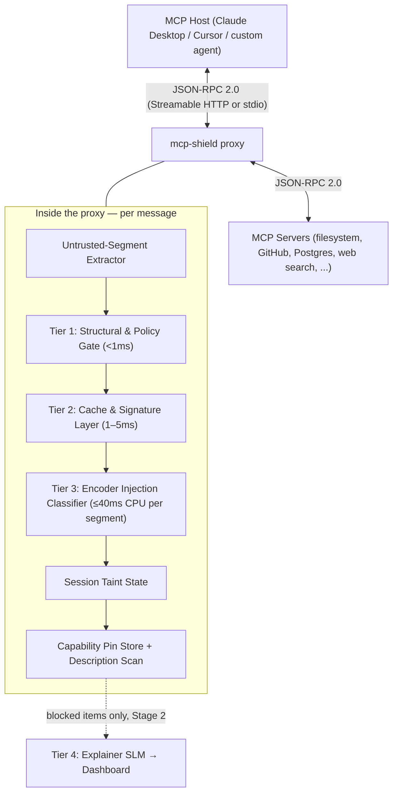

# MCP-Shield: Semantic LLM Firewall for Model Context Protocol in Agent Networks (registered title: MCP-SHIELD: SEMANTIC LLM FIREWALL FOR MODEL CONTEXT PROTOCOL IN MULTI AGENT NETWORKS)

> **Project Title**: MCP-Shield: An Autonomous Inline Multi-Agent Firewall for Protocol-Level Safety and Real-Time Indirect Prompt Injection Defense (registered title: MCP-SHIELD: SEMANTIC LLM FIREWALL FOR MODEL CONTEXT PROTOCOL IN MULTI AGENT NETWORKS)
> **Domain**: Agentic AI, Protocol-Level AI Safety, Inter-Agent Access Control, Real-Time Injection Defense
> **Target Package**: `pip install mcp-shield-llm` — primary interface `mcp-shield proxy`; secondary `@shield` decorator
> **Target SLA**: End-to-end p95 decision latency **< 50 ms on a CPU-only laptop** (target, pending benchmark — canonical numbers in [[02 - System Architecture & Technical Implementation]])
> **Naming note**: unrelated to `riseandignite/mcp-shield`, a 2025 static scanner for installed MCP server configs. MCP-Shield (this project) is an inline runtime firewall; see [[01 - Threat Model & Vulnerabilities]] for the comparison.

---

## 1. Executive Summary & Product Scope Boundaries

### What MCP-Shield IS:

- **A Local Security Proxy**: `mcp-shield proxy` sits between an MCP host (Claude Desktop, Cursor, a custom agent) and the MCP servers it uses, inspecting **both directions** of JSON-RPC 2.0 traffic — tool descriptions, tool results, resource contents, and server-issued input requests — not just the host's requests.
- **A Real-Time Semantic Firewall**: a three-tier hot-path cascade (structural policy gate → cache/signature layer → fine-tuned encoder classifier) that detects Indirect Prompt Injection, Tool-Description Poisoning, and Parameter Command Injection, with an end-to-end target under **50 ms**.
- **A Developer Library**: a secondary `@shield` decorator / ASGI middleware for developers who write MCP servers and want their own tool execution hardened.

### What MCP-Shield IS NOT:

- **NOT an AI Agent**: We are not building new LLM agents (coding agents, web search bots). We are building the **security guard layer** that protects any existing AI agent or MCP server.
- **NOT a replacement for protocol-level attestation**: ATTESTMCP (the base paper's defence) answers *who* a server is and *which* capabilities it may claim. MCP-Shield answers *what* the content flowing through a legitimate connection is trying to make the host do. The base paper itself notes that ATTESTMCP's residual 12.4% ASR "primarily reflects indirect injection through legitimately-retrieved content" — that residual is MCP-Shield's target. The two are complementary.

---

## 2. The 2026 Stateless MCP Update & Security Gaps

### What changed in the MCP spec (revision `2026-07-28`)?

|Architectural Dimension|Previous Spec (`2025-11-25`)|Current Spec (`2026-07-28`)|
|:--|:--|:--|
|**Transport Model**|Streamable HTTP with protocol-level sessions (`Mcp-Session-Id`), HTTP+SSE deprecated.|Streamable HTTP with **no protocol-level sessions**; `Mcp-Session-Id` removed (SEP-2567). Servers needing cross-call state use explicit, server-minted handles passed as ordinary tool arguments.|
|**Handshake**|Mandatory `initialize` / `notifications/initialized`.|**No handshake.** Every request carries `io.modelcontextprotocol/protocolVersion`, `clientCapabilities`, and `clientInfo` in `_meta`; `server/discover` replaces up-front negotiation (SEP-2575).|
|**Routing Headers**|Tool name only discoverable by parsing the JSON-RPC body.|`Mcp-Method` and `Mcp-Name` **required** on Streamable HTTP POSTs (SEP-2243); a header/body mismatch is a spec error (`HeaderMismatchError`, `-32020`).|
|**Caching**|`listChanged` notifications only.|`ttlMs` and `cacheScope` required on list/read results (SEP-2549).|
|**Server-initiated requests**|`sampling/createMessage`, `elicitation/create`, `roots/list` sent by the server.|Replaced by **Multi Round-Trip Requests (MRTR)**: the server returns `resultType: "input_required"` with `inputRequests`; the client retries with `inputResponses` (SEP-2322). **Sampling, Roots, and Logging are deprecated** (SEP-2577, 12-month window).|

### Does the stateless update fix prompt injection?

**No.** It is a transport, scaling, and lifecycle upgrade. It standardises how packets travel and how capabilities are advertised; it does not inspect whether the natural-language content inside a tool result or a tool description is trying to hijack the host. Indirect prompt injection, tool-description poisoning, and parameter command injection are untouched — and MRTR `inputRequests` are the direct successor of the Sampling vector the base paper measured at 58–72% ASR.

### What the update gives MCP-Shield

1. **Header-level Tier 1 (HTTP mode)**: `Mcp-Method` / `Mcp-Name` let the proxy validate *which* tool is being called against an allowlist before reading the body. The body is still parsed afterwards and must match the headers — a header-only check would be bypassable.
2. **`clientInfo` on every request**: the proxy derives client identity for session taint state and the topology map by rolling aggregation, since there is no handshake to hook.
3. **`ttlMs` / `cacheScope`**: Tier 2's fast-accept cache for `tools/list` and other list results is scoped to the server's own freshness hint, so a cached verdict never outlives the data it was computed on.
4. **`subscriptions/listen` → `toolsListChanged`**: the spec-native trigger for re-checking capability pins.

---

## 3. Differentiators Matrix

|Feature|Legacy WAF / Proxies|Static MCP Scanners (`mcp-scan`, `riseandignite/mcp-shield`, Cisco `mcp-scanner`)|Inline Guardrails (LlamaFirewall / Prompt Guard 2)|MCP-Shield|
|:--|:--|:--|:--|:--|
|**Integration**|Network appliance|CLI scan of installed configs; some offer a rule-based proxy|Library call inside the app|Local proxy (no code change) or `@shield` decorator|
|**Detection**|Regex / static signatures|Signature + hosted-API analysis of tool descriptions|Fine-tuned encoder classifier|Structural policy gate + cache + **fine-tuned encoder classifier, MCP-aware**|
|**Protocol awareness**|None|Tool descriptions at scan time|None|Every JSON-RPC message type, both directions, `2026-07-28` headers and MRTR|
|**Data scope**|Ingress only|Descriptions only|Whatever the app passes it|**Bidirectional**: descriptions, results, resources, MRTR input requests, call arguments|
|**Runtime state**|Stateless|Point-in-time|Stateless|Session taint state + capability pin store (+ multi-turn tracker in Stage 2)|
|**Latency**|Fast but blind|Not inline|~20–90 ms per 512 tokens (Meta's figures)|**< 50 ms end-to-end target** on CPU|
|**Cost**|Infra|Free / API-backed|Free|**$0** — small ONNX model auto-downloaded, runs locally|

---

## 4. High-Level Architecture Flow

Full tier definitions, the canonical latency table, and error types: [[02 - System Architecture & Technical Implementation]].

---

## 5. Delivery Scope: Stage 1 / Stage 2 / Future

|Stage|Deliverables|Status|
|:--|:--|:--|
|**Stage 1 — this semester (MVP)**|`mcp-shield proxy` (Streamable HTTP + stdio) · Tier 1 policy gate · Tier 2 cache/signature layer · Tier 3 encoder classifier (`mcp-shield-clf-small`, ONNX) · untrusted-segment extractor · capability pinning + description scan · session taint state with overlap check · `mcp-shield doctor` · benchmark harness on held-out suites · minimal dashboard (traffic log + flagged-request inspector) · PyPI release|In progress|
|**Stage 2**|`@shield` decorator + ASGI middleware · sliding-window state tracker (drift + loop breaker) · Tier 4 explainer (Ollama, consent-gated; or opt-in cloud) · MRTR-based human approval · full dashboard (topology map, tool hub, model switcher) · `mcp-shield-clf-base`|Planned|
|**Future / Enterprise**|gVisor sandboxing · OAuth-claim privilege scoping / RBAC · Kubernetes sidecar · eBPF interception · SIEM / OTLP export · IAM sync|Roadmap only|

Anything in a later stage is described in this vault as a design, not as a delivered feature.

---

## 6. Key Quick Links

- [[MCP-Shield Documentation]] (Master Hub & Simple English Introduction)
- [[01 - Threat Model & Vulnerabilities]]
- [[02 - System Architecture & Technical Implementation]] — **canonical**
- [[03 - Fine-Tuning & Dataset Strategy]]
- [[04 - Brainstorming Archive & Trade-off Analysis]]
- [[05 - Literature Survey & Research Papers]] — **canonical bibliography**
- [[06 - Fortified Solution & Defense Upgrades]]
- [[07 - Model Distribution, PyPI Packaging & Local Dashboard]]
- [[README.md]] (GitHub Repository Documentation)
