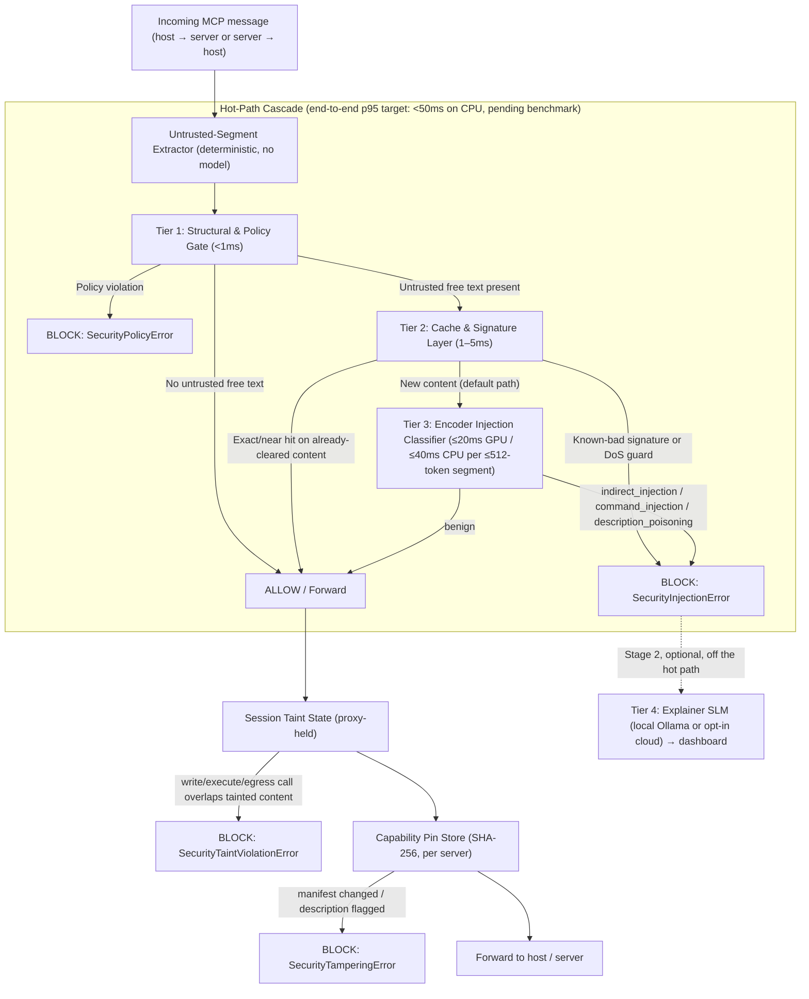

# 02 - System Architecture & Technical Implementation

> **This is the canonical architecture document.** Every number, name, tier definition, and error type used elsewhere in this vault (README, `00`, `06`, `07`, the presentation script) is defined here and referenced from there. If two documents ever disagree, this one wins — fix the other.

---

## 0. Design Decisions at a Glance

|Decision|Choice|Why (short)|
|:--|:--|:--|
|**Where MCP-Shield sits**|**`mcp-shield proxy`** between the MCP host and its servers is the primary product. The `@shield` decorator is a secondary, server-side integration.|The Confused Deputy is the *host* LLM; only a proxy on the host side can see every server's tool descriptions, every tool result, and cross-server flows. A decorator inside one server cannot.|
|**Tier 3 model**|A **fine-tuned small encoder classifier** (DeBERTa-v3 lineage, 22M default / 86M optional), not a 7B generative SLM.|Meta's own numbers for the same model class are 19.3ms (22M) / 92.4ms (86M) per 512 tokens on an A100; an independent 2026 study (CASCADE) measured a local review LLM at **2.51s per call**. Only the encoder fits a sub-50ms budget — and it runs on CPU, so no-GPU laptops get full protection.|
|**What decides Tier 3 runs**|**Source trust**, not an anomaly score. All untrusted free text is classified; Tier 2 is a cache, not a gate.|A cascade that only classifies "suspicious-looking" text is bypassed by any novel injection that doesn't resemble known ones — the exact weakness we criticise in vector-only tools.|
|**Taint tracking**|**Proxy-held session taint state** + argument-overlap check, not tags injected into strings.|A tag inside a string does not survive an LLM paraphrasing it and is trivially forgeable. State held outside the LLM is neither.|
|**Tool-description poisoning**|**Pin (SHA-256) + scan** descriptions with the classifier at `tools/list` time.|Pinning only detects *change* (rug-pulls). Scanning catches first-contact poisoning, which pinning alone cannot.|
|**Parameter command injection**|Tier 1 argument policy (path canonicalisation, shell-metacharacter rejection, URL allowlists) + per-tool approval flag.|gVisor is Linux-only, needs Docker/runsc, and costs 100ms–1s per call — wrong tool for individual developers on laptops. It moves to the enterprise roadmap.|
|**Scope**|Explicit **Stage 1 / 1E / 2 / Future** split (§9 below, and `00` §5): core first, a basic enterprise set last and cut-line protected, everything else deferred.|One semester. Everything not in Stage 1 is deliberately deferred, not forgotten.|

---

## 1. Deployment Modes

### Mode A — `mcp-shield proxy` (Stage 1, primary)

A local proxy that sits between an MCP host (Claude Desktop, Cursor, a custom agent) and the MCP servers it talks to. It sees **both directions** of every conversation with every server, which is what the threat model requires.

```bash
# Streamable HTTP server behind the proxy (2026-07-28 spec)
mcp-shield proxy --listen 127.0.0.1:8800 --upstream https://tools.example.com/mcp

# stdio server wrapped by the proxy (the host launches this command instead of the server)
mcp-shield proxy -- npx -y @modelcontextprotocol/server-filesystem /workspace
```

The host is pointed at the proxy instead of the server. From the host's point of view nothing changes; from the server's point of view nothing changes.

**Transport notes.** In HTTP mode the proxy is an ASGI reverse proxy and forwards the spec's `Mcp-Method` / `Mcp-Name` headers unchanged. In **stdio mode there are no HTTP headers**: Tier 1 applies the allowlist to the parsed body only, and the header ↔ body check does not apply. Binary content (`blob` fields) is hashed for the taint buffer but not classified — only text is.

**The proxy's own attack surface.** The spec's Security Best Practices name two risks that apply directly to this architecture, mitigated as follows:

- *Local HTTP service reachable from a browser (DNS rebinding / cross-site POST).* The listener binds to `127.0.0.1`, validates the `Host` header against its own bound address, rejects any request carrying a browser `Origin` header (MCP hosts never send one), and accepts an optional bearer token configured in the host's MCP settings.
- *"stdio transport security in proxy scenarios"* — a proxy that spawns stdio servers is an escalation path if an attacker can tell it what to spawn. The command the proxy spawns comes **only** from the CLI invocation or the on-disk `mcp-shield.toml`; no network endpoint and no dashboard action can start a process. Registering a stdio server through the Stage 2 dashboard writes the config and requires confirmation in the terminal that launched the proxy, with the full command shown untruncated.

**Coverage.** The proxy protects the servers routed through it, so the Stage 1 CLI includes **`mcp-shield install --host <claude-desktop|cursor|path>`**, which rewrites the host's MCP configuration to route *every* listed server through the proxy (stdio entries are wrapped, HTTP entries get a proxy listener each), keeps a backup, and is reversed by `mcp-shield uninstall`. `mcp-shield doctor` still warns if it finds an unproxied server. The residual limit is a host that adds a server after installation without re-running `install` — which `doctor` catches on its next run.

**What the proxy inspects, per direction:**

|Direction|Message|What is untrusted|Which tiers run|
|:--|:--|:--|:--|
|Host → Server|`tools/call`|Free-text arguments (if any)|Tier 1 always; Tier 2/3 only on free-text args; taint check if the target tool is `write`/`execute`/`egress`|
|Host → Server|`tools/list`, `prompts/list`, `resources/list`, `resources/read`, `prompts/get`|—|Tier 1 (allowlist, header ↔ body consistency)|
|Server → Host|`tools/list` result|Tool names, `description`s, schema `description` strings, annotations|**Capability pinning + Tier 3 `description_poisoning` scan**|
|Server → Host|`tools/call` result|`content[].text`, string values in `structuredContent`|Tier 2 cache → Tier 3; result recorded in session taint state|
|Server → Host|`resources/read`, `prompts/get` results|Resource text, prompt messages|Tier 2 → Tier 3; taint state|
|Server → Host|`resultType: "input_required"` (MRTR `inputRequests`)|Server-authored prompts to the client|Tier 3, then a **provenance banner** is prepended to each free-text prompt (`[MCP-Shield: request from server "github" — untrusted]`) so the human or host sees where it came from (this is the successor of the deprecated Sampling vector — see `01`)|
|Server → Host|`notifications/progress` and other request-scoped notifications|Their free-text `message` fields|Tier 3 (short segments, batched); binary `blob` content is hashed, not classified|

Because the proxy is an ASGI application in HTTP mode, Tier 1's header allowlist genuinely runs **before the request body is parsed** — that claim only holds in this mode.

### Mode B — `@shield` decorator (Stage 2, secondary)

For developers who *write* MCP servers and want their own tool execution protected from parameter-bound command injection without running a proxy:

```python
from mcp_shield import shield, SecurityConfig

@shield(config=SecurityConfig(taint_policy="strict"))
async def handle_mcp_request(json_rpc_payload: dict):
    # Core MCP Server / tool execution logic
    return await execute_tool(json_rpc_payload)
```

The decorator receives an **already-parsed** payload, so it runs Tier 1 argument policy and Tier 3 on free-text arguments. It **cannot** see other servers, tool descriptions from other servers, or what the host does with results — say so honestly wherever the decorator is mentioned. An ASGI middleware variant (`mcp_shield.asgi.ShieldMiddleware`) gives server authors the header-level fast path as well. The decorator cannot repair a server that builds shell strings from arguments: pass argument lists to `subprocess`, never `shell=True`, and treat the Tier 1 argument policy as the last line, not the first.

---

## 2. The Hot-Path Cascade



### Tier 1 — Structural & Policy Gate (<1ms)

Deterministic checks. No model.

1. **Header allowlist** (HTTP mode): `Mcp-Method` / `Mcp-Name` (required on Streamable HTTP POSTs since spec `2026-07-28`, SEP-2243) are checked against the per-client allowlist *before* the body is read.
2. **Header ↔ body consistency**: the parsed body's `method` / `params.name` must equal the headers; a mismatch is rejected exactly as the spec's `HeaderMismatchError` (`-32020`) requires. A header-only allowlist would otherwise be bypassable by sending a benign header with a malicious body.
3. **JSON-RPC 2.0 and schema conformance**: shape, `id`, `_meta` protocol version (`io.modelcontextprotocol/protocolVersion`), argument types against the pinned `inputSchema`.
4. **Argument policy — every string argument scanned, typed fields enforced**: every string argument is scanned for shell metacharacters (`;`, `|`, `&&`, `` ` ``, `$(`), path traversal (`../`, absolute paths outside the root) and URL smuggling. For fields whose schema or name marks them as path-, command-, or URL-like a hit is a **block** (plus path canonicalisation + root allowlist, and scheme/host allowlists for fetch-type parameters). For any *other* string field a hit does not block on its own — the call is annotated and, if the target tool is `execute` or `egress`, it proceeds only under `strict` policy (approval required in Stage 2). This closes the gap where a server builds a command from a field nobody flagged, without turning every code snippet passed to a tool into a false positive.
5. **Per-client tool allowlist** and per-tool privilege class (`read` / `write` / `execute` / `egress`). The class is the *highest* of: the developer's config, a name heuristic (`execute_*`, `run_*`, `shell*` → `execute`; `send_*`, `post_*`, `fetch_*` → `egress`; `write_*`, `delete_*`, `update_*` → `write`), and the server's tool annotations (`destructiveHint`, `openWorldHint`). Annotations can only *raise* a class, never lower it — the spec requires clients to treat annotations as untrusted unless the server is trusted, and otherwise a malicious server would mark `execute_shell` as read-only to escape taint enforcement. A tool matched by nothing defaults to `write` (fail closed).

Raises **`SecurityPolicyError`**.

### Tier 2 — Cache & Signature Layer (1–5ms)

Tier 2 **never** decides that new untrusted text is safe. It exists to make the common case cheap and the known-bad case instant.

- **Fast-accept**: **exact** SHA-256 hit on content already cleared by Tier 3, scoped by server + tool; list results additionally scoped by the spec's `ttlMs` / `cacheScope` so a cached verdict never outlives the server's own freshness hint. Near-duplicate matches are deliberately *not* accepted: appending a short injection to a long, previously-cleared document keeps its embedding almost unchanged, so similarity-based acceptance would be a bypass.
- **Fast-reject**: exact or near-duplicate (embedding cosine) matches against a local signature set of known injection strings — similarity is safe in the *reject* direction.
- **Context-DoS guard**: length caps and repetition-ratio / compression-ratio checks reject padding and recursive-text payloads before they reach the classifier or the host.

Embeddings use a small local model (BGE-Micro / E5-small class, ONNX). The cache is an in-process LRU; no locks are needed because the proxy is single-process asyncio.

### Tier 3 — Encoder Injection Classifier

|Model ID|Lineage|Params|Target latency (≤512-token segment)|Role|
|:--|:--|:--|:--|:--|
|`mcp-shield-clf-small` _(default)_|`microsoft/deberta-v3-xsmall` (MIT)|~22M|**≤20ms GPU / ≤40ms CPU** (ONNX Runtime, int8)|Runs everywhere, including CPU-only laptops|
|`mcp-shield-clf-base`|`microsoft/mdeberta-v3-base` (MIT)|~86M|~2–4× slower|Higher accuracy, multilingual; opt-in|

- **Task**: multi-class sequence classification over one untrusted text segment with a compact context prefix (`[server=github tool=get_issue field=content[0].text]`). Classes: `benign`, `indirect_injection`, `command_injection`, `description_poisoning`.
- **Runs on**: every new untrusted free-text segment (tool results, resource contents, tool/prompt descriptions, MRTR `inputRequests`, free-text call arguments). Skipped only when Tier 1 finds no free text.
- **Long content**: chunked at ≤512 tokens with overlap and classified as a batch; a segment is flagged if any chunk is. Latency scales with content length — the sub-50ms target applies per ≤512-token segment and large tool outputs are reported separately in benchmarks.
- **Calibration and the abstain band**: temperature-scaled probabilities; the **block threshold** is chosen on validation hard negatives for **FPR ≤ 0.5%** (see `03`). Below it sits an **abstain band** (its lower edge set at FPR ≈ 2%): a segment scoring inside the band is forwarded, but the session is escalated to `strict` taint policy and the item is queued in the flagged-request inspector for review. This is the runtime answer to distribution shift — a classifier that is unsure does not silently pass content, it raises the guard. Verdicts carry the calibrated probability, which is what the dashboard shows.
- **Why this model class**: Meta reports 19.3ms (22M) and 92.4ms (86M) per 512 tokens on an A100 for the same DeBERTa lineage (Llama Prompt Guard 2 model card, 2025); Prompt Guard 2 itself is used as an evaluation baseline, not as base weights, because it ships under the Llama community licence and MCP-Shield is Apache-2.0.

Raises **`SecurityInjectionError`** with the class and probability.

### Tier 4 — Explainer SLM (Stage 2, optional, off the hot path)

A generative model (e.g. `Qwen3-8B` / `Llama-3.1-8B` via Ollama, installed only with explicit consent; or a cloud API with the user's own key, opt-in) that produces a one-paragraph explanation and attack-vector tag for items Tier 3 quarantined. It feeds the dashboard's flagged-request inspector. It has **no latency budget, never runs inline, and never silently overrides a Tier 3 block**.

### Canonical latency table (targets — pending benchmark, see README)

|Stage|Target|Conditions|
|:--|:--|:--|
|Tier 1|< 1 ms|Always|
|Tier 2|1–5 ms|Untrusted text present|
|Tier 3 (`clf-small`)|≤ 20 ms GPU / ≤ 40 ms CPU|Per ≤512-token segment, ONNX Runtime int8|
|**End-to-end p95**|**< 50 ms**|CPU-only laptop, ≤512-token segments|
|Tier 4|none|Off the hot path|

---

## 3. Untrusted-Segment Extractor (replaces "Progressive Disclosure Compression")

A deterministic walker over the JSON-RPC message that yields `(context_prefix, text)` pairs for every string that originates from an untrusted party — tool result text, resource contents, descriptions, prompt messages, MRTR input requests, and call arguments above a minimum length. No model is involved; earlier drafts proposed a second LLM to "compress" payloads before classification, which cannot fit any latency budget and has been removed.

---

## 4. Session Taint State (Stage 1 core; approval flow Stage 2)

**The problem with in-band tags.** A `__tainted_source__` marker inside a string does not survive the host LLM reading the string and emitting a *new* string as a tool argument, and an attacker can simply write the marker themselves. Taint must therefore live **outside** the LLM, in the proxy.

**Mechanism.**

1. **Session key**: OAuth 2.1 bearer subject (when the HTTP `Authorization` header is present) + `io.modelcontextprotocol/clientInfo` (name/version, sent on every request under the stateless spec) + transport peer (stdio child process, or HTTP client address). Sessions age out after a configurable idle window (default 30 min). The 2026-07-28 spec removed protocol-level sessions, so MCP-Shield keeps this state itself.
2. **Recording**: every untrusted result forwarded to the host is added to the session's taint buffer as `TaintRecord{server, tool, sha256, shingles, embedding, ts}`.
3. **Enforcement**: when the host later calls a tool whose privilege class is `write`, `execute`, or `egress` in a tainted session, the proxy measures overlap between the call's arguments and the taint buffer (5-gram shingle Jaccard and embedding similarity; initial thresholds Jaccard ≥ 0.3 *or* cosine ≥ 0.9, tuned on the Stage 1 benchmark). Overlap above threshold → **`SecurityTaintViolationError`**. In `strict` policy, *any* `execute`/`egress` call in a tainted session is blocked until a human approves it.
4. **Human approval (Stage 2)**: instead of a hard block, the proxy can answer the host with an MRTR `input_required` result that asks the user to confirm — the spec-native way to put a human in the loop.
5. **Probe detection**: an attacker optimising inputs *online* against the proxy produces a streak of blocks. After N blocks in a session window (default N = 3) the session is escalated to `strict`; after M (default 10) the offending server or client is quarantined until a human reviews it in the dashboard. This does not stop offline optimisation against the open weights, but it denies the cheap feedback loop.

**Honest limits.** The overlap check catches verbatim and near-verbatim smuggling (exfiltrating the poisoned document, passing an injected command through). It does not catch an instruction the host LLM has fully paraphrased — that is why Tier 3 classifies untrusted content *before* it reaches the host (prevention), with taint as defence in depth. The principled solution is to rewrite the host itself (CaMeL, Debenedetti et al. 2025); host-side marking (Spotlighting, Hines et al. 2024) is complementary. Nothing here is "cryptographic" and the docs no longer call it that.

---

## 5. Capability Pinning + Description Scanning (Stage 1)

- **Pin**: on the first `tools/list` (also `prompts/list`, `resources/templates/list`) from a server, each tool's canonical JSON (name, description, `inputSchema`, `outputSchema`, annotations) is hashed with SHA-256 and stored in a per-server pin store. Every later list result is compared; any changed or added tool is withheld from the host and raises **`SecurityTamperingError`** until the developer explicitly re-pins (`mcp-shield pin --server <name> --accept`). `subscriptions/listen` → `toolsListChanged` is the spec-native trigger for re-checking.
- **Scan**: every description and schema string is run through Tier 3 at list time (`description_poisoning` class). A flagged tool is never exposed to the host. This is what addresses **first-contact** poisoning, which pinning alone cannot.
- **First-contact quarantine ("trust on first review")**: a server with no entry in the pin store starts **quarantined**: its `read`-class tools are exposed, its `write` / `execute` / `egress` tools are withheld, and all of its results are handled under `strict` taint policy — until the developer has looked at the pinned manifest and the scan verdicts and accepted them (`mcp-shield pin --server <name> --accept`, or one click in the dashboard). The package also ships **known manifests**: published SHA-256 pins for the reference MCP servers, so those are trusted on match without a manual step.
- **Known limitation (TOFU, narrowed)**: pinning alone is trust-on-first-use, the same limitation the base paper names for ATTESTMCP. Quarantine turns it into trust-on-first-*review* — a human sees the descriptions and the classifier's verdicts before a new server gets any dangerous capability — but a reviewer can still approve a description whose malice neither they nor the classifier recognise.

---

## 6. Sliding-Window State Tracker (Stage 2)

Per-session rolling window over Tier 3 probabilities and the tool-call sequence.

- **Drift**: an exponentially weighted average of injection probability across turns; sustained drift above threshold escalates the session to `strict` taint policy even if no single turn was blocked — the defence against split, multi-turn injections.
- **Loop breaker**: the same `tool + argument hash` repeated N times (default N = 3) with no change in the result hash blocks the call as a zero-progress loop.

---

## 7. Configuration (canonical fields)

```python
from mcp_shield import SecurityConfig, ClassifierModel, ExplainerProvider

SecurityConfig(
    classifier_model=ClassifierModel.SMALL,   # SMALL (22M, default) | BASE (86M, Stage 2)
    taint_policy="standard",                  # "standard": block on overlap | "strict": every execute/egress call in a tainted session needs approval
    fpr_target=0.005,                         # selects the shipped operating threshold (default FPR <= 0.5%)
    explainer=ExplainerProvider.NONE,         # NONE (default) | OLLAMA | OPENAI | DEEPSEEK | ANTHROPIC (Stage 2, opt-in)
)
```

The same fields live in `mcp-shield.toml` for the proxy. There is no separate `strict_mode` flag — `taint_policy="strict"` is the strict setting, and every code sample in this vault uses these names.

---

## 8. Error Types (canonical)

|Error|Raised by|Meaning|
|:--|:--|:--|
|`SecurityPolicyError`|Tier 1|Header/body mismatch, disallowed tool, argument policy violation, schema violation|
|`SecurityInjectionError`|Tier 2/3|Known-bad signature, DoS guard, or classifier verdict ≠ `benign` (carries class + probability)|
|`SecurityTaintViolationError`|Taint engine|High-privilege call whose arguments overlap tainted content, or any such call under `strict` policy|
|`SecurityTamperingError`|Pin store|Tool manifest changed after pinning|

Every block is logged with the tier, class, probability, and the offending segment, and shown in the dashboard's flagged-request inspector (`07`, §3).

---

## 9. Stage Tags Used Across the Vault

- **Stage 1 — Core (this semester, built first)**: `mcp-shield proxy` (HTTP + stdio), Tier 1–3 with the abstain band, untrusted-segment extractor, pin + scan + first-contact quarantine, session taint with overlap check and probe detection, MRTR provenance banner, `mcp-shield doctor` / `install`, benchmark harness (including the CI CPU-only baseline), minimal dashboard (traffic log + flagged inspector + pin viewer), PyPI release.
- **Stage 1E — Enterprise Basics (this semester, built last, cut-line protected)**: structured JSONL audit log + OTLP export with `_meta` trace-context propagation; Dockerfile / docker-compose and a plain Kubernetes sidecar manifest; OAuth 2.1 bearer validation at the proxy (JWKS, `iss` / `aud` / `exp`) with a basic policy map (subject or role → allowed servers, tools and maximum privilege class); per-client sections in `mcp-shield.toml`. Built only after Stage 1 Core is benchmarked; if it slips, the thesis is unaffected. Details in `07` §7.
- **Stage 2 (next semester)**: `@shield` decorator + ASGI middleware, state tracker (drift + loop breaker), Tier 4 explainer, MRTR-based human approval, full dashboard (topology map, tool hub, model switcher), `clf-base`.
- **Future — Enterprise Advanced**: Envoy / service-mesh filter, eBPF interception, SIEM connectors (Splunk, Datadog, Sentinel), IAM sync (Vault, Okta / Entra ID), gVisor sandboxing, dashboard SSO, central policy server.
