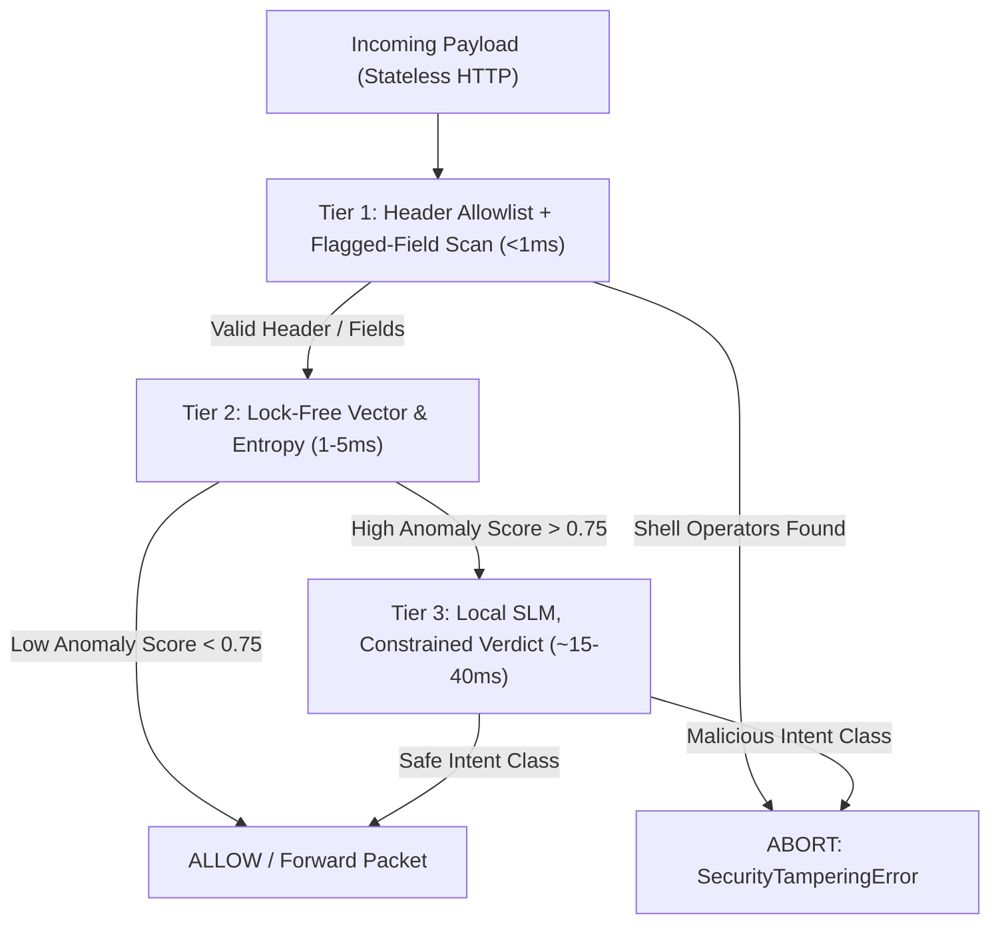

# 02 - System Architecture & Technical Implementation

## Core Developer Integration: The `@shield` Decorator

MCP-Shield is built as a zero-trust, developer-first inline middleware. Developers protect native Python MCP servers with a single line of code:

```python
from mcp_shield import shield, SecurityConfig

@shield(config=SecurityConfig(strict_mode=True, max_latency_ms=50))
async def handle_mcp_request(json_rpc_payload: dict, context: SessionContext):
    # Core MCP Server execution
    return await execute_tool(json_rpc_payload)
```

---

## Technical Implementation Pillars

### Pillar 1: The 3-Tier Adaptive Hot-Path Cascade (Sub-50ms Target)

To protect real-time performance on modern **Stateless MCP HTTP Transports**, traffic is routed through a progressive processing line:

1. **Tier 1: Header Allowlist & Flagged-Field Scan (well under 1ms)**
    
    - Inspects standard HTTP operation headers (`Mcp-Method: tools/call`, `Mcp-Name: read_file`) against a per-agent allowlist — this part genuinely needs no JSON body parsing.
    - Separately, runs a cheap string scan for command execution operators (`|`, `;`, `&&`, `` ` ``) over a small, schema-flagged set of argument fields (e.g. path-like or command-like parameters) — not the full payload, but not header-only either.
2. **Tier 2: Lock-Free Vector Distance & Entropy Filter (1–5ms)**
    
    - Uses a fast local embedding model (`BGE-Micro` or `E5`) paired with spec `ttlMs` memory caching.
    - Computes semantic distance against a local vector database of known injection patterns.
    - Measures semantic entropy to deflect Context-Length DoS / Token Bloat attacks.
3. **Tier 3: Localized Small Language Model Inference (~15–40ms target)**
    
    - Triggered **only** if Tier 2 records an anomaly score above threshold (`> 0.75`).
    - Runs a fine-tuned local SLM (`Qwen-2.5-7B`) via Ollama/ONNX Runtime side-car (Windows/Mac/Linux default), or vLLM with PagedAttention continuous batching where available (Linux/WSL2 only, for max throughput).
    - **Outputs a constrained, minimal-token verdict** (e.g. grammar-constrained `ALLOW`/`DENY` + a short reason code and confidence score) rather than freely generating the full JSON Authorization Manifest — the rest of the manifest (transaction ID, extracted params, etc.) is filled in programmatically from data the system already parsed, since those fields don't need the LLM to reproduce them. This is what keeps the latency target achievable: generating an open-ended multi-field JSON object token-by-token on consumer hardware does not fit inside tens of milliseconds, but a few constrained output tokens can.



---

### Pillar 2: Bidirectional Inspection & Semantic Taint Tracking

- Scans both **input prompts** and **tool output payloads**.
- Output strings from unverified external tools (web search, email, database) are wrapped in cryptographic metadata tags: `__tainted_source__: { origin: "tool_id_49", integrity_hash: "0x8f..." }`
- If a downstream agent tries to feed this tainted string into high-privilege tools (e.g., `execute_system_script` or `write_database`), MCP-Shield immediately blocks execution.

---

### Pillar 3: Context-Aware User Session Mapping & Capability Pinning

- **Identity Context**: Extracts user JWT / mTLS auth tokens from the JSON-RPC `_meta` metadata block to enforce Dynamic Privilege Scoping.
- **Capability Pinning**: Tool descriptions and server manifests are cryptographically hashed (SHA-256) on initialization. Runtime modifications attempted by downstream servers trigger an immediate `SecurityTamperingError`.

---

### Pillar 4: Fused Skill Routing & Token Efficiency Engine

- Uses **Progressive Disclosure Compression** (via context optimization).
- Strips verbose structural JSON/text descriptions mid-flight.
- Feeds the core safety classifier an ultra-dense, token-compressed routing format to calculate verdicts under tight token budgets.