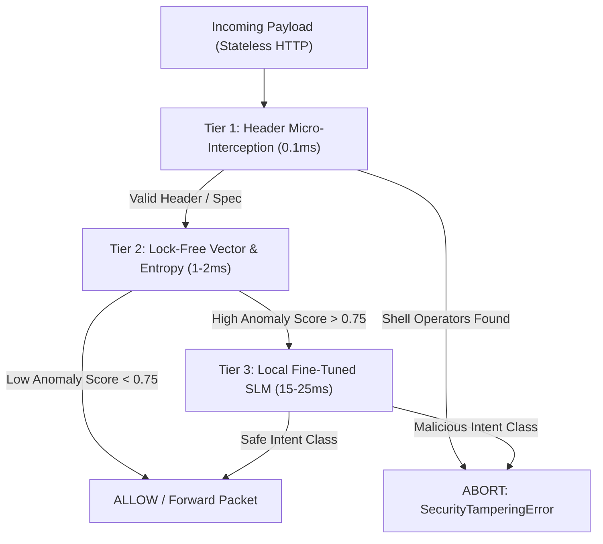

# 02 - System Architecture & Technical Implementation

## Core Developer Integration: The `@shield` Decorator
MCP-Shield is built as a zero-trust, developer-first inline middleware. Developers protect native Python MCP servers with a single line of code:

```python
from mcp_shield import shield, SecurityConfig

@shield(config=SecurityConfig(strict_mode=True, max_latency_ms=20))
async def handle_mcp_request(json_rpc_payload: dict, context: SessionContext):
    # Core MCP Server execution
    return await execute_tool(json_rpc_payload)
```

---

## Technical Implementation Pillars

### Pillar 1: The 3-Tier Adaptive Hot-Path Cascade (Sub-20ms SLA)

To protect real-time performance on modern **Stateless MCP HTTP Transports**, traffic is routed through a progressive processing line:

1. **Tier 1: Header Micro-Interception & Spec Validation (0.1ms)**
   * Inspects standard HTTP operation headers (`Mcp-Method: tools/call`, `Mcp-Name: read_file`) at the socket layer.
   * Rejects illegal structural keys and unmapped command execution operators (`|`, `;`, `&&`, `` ` ``) in **0.1ms** without allocating memory or parsing JSON bytes.

2. **Tier 2: Lock-Free Vector Distance & Entropy Filter (1–2ms)**
   * Uses a fast local embedding model (`BGE-Micro` or `E5`) paired with spec `ttlMs` memory caching.
   * Computes semantic distance against a local vector database of known injection patterns.
   * Measures semantic entropy to deflect Context-Length DoS / Token Bloat attacks.

3. **Tier 3: Localized Small Language Model Inference (15–25ms)**
   * Triggered **only** if Tier 2 records an anomaly score above threshold (`> 0.75`).
   * Runs a fine-tuned local SLM (`Qwen-2.5-7B`) via vLLM / ONNX side-car with PagedAttention continuous batching.
   * Evaluates multi-agent intent and outputs a structured JSON Authorization Manifest.



---

### Pillar 2: Bidirectional Inspection & Semantic Taint Tracking
* Scans both **input prompts** and **tool output payloads**.
* Output strings from unverified external tools (web search, email, database) are wrapped in cryptographic metadata tags:
  `__tainted_source__: { origin: "tool_id_49", integrity_hash: "0x8f..." }`
* If a downstream agent tries to feed this tainted string into high-privilege tools (e.g., `execute_system_script` or `write_database`), MCP-Shield immediately blocks execution.

---

### Pillar 3: Context-Aware User Session Mapping & Capability Pinning
* **Identity Context**: Extracts user JWT / mTLS auth tokens from the JSON-RPC `_meta` metadata block to enforce Dynamic Privilege Scoping.
* **Capability Pinning**: Tool descriptions and server manifests are cryptographically hashed (SHA-256) on initialization. Runtime modifications attempted by downstream servers trigger an immediate `SecurityTamperingError`.

---

### Pillar 4: Fused Skill Routing & Token Efficiency Engine
* Uses **Progressive Disclosure Compression** (via context optimization).
* Strips verbose structural JSON/text descriptions mid-flight.
* Feeds the core safety classifier an ultra-dense, token-compressed routing format to calculate verdicts under tight token budgets.

