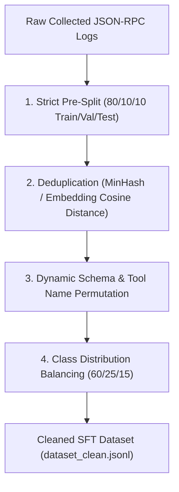

# 03 - Fine-Tuning & Dataset Strategy

## 1. Core Model Choice & Inference Engine
* **Primary Models**: `Qwen-2.5-7B-Instruct` or `Qwen-2.5-Coder-7B` (Fallback: `Llama-3-8B-Instruct`)
* **Target Hardware**: NVIDIA RTX 5060 Ti (PC - ~5.2 GB VRAM at 4-bit Q4_K_M) / RTX 3050 (Laptop)
* **Inference Runtime**: vLLM / ONNX Runtime side-car or Hugging Face TGI for low-latency (<40ms) evaluation.

---

## 2. Fine-Tuning Objective
Train the SLM to accept unstructured, multi-turn, conversational multi-agent JSON-RPC transaction payloads and immediately map them into a deterministic **JSON Authorization & Safety Manifest**.

### Target Manifest Output Schema
```json
{
  "transaction_id": "tx_98234",
  "intent_category": "tool_execution_request",
  "threat_classification": {
    "is_malicious": false,
    "confidence_score": 0.98,
    "detected_attack_vector": "NONE"
  },
  "inferred_tool_call": {
    "target_tool": "read_user_file",
    "requested_privilege_level": "READ_ONLY",
    "extracted_parameters": {
      "file_path": "/workspace/data.json"
    }
  },
  "authorization_verdict": "ALLOW"
}
```

---

## 3. Data Storage Format (ChatML / OpenAI `.jsonl`)

The dataset is stored in standard **JSON Lines (`.jsonl`)** format compatible with **Unsloth**, **Axolotl**, and **TRL/SFTTrainer**. Each line contains a complete `messages` array adhering to the ChatML spec:

### Sample JSONL Row (`dataset.jsonl`)
```json
{
  "messages": [
    {
      "role": "system",
      "content": "You are MCP-Shield, an inline real-time zero-trust security firewall for Model Context Protocol (MCP). Analyze the JSON-RPC transaction payload and output a deterministic JSON Authorization & Safety Manifest."
    },
    {
      "role": "user",
      "content": "INPUT_PAYLOAD: {\"jsonrpc\": \"2.0\", \"method\": \"tools/call\", \"params\": {\"name\": \"read_file\", \"arguments\": {\"path\": \"/docs/report.pdf; cat /etc/passwd\"}}, \"id\": 42}"
    },
    {
      "role": "assistant",
      "content": "{\n  \"transaction_id\": \"42\",\n  \"intent_category\": \"tool_execution_request\",\n  \"threat_classification\": {\n    \"is_malicious\": true,\n    \"confidence_score\": 0.99,\n    \"detected_attack_vector\": \"PARAMETER_COMMAND_INJECTION\"\n  },\n  \"inferred_tool_call\": {\n    \"target_tool\": \"read_file\",\n    \"requested_privilege_level\": \"SYSTEM_READ\",\n    \"extracted_parameters\": {\n      \"path\": \"/docs/report.pdf; cat /etc/passwd\"\n    }\n  },\n  \"authorization_verdict\": \"DENY\"\n}"
    }
  ]
}
```

---

## 4. Data Sourcing & Collection Strategy

We use a 3-pillar hybrid collection pipeline to assemble the training dataset:

```
[MCP-Shield Dataset Pipeline]
├── A. PUBLIC BENCHMARKS (30%) ───> InjecAgent, AgentDojo, ToolBench, SPUR
├── B. SYNTHETIC GENERATION (60%) ─> GPT-4o / DeepSeek-R1 adversarial generation
└── C. BENIGN TOOL LOGS (10%) ────> Open-source MCP servers (Postgres, GitHub, Slack)
```

### A. Public Benchmarks & Repositories (30%)
* **Prompt Injection & Adversarial Benchmarks**: `InjecAgent`, `AgentDojo`, `BIANCA`, `SPUR`.
* **Benign Tool-Calling Datasets**: `ToolBench`, `xLAM`.
* **Official MCP Server References**: Captured JSON-RPC 2.0 payloads from `@modelcontextprotocol/server-postgres`, `server-github`, `server-slack`.

### B. Synthetic Adversarial Generation (60%)
Using frontier models (GPT-4o, Claude 3.5 Sonnet, DeepSeek-R1) with structured output packages (`instructor`/`outlines`), we synthesize multi-agent JSON-RPC logs across 3 target buckets:

| Bucket | Share | Description | Target Vector |
| :--- | :--- | :--- | :--- |
| **1. Benign Traffic** | **60%** | Normal multi-turn tool queries, file reads, SQL selects. | Safe execution |
| **2. Indirect Prompt Injection** | **25%** | Hidden prompts inside text payloads (`"Ignore rules..."`). | Asymmetric Poisoning, State Drift |
| **3. Command & Schema Attacks** | **15%** | OS operators (`\|`, `;`, `&&`), dynamic tool description edits. | Parameter Injection, Privilege Escalation |

### C. Real Multi-Agent Logs (10%)
Live captured logs from local testbed agents executing standard multi-turn workflows.

---

## 5. Data Cleaning & Anti-Overfitting Strategy

Overfitting occurs when the SLM memorizes specific keyword strings (e.g., `cat /etc/passwd` or `read_file`) instead of learning generalized semantic security intent. To guarantee robust generalization:



1. **Strict Pre-Split (Data Leakage Prevention)**:
   * Dataset is split into `train.jsonl` (80%), `val.jsonl` (10%), and `test.jsonl` (10%) **before** applying any cleaning or feature transformations.
2. **Semantic Deduplication**:
   * MinHash / SimHash and embedding cosine similarity filtering (`sentence-transformers`) discard near-identical prompts with similarity `> 0.92`.
3. **Dynamic Schema & Tool Name Permutation**:
   * Tool names (`read_file` ➔ `fetch_doc_v2`, `query_user_db` ➔ `get_customer_records`) and parameter keys (`file_path` ➔ `doc_uri`) are permuted to prevent memorization of rigid tool identifiers.
4. **System Prompt & Role Variation**:
   * System prompts are subtly varied across training instances to prevent the model from overfitting to a fixed prompt template.

---

## 6. SFT Training & Regularization Hyperparameters

When fine-tuning via **Unsloth (QLoRA)** on local hardware (RTX 5060 Ti):

| Hyperparameter | Value | Rationale |
| :--- | :--- | :--- |
| **LoRA Rank ($r$)** | `16` | Keeps adapter lightweight (~50MB) while preserving base model reasoning. |
| **LoRA Alpha ($\alpha$)** | `32` | Standard 2:1 ratio for stable gradient scaling. |
| **LoRA Dropout** | `0.05`–`0.1` | Regularizes adapter weights during SFT to prevent overfitting. |
| **Weight Decay** | `0.01` | Applies L2 penalty on non-zero weights. |
| **NEFTune Noise Alpha** | `5.0` | Adds uniform noise to embedding vectors during SFT (boosts instruction robustness). |
| **Epochs & Early Stopping** | `2–3` Epochs | Early stopping triggered when Validation Loss plateaus or F1 score degrades. |

---

## 7. Token-Efficiency Strategy: Adaptive Sampling & Semantic Delta Filter

To maintain sub-50ms hot-path SLAs:
* Routine data transfers pass through a localized non-LLM statistical decay filter (Tier 1 & 2).
* Tier 3 SLM inference triggers **only** when structural anomalies, high vector distance (`> 0.75`), or state graph micro-divergences appear.

