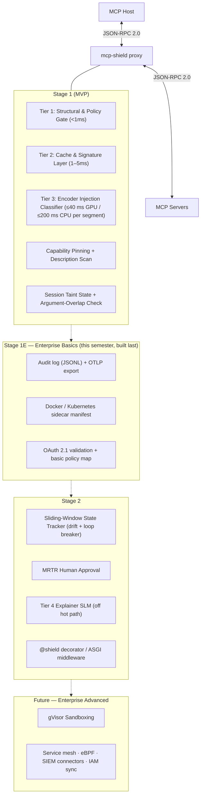

# 06 - Fortified Solution & Defense Upgrades

> **Focus**: how each vulnerability in [[01 - Threat Model & Vulnerabilities]] is addressed, by which mechanism from [[02 - System Architecture & Technical Implementation]], at which delivery stage, and with which known limits. No defence here is "bulletproof"; each row says what it detects, what it mitigates, and what it leaves open.

---

## 🛡️ Defense Mapping Matrix

|Vulnerability|Why existing solutions miss it|MCP-Shield mechanism|Stage|Effect (honest verb)|Residual risk|
|:--|:--|:--|:--|:--|:--|
|**1. Indirect prompt injection via results, resources, MRTR input requests**|WAFs match code syntax; cloud guardrails are protocol-blind, ingress-only, and slow|**Tier 3 encoder classifier** on every untrusted segment before it reaches the host; Tier 2 cache/signature layer|1|**Detects and blocks** the classifier's four attack classes at a calibrated FPR ≤ 0.5%|Offline adaptive attacks against the open weights (Fairoze et al., 2025) — the classifier is adversarially trained for 2–3 rounds against attacks on its own checkpoints (raises attack cost, does not close the class), online probing is throttled by probe detection, a block is never an oracle (nothing to the server, an opaque reference to the host, the reason only in the dashboard), and the abstain band raises the guard under distribution shift (Fomin et al., 2026); adaptive-set ASR is measured and reported, not hidden; Spotlighting markers + the host prompt rules ([[Host Prompt Rules]]) add an advisory instruction layer that ranks below all of the above|
|**2. Tool-description poisoning (first-contact and rug-pull)**|Scanners check schema validity or run once at install; proxies pass descriptions through|**Capability pinning** (SHA-256, re-checked on `toolsListChanged`) **+ description scan** with the classifier at list time **+ first-contact quarantine** (new servers get no dangerous tools until a human accepts the manifest)|1|**Blocks** rug-pulls deterministically; **detects** first-contact poisoning the classifier recognises; **holds** everything else for review|TOFU narrowed to trust-on-first-review: a human sees descriptions and scan verdicts before a new server gets dangerous capabilities, but can still approve malice neither they nor the classifier recognise; every legitimate server update also trips the pin and needs a guided re-pin (diff + re-scan)|
|**3. Parameter-bound command injection**|Schema validation accepts any string; kernel sandboxes see a legal syscall|**Tier 1 argument policy**: every string argument scanned; block in path/command/URL-typed fields (canonicalisation + root allowlist, scheme/host allowlists); a hit anywhere else forces `strict` policy for the call|1|**Blocks** the operator and traversal patterns Equixly found in 43% / 22% of servers|A hit in an unflagged field no longer passes silently, but a server that executes a *clean-looking* string is beyond any proxy; hence the Stage 2 approval flag and the enterprise gVisor option|
|**4. Multi-turn state drift (split injections)**|Stateless proxies evaluate each message alone|**Session taint state** (Stage 1) carries context; **sliding-window tracker** (Stage 2) adds drift score + loop breaker|1 / 2|**Reduces** — escalates a drifting session to `strict` policy|A fragment sequence with no single flagged turn and no overlap with tainted content|
|**5. Data-flow abuse after ingesting untrusted content (exfiltration, command smuggling)**|Guardrails scan text, not the *flow* from result to later tool call|**Proxy-held session taint state** + argument-overlap check on `write` / `execute` / `egress` calls; Stage 2 human approval via MRTR|1 / 2|**Blocks** verbatim and near-verbatim smuggling; **gates** high-privilege calls in tainted sessions under `strict`|Fully paraphrased intent — the reason Tier 3 runs *before* content reaches the host; principled fix is host rewriting (CaMeL)|
|**6. Context-length DoS ("denial of wallet")**|Nothing upstream of the host measures size or redundancy|**Tier 2 DoS guard**: length caps, repetition- and compression-ratio checks|1|**Blocks** padding and recursive-text payloads before the classifier and the host|Legitimately large results need a per-tool cap override|
|**7. Header / body desync**|Header-only filters trust `Mcp-Name`|**Tier 1 consistency check** mirroring `HeaderMismatchError` (`-32020`)|1|**Blocks** deterministically|None known|
|**8. Cloud-guardrail latency and cost**|Every check is a cloud round trip: hundreds of ms to seconds, per-token billing|**Local 86M encoder** (ONNX, CPU-capable) — end-to-end p95 target < 50 ms with a GPU, < 250 ms CPU-only, $0|1|**Removes** the cloud dependency on the hot path|Latency scales with content length for very large results (reported separately)|
|**9. Credential / privilege misuse by a hijacked agent**|IAM validates the token, not what the agent was tricked into doing|**Stage 1E basic policy map**: OAuth 2.1 bearer validated at the proxy (JWKS, `iss`/`aud`/`exp`); subject or role → allowed servers, tools and maximum privilege class, enforced before every call|1E|**Limits** what a hijacked agent can call to what its human is allowed to call|Fine-grained RBAC, IAM sync and a central policy server are Future; a hijacked agent can still misuse tools its human *is* allowed to call|
|**10. Visual prompt injection via images**|Text classifiers cannot see pixels|—|—|Out of scope|Images and other binary content returned by tools are hashed, not classified; stated as a limitation|

---

## 🏗️ Core Architectural Fortifications

### 1. Tier 3 Encoder Injection Classifier (Stage 1)

- **What**: a fine-tuned mDeBERTa-v3-base (~86M backbone) classifier, ONNX (fp16 on GPU, int8 on CPU), run on every untrusted free-text segment — tool results, resource contents, tool and prompt descriptions, MRTR `inputRequests`, free-text call arguments. Four classes: `benign`, `indirect_injection`, `command_injection`, `description_poisoning`.
- **Why an encoder**: it is the only model class that fits the budget (Meta: 92.4 ms per 512 tokens on an A100 in unoptimised PyTorch for this 86M lineage — far below the 500–2000 ms of an agent turn; CASCADE: a local review LLM cost 2.51 s per call and changed no outcomes).
- **Why "always on" for untrusted text**: a classifier gated behind a similarity score is bypassed by any injection that does not resemble known ones. Source trust, not anomaly score, decides what gets classified.
- **Enforcement**: `SecurityInjectionError` with class and calibrated probability.

### 2. Capability Pinning + Description Scanning (Stage 1)

- **Pin**: canonical-JSON SHA-256 per tool on first `tools/list`; compared on every later listing and on `toolsListChanged`; any change withholds the tool and raises `SecurityTamperingError` until the developer re-pins explicitly.
- **Scan**: descriptions and schema strings go through Tier 3 at list time; a flagged tool is never shown to the host (`SecurityInjectionError`, class `description_poisoning` — `SecurityTamperingError` is only for a manifest that changed).
- **First-contact quarantine**: a server with no pin yet exposes only `read`-class tools and runs under `strict` taint until the developer reviews the manifest and the scan verdicts and accepts them; published pins for the reference servers are trusted on match.
- **Known limitation — TOFU, narrowed**: pinning alone protects against *changes* after first contact; quarantine puts a human review in front of first contact, but a reviewer can still accept a description whose malice neither they nor the classifier recognise.

### 3. Session Taint State (Stage 1) and Human Approval (Stage 2)

- **Record**: every untrusted result forwarded to the host is stored (hash, shingles, embedding) under the session key (OAuth subject + `clientInfo` + transport peer).
- **Enforce**: a later `write` / `execute` / `egress` call whose arguments overlap tainted content raises `SecurityTaintViolationError`; under `strict` policy every such call in a tainted session needs approval.
- **Approve (Stage 2)**: the proxy answers with an MRTR `input_required` result asking the user to confirm — the spec-native human-in-the-loop.
- **Not cryptographic, not in-band**: earlier drafts described "cryptographic `__tainted_source__` tags" inside strings; those neither survive LLM paraphrase nor resist forgery and have been replaced by this design.

### 4. Tier 1 Argument Policy for Command Injection (Stage 1)

- Path canonicalisation against a per-tool root allowlist; rejection of `;`, `|`, `&&`, `` ` ``, `$(` in path/command-typed fields (the POSIX set; on Windows the cmd / PowerShell operators as well, with a Windows-aware canonicaliser — `02` §2); scheme/host allowlists for URL-typed fields; schema type enforcement against the pinned `inputSchema`.
- Works identically in proxy mode and in the `@shield` decorator, because it needs only the parsed arguments.
- **gVisor** is *not* part of this defence for individual developers: it is Linux-only, requires Docker/`runsc`, and adds 100 ms–1 s per call. It remains on the enterprise roadmap for deployments that already run containers.

### 5. Sliding-Window State Tracker (Stage 2)

- EWMA of injection probability across turns → escalate to `strict` on sustained drift; loop breaker on repeated `tool + argument hash` with no result change.

### 6. Untrusted-Segment Extractor (Stage 1) — replaces "Progressive Disclosure Compression"

- A deterministic walker that yields `(context_prefix, text)` pairs from every untrusted string in a message. The earlier idea of a second LLM (Phi-3.5-Mini / Mistral-7B) compressing payloads before classification is removed: two model calls cannot fit one 50 ms budget, and a JSON walker needs no model.

### 7. Tier 4 Explainer SLM (Stage 2, optional)

- Local `Qwen3-8B` / `Llama-3.1-8B` via Ollama (consent-gated) or opt-in cloud API; produces the "why was this blocked?" explanation for the dashboard. Never on the hot path; never overrides a block silently.

---

### 8. Enterprise Basics (Stage 1E)

- **E1 audit log + OTLP export**: every decision as one JSON line locally and, when enabled, as OpenTelemetry logs/spans with the spec's `_meta` trace context propagated — any OTLP collector receives it without a vendor connector.
- **E2 container deployment**: Dockerfile, docker-compose, and a plain Kubernetes sidecar manifest (the proxy in a container next to the agent; no service-mesh filter).
- **E3 OAuth 2.1 validation + basic policy map**: bearer token validated at the proxy (JWKS, `iss`/`aud`/`exp`); subject or role → allowed servers, tools and maximum privilege class.
- **E4 per-client configuration** in `mcp-shield.toml`.
- **Cut-line rule**: built as Phase 6, after validation; dropped in the order E4 → E3 → E2 if Phase 5 runs late. Full description in `07` §7.

---

## What this document no longer claims

- That MCP-Shield "solves every cross-domain vulnerability" or is "bulletproof" — the Residual-risk column exists for a reason.
- That Tier 3 runs a 7B generative SLM in 30–40 ms.
- That taint tags are cryptographic or travel inside strings.
- That gVisor is part of the default developer deployment.
- That privilege scoping beyond the Stage 1E basic policy map (fine-grained RBAC, IAM sync, central policy) is a delivered feature.
