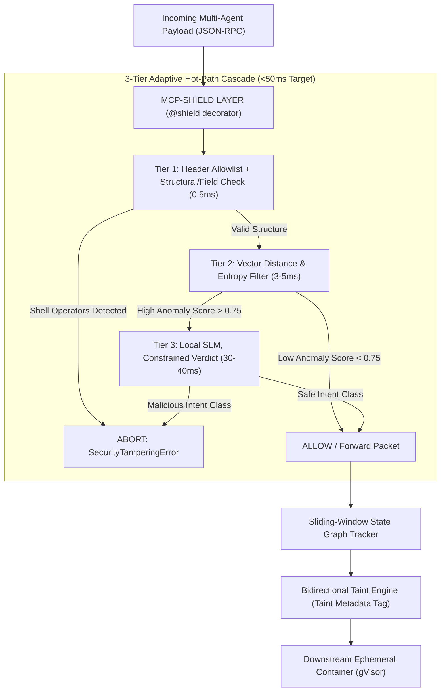

# 06 - Fortified Solution Architecture & Defense Upgrades

> **Focus**: How MCP-Shield is engineered to solve every cross-domain security vulnerability and stand bulletproof against advanced protocol attack vectors.

---

## 🛡️ Executive Defense Mapping Matrix

|Vulnerability & Cross-Domain Gap|Why Existing Solutions Fail|How MCP-Shield Solves It (Our Fortified Defense)|
|:--|:--|:--|
|**1. Natural Language Prompt Injection**|Traditional WAFs check for fixed code syntax (`DROP TABLE`, `<script>`).|**3-Tier Cascade & Fine-Tuned SLM**: Tier 3 outputs a constrained ALLOW/DENY verdict from natural-language prose; the rest of the authorization manifest is filled in programmatically from already-parsed request data.|
|**2. Ingress-Only Tool Output Attacks**|LLM Guardrails & DLP only scan user input; ignore tool output text streams.|**Bidirectional Semantic Taint Engine**: Wraps unverified tool output in `__tainted_source__` cryptographic tags.|
|**3. Kernel-Level Syscall Ignorance**|OS Sandboxes (gVisor) permit legal API database calls even if triggered by injection.|**Hybrid Semantic-Syscall Sandbox**: MCP-Shield validates protocol intent first, then executes tool inside gVisor.|
|**4. Multi-Turn State Graph Drift**|Stateless proxies evaluate each turn in isolation; miss split multi-turn attacks.|**Sliding-Window State Graph Tracker**: Evaluates cumulative semantic delta drift across multi-turn trajectories.|
|**5. Asymmetric Tool Description Poisoning**|Proxies check JSON schema validity but ignore malicious text inside tool descriptions.|**Cryptographic Capability Pinning**: Cryptographically hashes tool manifests (SHA-256) on startup; blocks runtime edits.|
|**6. Monolithic Credential Impersonation**|IAM/OAuth verifies token validity, but cannot detect hijacked agent tool execution.|**Dynamic Privilege Scoping**: Intercepts user JWT/mTLS context to assert real-time workspace RBAC maps.|
|**7. API Token Bloat & Latency ("Denial of Wallet")**|Cloud LLM checkers add 1-3s delay and thousands in API token costs.|**Progressive Disclosure Compression**: Local side-car SLM (Qwen-2.5/Llama-3 via vLLM/ONNX) achieves **sub-50ms** decisioning.|

---

## 🏗️ 6 Core Architectural Fortifications



### 1. Bidirectional Semantic Taint Tracking Engine

- **Scope**: Scans both incoming user prompts and outgoing tool response payloads.
- **Tagging Mechanism**: Wraps external, unverified data (web search results, support tickets, emails) in ephemeral cryptographic tags:
    
    ```yaml
    __tainted_source__: { origin: "tool_id_49", integrity_hash: "SHA256" }
    ```
    
- **Enforcement**: If a downstream LLM agent attempts to pass tainted text into high-privilege execution tools (`execute_system_command`, `write_database`), MCP-Shield halts execution immediately with a `SecurityTaintViolationError`.

### 2. Cryptographic Capability Pinning

- **Initialization Hashing**: On server initialization, MCP-Shield generates a SHA-256 cryptographic hash of all registered tool schemas, names, and natural language descriptions.
- **Tamper Prevention**: Any dynamic tool re-registration or hot-reloaded capability alteration attempted by downstream servers at runtime triggers an immediate `SecurityTamperingError`.
- **Known limitation — Trust On First Use (TOFU)**: Pinning protects against _changes_ after the first handshake, not against a malicious server that presents bad capabilities from the start. This mirrors the same limitation the base paper names for ATTESTMCP's own pinning; it is not something MCP-Shield resolves.

### 3. Dynamic Privilege Scoping & User Session Mapping

- **Context Interception**: Intercepts user authentication tokens (JWT or mTLS identity claims) embedded inside JSON-RPC metadata context blocks.
- **RBAC Enforcement**: Cross-references the fine-tuned SLM's inferred tool execution manifest against an active workspace Role-Based Access Control (RBAC) map.
- **Clearance Assurance**: Ensures an agent cannot execute tools beyond the clearance of the triggering human user.

### 4. Sliding-Window State Graph Tracker

- **Trajectory Tracking**: Tracks multi-turn conversational trajectories as a continuous state machine.
- **Semantic Delta**: Computes the cumulative semantic delta across turns to detect split prompt injections.
- **Infinite Loop Breaker**: Incorporates an automated infinite loop breaker that halts multi-agent execution if agents loop recursively with zero semantic progress.

### 5. Progressive Disclosure Compression & Sub-50ms Hot Path

- **Context Optimization**: Employs context optimization (`Phi-3.5-Mini` / `Mistral-7B`) to strip structural JSON wrappers and redundant parameters mid-flight.
- **Local Inference**: Passes ultra-dense routing payloads to a local, side-car compiled SLM engine (`vLLM` / `ONNX Runtime` on edge hardware / RTX 5060 Ti), targeting decision latency under **50ms** — achievable if Tier 3 emits a short, constrained verdict rather than a freely-generated JSON object; to be confirmed against our own hardware benchmark before this number is published as a guarantee.

### 6. Hybrid Ephemeral Containerization (gVisor Integration)

- **Secondary Isolation**: Serves as a secondary execution defense.
- **Sandbox Execution**: Approved tool execution payloads are passed to ephemeral, isolated `gVisor` sandbox containers with restricted kernel syscall access, neutralizing parameter-bound command injection (`filename: "log.txt; rm -rf /"`).