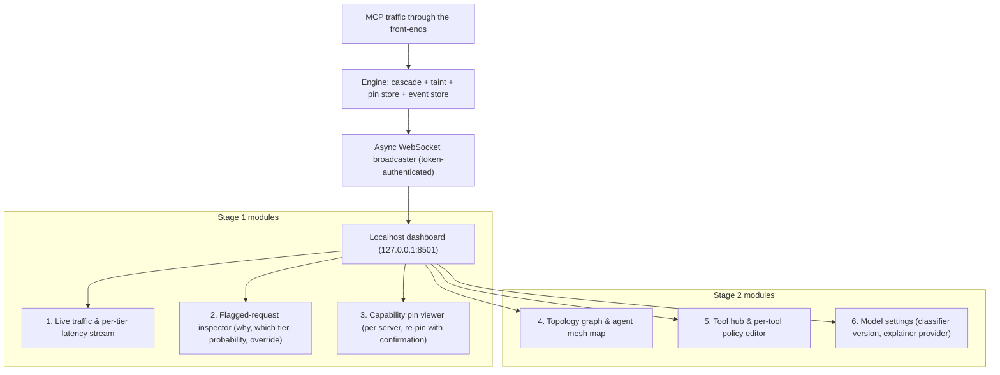
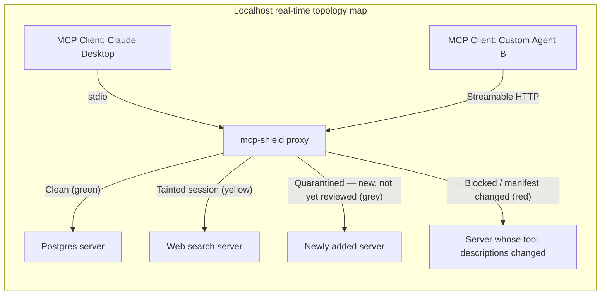
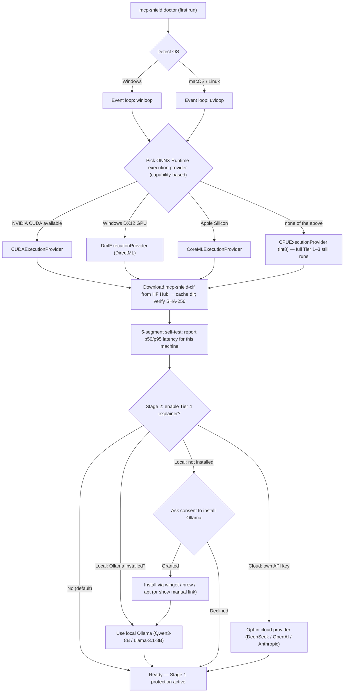
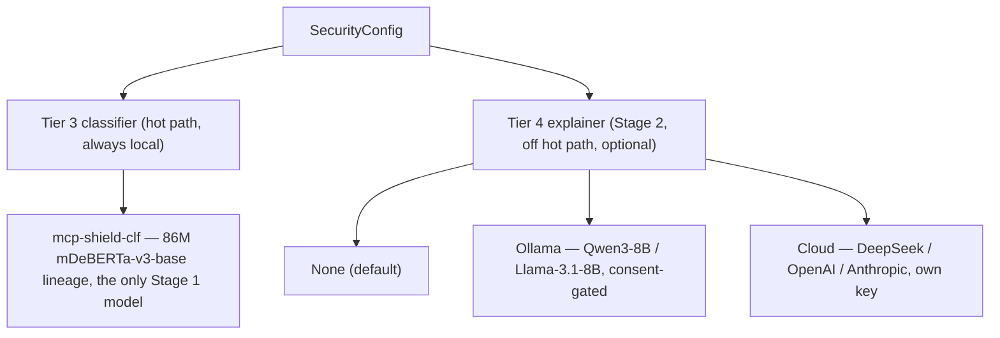
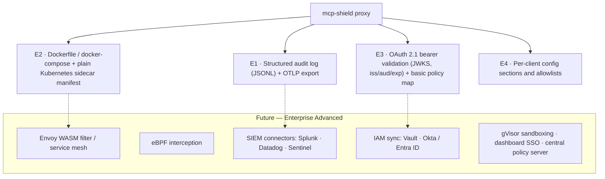

# 07 - Model Distribution, PyPI Packaging & Local Dashboard

> **Focus**: zero-cost model distribution, the PyPI release pipeline, the OS-aware runtime selection performed by `mcp-shield doctor`, and the localhost security dashboard — all aligned to the canonical design in [[02 - System Architecture & Technical Implementation]]. Stage tags follow `02` §9.

---

## 1. Zero-Cost Model Distribution Strategy

### The packaging picture after the encoder decision

The Stage 1 hot-path model is a **~86M-backbone encoder** (`mcp-shield-clf`, mDeBERTa-v3-base lineage; roughly 300 MB as int8 ONNX because of its 250k-token vocabulary, ~550 MB as fp16 — figures that assume the **embedding table is quantised** along with the transformer weights, or the vocabulary pruned to the tokens seen in training: the 250k × 768 embedding matrix is ~190M of the model's ~278M parameters and is ~760 MB on its own in fp32). The earlier draft's problem — a 4–14 GB generative model that needed a GPU — no longer exists, but 300 MB still exceeds PyPI's 100 MB limit, so weights live on Hugging Face Hub, which also lets retrained classifiers ship without a package release.

```
1. Classifier weights (.onnx + tokenizer)  ──>  Hugging Face Hub (free file hosting)
2. Python package (pip install mcp-shield-llm) ──>  PyPI (free, ~2 MB wheel)
3. First run  ──>  `mcp-shield doctor` detects OS + accelerators, downloads weights to an OS-appropriate cache dir
4. Runtime  ──>  ONNX Runtime, 100% local, CPU by default, GPU execution provider if present — $0
```

1. **Hugging Face Hub hosting**: `rishikesh/mcp-shield-clf`, versioned, with a model card carrying the numbers from `03` §9 (held-out ASR, FPR, LOSO gap, seeds).
2. **Download and cache**: `huggingface_hub` downloads into the directory `platformdirs` resolves for the OS (`~/.cache/mcp-shield/` on Linux, `~/Library/Caches/mcp-shield/` on macOS, `%LOCALAPPDATA%\mcp-shield\Cache` on Windows). Files are checksum-verified against the model card's published SHA-256 before use. **State lives elsewhere**: the cache holds only what can be downloaded again. The pin store, the event store behind the dashboard, the dashboard token and the Stage 1E audit file live in the per-user **data** directory (`~/.local/share/mcp-shield/` on Linux, `~/Library/Application Support/mcp-shield/` on macOS, `%LOCALAPPDATA%\mcp-shield\` on Windows) — a cache cleaner that wiped them would silently re-quarantine every server and erase the audit trail.
3. **Rate limits and tokens**: Hub file downloads have per-5-minute request limits that are lower for anonymous access and shared across an IP — several teammates pulling on the same campus network can hit them. An optional `HF_TOKEN` (free account) raises the per-user quota. **We do not ship a shared token in the package**: it would put every user on one quota and embed a credential in public source — unacceptable for a security tool.
4. **Nothing runs off-device.** This is Hub *file storage*, not the Hugging Face Inference API. After the one-time download, no network call is made on the hot path.
5. **Cost to developer = $0. Cost to end user = $0.** Cloud APIs appear only as an opt-in Tier 4 explainer provider (§6), never on the hot path.

---

## 2. PyPI Package Deployment Pipeline

Publishing to PyPI is free. Package name `mcp-shield-llm`, import name `mcp_shield`, CLI `mcp-shield`.

### Repository & Package Structure

```
mcp-shield-llm/
├── src/mcp_shield/
│   ├── __init__.py            # shield, SecurityConfig, error types
│   ├── cli.py                 # doctor · install · uninstall · rules · proxy · engine · dashboard · pull-model · pin · benchmark
│   ├── engine/                # Stage 1: one per OS user — model, cache, taint store, pins, event store, dashboard
│   │   ├── server.py          #   local IPC (Unix socket / named pipe), session store, hosts the HTTP listeners
│   │   └── autostart.py       #   per-user login item when HTTP entries are routed (launchd · systemd --user · logon task)
│   ├── proxy/                 # Mode A (Stage 1)
│   │   ├── http.py            #   Streamable HTTP listener (ASGI), runs inside the engine
│   │   └── stdio.py           #   stdio front-end: spawns the wrapped server, relays frames to the engine
│   ├── cascade/
│   │   ├── extractor.py       #   Untrusted-Segment Extractor
│   │   ├── tier1_policy.py    #   headers, header↔body consistency, schema, argument policy
│   │   ├── tier2_cache.py     #   cleared-content cache, signatures, DoS guard
│   │   └── tier3_classifier.py#   ONNX encoder classifier + calibration
│   ├── taint.py               # session taint state: winnowed fingerprints, containment check, approve-then-retry grants
│   ├── pinning.py             # SHA-256 pin store + description scan
│   ├── store.py               # SQLite in the user data dir: pin tables + event store (redacted segments, 7-day retention)
│   ├── spotlight.py           # Spotlighting markers on forwarded untrusted text
│   ├── host_rules.md          # packaged Host Prompt Rules (mcp-shield rules --print; install --with-rules)
│   ├── audit.py               # Stage 1E: JSONL audit file + OTLP export
│   ├── auth.py                # Stage 1E: OAuth 2.1 bearer validation (JWKS) + policy map
│   ├── state_tracker.py       # Stage 2: drift + loop breaker
│   ├── decorator.py           # Stage 2: @shield + ASGI middleware (Mode B)
│   ├── explainer/             # Stage 2: Tier 4 providers (ollama, openai, deepseek, anthropic)
│   └── dashboard/             # FastAPI + static web UI, served by the engine
│       ├── app.py
│       └── static/
├── benchmarks/                # held-out evaluation harness (AgentDojo, MCPSecBench, red-team)
├── tests/
├── pyproject.toml
├── README.md
└── LICENSE                    # Apache 2.0
```

### Publication Workflow

```bash
# 1. Build tools
pip install build twine

# 2. Build the ~2 MB source distribution and wheel
python -m build

# 3. Upload (CI uses PyPI Trusted Publishing via GitHub Actions OIDC — no long-lived API token in secrets)
twine upload dist/*
```

Once published:

```bash
pip install mcp-shield-llm
```

---

## 3. Localhost Admin Dashboard Architecture

The dashboard gives visibility into traffic, verdicts, and pins. **Stage 1** ships the traffic log, the flagged-request inspector and the pin viewer; the topology map, tool hub, and model switcher are **Stage 2**.

### Security of the dashboard itself

A monitoring surface for a security product is itself an attack surface. CVE-2025-49596 — cited by our base paper — was exactly this: MCP Inspector exposed an unauthenticated localhost HTTP server that any web page open in the same browser could drive. The MCP-Shield dashboard therefore:

- binds to `127.0.0.1` only, never `0.0.0.0`;
- generates a bearer token on first run (stored in the per-user data directory (§1), readable only by the current user — POSIX `0600` / NTFS ACL) and **requires it on every endpoint, read and write, including from localhost** — the launch command prints a one-time URL carrying the token, which the page exchanges for an `HttpOnly`, `SameSite=Strict` session cookie on first load;
- validates `Origin` and `Host` on every request and sets no permissive CORS headers, so a malicious tab cannot POST to it;
- treats every mutating action (*Allow this exact content*, *Allow once*, re-pin, policy toggle) as authenticated, logged, and reversible;
- **never spawns a process from a web request.** The spec's Security Best Practices single out proxies that spawn stdio servers as an escalation path ("stdio transport security in proxy scenarios"): the dashboard can only record a stdio server as *pending* in `mcp-shield.toml`; it reaches the host's config when the user runs `mcp-shield install` in a terminal, which prints the full command untruncated and asks for confirmation.

```
Developer terminal  ──>  mcp-shield dashboard  ──>  the engine serves FastAPI + web UI on http://127.0.0.1:8501/?token=…
```



### Key Dashboard Capabilities

1. **Live traffic & latency stream (Stage 1)**: WebSocket feed of JSON-RPC transactions with Tier 1 / 2 / 3 timings — the raw data behind the benchmark table in the README.
2. **Flagged-request inspector (Stage 1)**: every blocked or quarantined item with the full message, the tier that caught it, the class, the calibrated probability, and (Stage 2) the Tier 4 explanation. Every entry carries the **reference ID** that the host's opaque error shows (`Request blocked by MCP-Shield policy (ref …)`), so the user goes from the stub in the chat to the full reason here with one search — the reason is never sent to the model. Errors that the *server* returned are listed as the server's — including one that imitates MCP-Shield's stub, whether from a server hardened with the Stage 2 decorator or from a server pretending to be — never as a proxy block; such a reference resolves in the server operator's log, not here.
    Raw segments are kept **locally only**, redacted for known secret patterns (keys, tokens, card numbers) and retention-limited (default 7 days), because tool outputs contain the user's own secrets and PII.
    One-click actions depend on what caught the item — an override is never broader than the check it overrides:
    - **Classifier or signature verdict on content** (Tier 2/3) — *Allow this exact content*: adds the segment's SHA-256, scoped to that server and tool and with a TTL, to the Tier 2 fast-accept cache. Overrides are *never* similarity neighbourhoods: an attacker who gets one injection past a tired developer must not thereby whitelist everything that looks like it.
    - **Taint block, or a call held under `strict`** — *Allow once*: a single-use grant bound to the exact session, tool and argument hash, valid for 5 minutes, after which the user asks the agent to retry (`02` §4); *Allow this flow*: exempts that source server → destination for 24 h (permanently only through `[taint] allow_flows` in the config). There is no "allow this content" here — the content is the user's own data on its way out.
    - **Tier 1 argument-policy block** — no one-click override: a traversal or shell-operator block is fixed in the policy (root allowlist, field type, `mode = "shell"`), because a one-click exception is how a tired developer opens a traversal hole.
    - **DoS-guard block** — *Raise this tool's result cap*.
    - **Abstain-band item** — *Mark benign* (returns the session to `standard`, adds a hard negative) or *Mark as attack* (adds a signature).
    - **Classifier verdicts** (Tier 3, including description scans) — *Report false positive*: sends the segment to the local dataset-review queue for the next training round's hard negatives (`03` §12). A false positive from Tier 1 or the taint rule is a policy question, not a training example, and is fixed with the actions above.
    This inspector is the main lever against false-positive fatigue: a developer who can see *why* something was flagged and fix it in one click is far less likely to switch the tool off.
3. **Capability pin viewer (Stage 1)**: per-server pin table with diffs when a listing changes; re-pin requires an explicit confirmation.
4. **Verdict analytics (Stage 2)**: counts by class and tier, allowed vs. blocked, per server.
5. **Policy manager (Stage 2)**: toggle `strict` taint policy, per-tool privilege classes and root allowlists, per-client tool allowlists — without restarting the proxy.
6. **Payload sandbox (Stage 2)**: submit a test message and see each tier's decision.

### CLI Command Controls

```bash
# Detect OS, accelerators, cache and data dirs; show which tiers and which execution provider will run, and whether the engine is running
mcp-shield doctor

# Route every stdio and non-OAuth HTTP server in the host's MCP config through the proxy (backup kept; `mcp-shield uninstall` restores).
# OAuth-protected remote servers are reported, not rewritten — see 02 §1
# Routing any HTTP entry also registers the engine as a per-user login item; servers marked pending in the dashboard
#   are shown with their full command and added only on confirmation
# Config files `install` knows: Claude Desktop — %APPDATA%\Claude\claude_desktop_config.json (Windows),
#   ~/Library/Application Support/Claude/claude_desktop_config.json (macOS; no official Linux build);
#   Cursor — ~/.cursor/mcp.json (global) and <project>/.cursor/mcp.json. Anything else: --host <path-to-config>
mcp-shield install --host claude-desktop
mcp-shield install --host cursor
# Also insert the host prompt rules where the host exposes an instructions file (Claude Desktop project, Cursor rules, custom agent)
mcp-shield install --host cursor --with-rules

# Print the host prompt rules (Host Prompt Rules.md, rule IDs H-1…) to paste into any host's system instructions
mcp-shield rules --print
mcp-shield rules --print --short   # the compact form for hosts with tight instruction limits

# Run the proxy (Stage 1) — a non-OAuth HTTP upstream (or one you operate), or a wrapped stdio server
mcp-shield proxy --listen 127.0.0.1:8800 --upstream http://localhost:3000/mcp
mcp-shield proxy -- npx -y @modelcontextprotocol/server-filesystem /workspace

# The engine (one per OS user) — normally started by the first front-end; --foreground for a container (Stage 1E)
mcp-shield engine --status
mcp-shield engine --foreground

# Launch the dashboard (served by the engine; starts it if needed)
mcp-shield dashboard --port 8501

# Download / verify classifier weights
mcp-shield pull-model --model mcp-shield-clf

# Inspect or accept capability pins for a server
mcp-shield pin --server github --show
mcp-shield pin --server github --accept

# Run the held-out evaluation harness
mcp-shield benchmark --suite agentdojo
mcp-shield benchmark --suite mcpsecbench
```

---

## 4. Client Tracking & Topology Graph Visualiser (Stage 2)

Under the `2026-07-28` spec there is no `initialize` handshake to hook; every request self-describes via `io.modelcontextprotocol/clientInfo` in `_meta`, so discovery is a rolling aggregation over recent requests. The proxy already keys session taint state this way (`02` §4); the topology map is a view over the same table.



- **Rolling node discovery**: clients and servers seen within a configurable idle window are rendered as an interactive D3.js / Cytoscape graph; idle ones age out instead of showing a stale "connected" state.
- **Colour coding**: 🟢 clean · 🟡 session tainted (untrusted content ingested) · 🔴 block or pin change in the window.
- **Edge drill-down**: click an edge for the JSON-RPC history, per-tier latency, and (Stage 2) the drift trace.

---

## 5. Tool Management Hub (Stage 2)

```
[ Localhost Tool Hub ]
├── 1. REGISTER SERVER ────> stdio command or Streamable HTTP endpoint to route through the proxy
├── 2. PINS & SCAN ────────> view pins, description-scan verdicts, accept re-pins
├── 3. PRIVILEGE CLASSES ──> mark tools read / write / execute / egress; set root and URL allowlists
└── 4. PLAYGROUND ─────────> send a test message, watch each tier decide
```

Per-tool policies: privilege class (config can only raise the class above the name heuristic and the server's annotations — see `02` §2, Tier 1), argument root allowlist, `requires_approval` (dashboard approve-then-retry in Stage 1, in-host MRTR elicitation in Stage 2), a per-tool result-size cap for the DoS guard, and a taint opt-out for servers the developer explicitly trusts (logged, visible in the map). Registering a **stdio** server here records it as pending in `mcp-shield.toml`; it reaches the host's config only through `mcp-shield install` in a terminal, never from the web request itself. A `mode = "shell"` setting marks tools that legitimately use shell operators: the operator block is off for them and every call runs under `strict` policy instead — once the session is tainted, each command is approved in the dashboard (`02` §4).

---

## 6. Runtime Selection & Model Provider Hub

### What changed, and why it got simpler

With an encoder on the hot path, **Stage 1 needs nothing beyond `pip install`**: ONNX Runtime is an ordinary dependency, the classifier runs on CPU everywhere, and a GPU only makes it faster. The earlier draft's decision tree — Ollama as first choice with a consent prompt, ONNX as fallback, "Tier 1 + 2 only" when no GPU exists — was a consequence of needing a 7B model. It is gone. No user is ever left with a degraded, classifier-less mode because of their hardware.

Two packaging facts shape this. **ONNX Runtime ships as mutually exclusive wheels** — `onnxruntime` (CPU; every OS, x64 and arm64; the macOS wheel is expected to carry the CoreML EP — verify with `onnxruntime.get_available_providers()` in Phase 1), `onnxruntime-gpu` (CUDA; Linux and Windows) and `onnxruntime-directml` (Windows) — and pip cannot express "replace the CPU wheel", so the package depends on the CPU wheel and an accelerator is a documented swap that `doctor` prints when it detects the device (`pip uninstall onnxruntime && pip install onnxruntime-gpu`), never an extra that would install two wheels side by side; `doctor` warns when it finds two. And **an accelerator is kept only if it wins**: `doctor` runs the self-test on the accelerator and on CPU and keeps CPU when the accelerator is not faster — int8 op coverage on DirectML and CoreML is partial, and a graph split between an accelerator and the CPU can be slower than the CPU alone.

Consent still matters in exactly one place: the **Stage 2 Tier 4 explainer**, which uses Ollama (a separate daemon, installed outside the Python process) or a cloud API (the user's own key). Both are opt-in.

### `mcp-shield doctor` decision flow



|OS|Event loop|Hot-path runtime (Stage 1)|Acceleration if present|Explainer (Stage 2, optional)|
|:--|:--|:--|:--|:--|
|**Windows**|`winloop` (`uvloop` does not run on Windows)|ONNX Runtime, CPU int8|CUDA or DirectML (any DX12 GPU)|Ollama (consent-gated install) or opt-in cloud|
|**macOS**|`uvloop`|ONNX Runtime, CPU int8|CoreML where op coverage allows, else CPU|same|
|**Linux**|`uvloop`|ONNX Runtime, CPU int8|CUDA|same|

Detection is capability-based — "a CUDA device", "a DX12 device", "Apple Silicon" — never a list of named GPUs. The RTX 5060 Ti / RTX 3050 mentioned in `03` are our own dev machines, not a supported-hardware list. All three operating systems are in the CI matrix (`ubuntu-latest`, `windows-latest`, `macos-latest`, Python 3.10 and 3.12): "runs on" is a design claim until that matrix is green, and Phase 3 verifies the host-config paths and the stdio wrapping on each OS by hand.

The classifier loads once, in the engine — one per OS user, however many servers are proxied. Each front-end is a small Python process without the model (≈ 30–50 MB, estimate), so a host with seven servers costs one model plus seven small processes, not seven models. The engine is the one other piece of per-OS work: its local channel (a Unix domain socket on macOS and Linux, a named pipe on Windows) and, only when the host config has HTTP entries, its login item (a launchd agent, a `systemd --user` unit, a Task Scheduler logon task).

### Minimum requirements (design estimates — measured and published in Phase 5, `03` §9.1)

|Resource|CPU-only (the default)|With an accelerator|Notes|
|:--|:--|:--|:--|
|**Python**|3.10 – 3.12|same|the versions in the CI matrix|
|**Disk**|≈ **0.6 GB**: int8 weights ≈ 300 MB + tokenizer ≈ 5 MB + Python dependencies ≈ 200–250 MB; keep **1 GB free**|+ fp16 weights ≈ 550 MB; CUDA also needs `onnxruntime-gpu` (≈ 250 MB) and the CUDA / cuDNN runtime libraries if they are not already installed (1–3 GB); DirectML ≈ +100 MB|weights are downloaded once into the `platformdirs` cache; `doctor` prints the exact sizes it found|
|**RAM**|≈ 0.6 GB resident for the engine, ≈ **1 GB peak** while a batch of 512-token chunks is classified, plus ≈ 30–50 MB per front-end; **2 GB free minimum, 4 GB recommended**|host RAM the same; ≈ 1 GB of VRAM for the fp16 weights plus activations — any GPU with **≥ 2 GB VRAM**|the model is loaded once per OS user, in the engine; front-ends never load it|
|**CPU**|any x64 or arm64; the < 250 ms target is defined on a 4-vCPU x64 runner and scales with core count and AVX2 / VNNI support|—|a 2-core or older machine still runs everything, slower; `doctor`'s self-test reports the real number for that machine|
|**Network**|one download of the weights (≈ 300 MB int8 or ≈ 550 MB fp16); nothing on the hot path afterwards|same|—|
|**Stage 2 explainer** (optional)|not part of the Stage 1 minimum: a local 8B model through Ollama needs ≈ 5–6 GB of RAM or VRAM on its own|||

These are estimates from the model size and the runtime's usual overhead, not measurements. Phase 5 records peak resident memory, VRAM and disk on the CI runner and on the team's laptops next to the latency numbers, and the model card and README carry the measured figures. `doctor` checks free memory before loading the model and warns when it is below the peak figure; a model that then fails to load is the fail-closed case of `02` §2, never a silent degradation.

### Configuration

```python
from mcp_shield import SecurityConfig, ExplainerProvider

config = SecurityConfig(
    classifier_model="mcp-shield-clf",           # the single 86M classifier; version pinned via the model card
    taint_policy="standard",                     # or "strict": every execute/egress call in a tainted session needs approval
    fpr_target=0.005,                            # selects the shipped operating threshold
    explainer=ExplainerProvider.NONE,            # Stage 2: OLLAMA | OPENAI | DEEPSEEK | ANTHROPIC (own key, opt-in)
)
```

The same options live in `mcp-shield.toml` for the proxy and are editable in the dashboard's policy manager (Stage 2).

### Model Provider Hub (reframed)



This is a visible, startup-time decision: `doctor` prints the event loop, execution provider, cache path, downloaded files, self-test latency, and whether an explainer is enabled — so a developer always knows what is protecting them and what, if anything, was installed.

---

## 7. Enterprise Integration — Basics This Semester (Stage 1E), Advanced Later

Enterprise deployment is no longer "roadmap only". A deliberately small **Enterprise Basics** set is part of this semester's scope, built *after* Stage 1 Core is benchmarked so that a slip cannot damage the core thesis; the heavier integrations stay on the roadmap.



### Stage 1E — Enterprise Basics (this semester, built last)

1. **E1 — Audit log + OTLP export.** The Stage 1 event store already holds every decision locally for the dashboard; E1 adds the portable forms. Every decision (tier, class, probability, session, server, tool, verdict) is written as one JSON line to a local audit file and, when enabled, exported through the OpenTelemetry SDK as logs and spans. The spec's `_meta` trace-context keys (`traceparent`, `tracestate`, `baggage`) are propagated, so a blocked call appears in the same trace as the agent that made it. Any OTLP-compatible collector (Grafana, Jaeger, the Datadog agent, the Splunk OTel collector) receives it — no vendor connector needed. Exported records carry **hashes, verdicts, tiers and classes — never raw segments** unless raw export is explicitly enabled; shipping raw tool output to a shared collector would be internal data exfiltration. Each record carries the same reference ID the host's opaque error shows.
2. **E2 — Container deployment.** A `Dockerfile` and `docker-compose.yml` run the proxy as a container; a plain Kubernetes manifest runs it as a **sidecar** in the agent's pod (shared pod network, the host points at `localhost:8800`). No Envoy filter, no CRDs — the sidecar is just the engine, in the foreground with its HTTP listener (`mcp-shield engine --foreground`), in a container next to the agent.
3. **E3 — OAuth 2.1 bearer validation + basic policy map.** In HTTP mode the proxy validates the `Authorization` bearer token the host presents (signature via JWKS, `iss`, `aud`, `exp`) and maps the token's subject or role claim to a policy in `mcp-shield.toml`: allowed servers, allowed tools, and the maximum privilege class that principal may invoke. This is *basic* privilege scoping — a hijacked agent can call nothing its human could not — and the same subject is the session key for taint state.
4. **E4 — Per-client configuration.** `[clients.<name>]` sections carry allowlists, taint policy and result-size caps per client; `[policies.<role>]` sections carry E3's maps.

```toml
# mcp-shield.toml (excerpt)
[taint]                                     # Stage 1 (02 §4)
allow_flows   = ["filesystem -> github"]    # trusted source -> destination pairs; every use is logged

[audit]
file          = "~/.local/share/mcp-shield/audit.jsonl"   # default = the platformdirs data dir for the OS (§1); any path accepted
otlp_endpoint = "http://localhost:4318"     # optional

[auth]
jwks_url = "https://login.example.com/.well-known/jwks.json"
issuer   = "https://login.example.com/"
audience = "mcp-shield-proxy"

[policies.analyst]
allowed_servers = ["postgres", "github"]
max_privilege   = "read"

[policies.engineer]
allowed_servers = ["postgres", "github", "filesystem"]
max_privilege   = "write"
```

**Cut-line rule**: E1–E4 are scheduled as Phase 6 (build calendar in `00` §5). If Phase 5 validation runs late, E4, E3 and E2 are dropped in that order; E1 is small enough to keep.

### Future — Enterprise Advanced (roadmap)

1. **Service-mesh integration**: an Envoy / Istio filter so the proxy is injected without changing pod manifests.
2. **eBPF interception**: zero-code-change capture of JSON-RPC sockets on Linux hosts.
3. **SIEM connectors**: native Splunk HEC, Datadog and Microsoft Sentinel exporters on top of E1's OTLP stream.
4. **IAM sync**: roles and policies pulled from HashiCorp Vault, AWS Secrets Manager, Okta / Entra ID instead of `mcp-shield.toml`.
5. **gVisor** sandboxed execution for deployments that already run containers (Linux-only, per-call cost documented in `06`); **dashboard SSO**; a **central policy server** for fleets of proxies.

---

## 8. Summary Architectural Matrix

|Component|Host / Storage|Cost|Stage|Execution|
|:--|:--|:--|:--|:--|
|**Python package (`mcp-shield-llm`)**|PyPI|$0|1|`pip install`, ~2 MB wheel|
|**`mcp-shield proxy`** (front-ends + engine)|User's machine|$0|1|A stdio front-end per server or an HTTP listener, all attached to one engine per OS user|
|**Classifier weights (`mcp-shield-clf`)**|Hugging Face Hub|$0|1|Downloaded once to the `platformdirs` cache, SHA-256 verified|
|**Hot-path runtime**|ONNX Runtime|$0|1|CPU int8 everywhere; CUDA / DirectML / CoreML if present|
|**Dashboard**|Embedded FastAPI|$0|1 (log + inspector) / 2 (full)|`127.0.0.1:8501`, token on every endpoint|
|**Tier 4 explainer**|Ollama (local) or cloud API|$0 local / user's key|2|Off the hot path, opt-in|
|**`@shield` decorator / ASGI middleware**|In the developer's server|$0|2|Tier 1 + Tier 3 on parsed payloads|
|**Enterprise basics** (audit log + OTLP, Docker / K8s sidecar manifest, OAuth 2.1 validation + policy map)|In the package|$0|1E|Built after Stage 1 Core is benchmarked; cut first if validation slips|
|**Enterprise advanced**|Envoy / eBPF / SIEM connectors / IAM sync / gVisor|Enterprise|Future|Roadmap|
