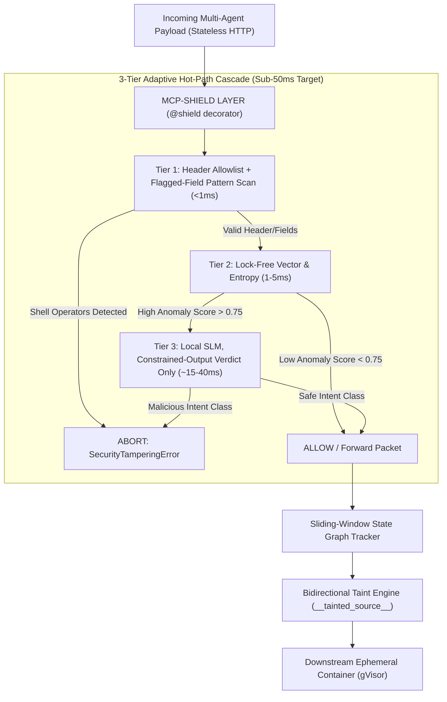
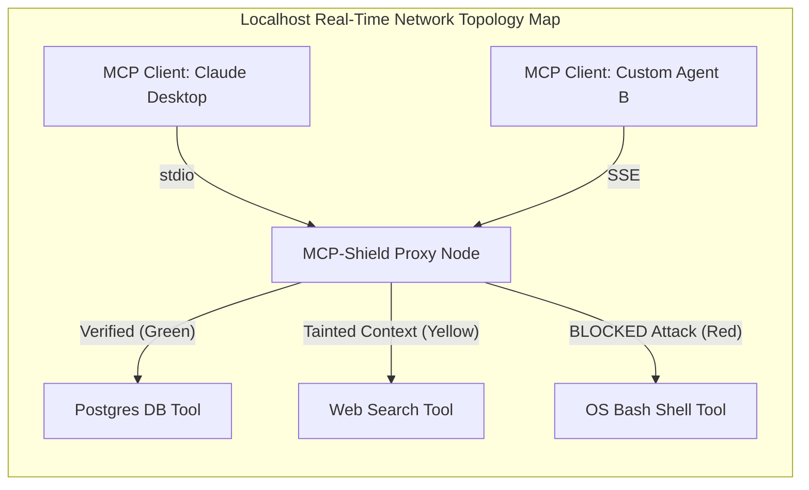

<div align="center">

# 🛡️ MCP-Shield

**Semantic LLM Firewall for Model Context Protocol (MCP) in Agent Networks**

_An Autonomous Inline Multi-Agent Firewall for Protocol-Level Safety & Real-Time Indirect Prompt Injection Defense_

[](https://python.org/) [](https://pypi.org/) [](https://claude.ai/chat/LICENSE) [-yellow.svg)](https://claude.ai/chat/f3342a1d-9978-4276-b4de-920ead776f47) [](https://arxiv.org/abs/2601.17549)

[Features](https://claude.ai/chat/f3342a1d-9978-4276-b4de-920ead776f47#-key-features) • [Architecture](https://claude.ai/chat/f3342a1d-9978-4276-b4de-920ead776f47#-3-tier-hot-path-cascade) • [Quickstart](https://claude.ai/chat/f3342a1d-9978-4276-b4de-920ead776f47#-quickstart) • [Dashboard](https://claude.ai/chat/f3342a1d-9978-4276-b4de-920ead776f47#-localhost-admin-dashboard) • [Benchmarks](https://claude.ai/chat/f3342a1d-9978-4276-b4de-920ead776f47#-empirical-benchmarks) • [Citation](https://claude.ai/chat/f3342a1d-9978-4276-b4de-920ead776f47#-citation)

</div>

---

## ⚡ Overview & Product Boundaries

### What MCP-Shield Is (and Isn't)

- **WE ARE BUILDING**: An autonomous inline security firewall middleware (`pip install mcp-shield-llm`) centered around a Python `@shield` decorator.
- **WE ARE NOT BUILDING**: New AI agents (e.g. web search or coding bots). MCP-Shield wraps and protects _any existing_ AI agent framework or MCP tool server.

### The 2026 Stateless MCP Update & Security Gaps

In July 2026, the Model Context Protocol transitioned to a **Stateless HTTP Core**. While this update resolves cloud load-balancing and horizontal scaling bottlenecks:

- ⚠️ **It does NOT solve Prompt Injection or Confused Deputy attacks**. Stateless HTTP standardizes packet transmission, but remains completely blind to natural language prompt injections hidden inside data payloads.
- ⚡ **It lets MCP-Shield's Tier 1 route and pre-filter almost for free**: Native HTTP headers (`Mcp-Method: tools/call`, `Mcp-Name: read_file`) — standard as of MCP spec `2026-07-28` — let Tier 1 validate _which_ tool is being called against an allowlist in well under a millisecond, without touching the request body. Catching malicious _content_ inside a call's arguments (e.g. a shell operator hidden in a file path) still requires a cheap scan of that argument string, which Tier 1 also does — but on a handful of flagged fields, not a full JSON parse.

---

---

## 🎯 Target Users

**Primary — Individual developers & small teams.** Anyone building or running an MCP server/agent who wants real protection without a security budget: `pip install`, zero infra, zero cloud API bill. The decorator-based integration and $0-cost-by-default design are built for this group first, and most of the roadmap below should be prioritized against their needs before anyone else's.

**Secondary (roadmap, not current focus) — Enterprise SecOps & platform teams.** Organizations wanting the Kubernetes sidecar, eBPF interception, SIEM export, and IAM sync described in [Enterprise Integration Roadmap](https://claude.ai/chat/f3342a1d-9978-4276-b4de-920ead776f47#-enterprise-integration-roadmap). Deliberately scoped as future work so it doesn't pull effort off the core detection engine.

---

## 🔥 Key Features

- 🚀 **Sub-50ms Hot-Path Cascade (target)**: Header + fast pattern check (<1ms) and lock-free vector caching (1-5ms) are designed to verify 90-95% of clean traffic almost instantly, with the remainder escalated to a local SLM classifier — see [Benchmarks](https://claude.ai/chat/f3342a1d-9978-4276-b4de-920ead776f47#-empirical-benchmarks) for what's measured vs. still-to-be-validated.
- 🐍 **Zero-Infra `@shield` Decorator**: Protect any native Python MCP server or agent framework with a single line of code.
- 🏷️ **Bidirectional Semantic Taint Engine**: Wraps unverified external tool output in `__tainted_source__` cryptographic tags to halt downstream high-privilege tool execution.
- 📌 **Cryptographic Capability Pinning**: Hashes tool schemas (SHA-256) on startup to prevent dynamic tool description poisoning attacks.
- 🕸️ **Sliding-Window State Graph Tracker**: Evaluates multi-turn conversational trajectories to catch split prompt injections and break infinite agent loops.
- 🎛️ **Localhost Admin Dashboard & Mesh Visualizer**: Embedded FastAPI + Web UI (`mcp-shield dashboard`) to track real-time agent topology graphs, monitor latency, and manage tools.
- 🔌 **Multi-Model Provider Hub**: Choose between local pre-tuned models (`Qwen-2.5-7B`, `Qwen-2.5-3B`, `Llama-3-8B`), local Ollama/ONNX Runtime backends (Windows/Mac/Linux) or vLLM (Linux/WSL2), or cloud APIs.
- 💰 **$0 Cost by Default**: Model weights auto-download from Hugging Face Hub to local disk (`~/.cache/mcp-shield/`) and run 100% locally. Zero external API costs on the default path — cloud providers (DeepSeek/OpenAI/Claude) are available as an opt-in swap, not the default.

---

## 🏗️ 3-Tier Hot-Path Cascade



---

## 💻 Quickstart

### 1. Installation

```bash
pip install mcp-shield-llm
```

### 2. Basic Usage (`@shield` Decorator)

Wrap your MCP server request handler with the `@shield` decorator:

```python
import asyncio
from mcp_shield import shield, SecurityConfig

# Initialize zero-trust protection (<50ms SLA)
@shield(config=SecurityConfig(strict_mode=True, max_latency_ms=50))
async def handle_mcp_request(json_rpc_payload: dict):
    # Core MCP Server / Tool Execution Logic
    return {"jsonrpc": "2.0", "result": "Operation successful", "id": json_rpc_payload.get("id")}

# Example Execution
if __name__ == "__main__":
    payload = {
        "jsonrpc": "2.0",
        "method": "tools/call",
        "params": {
            "name": "read_file",
            "arguments": {"path": "/workspace/report.pdf; cat /etc/passwd"}
        },
        "id": 1
    }
    
    try:
        response = asyncio.run(handle_mcp_request(payload))
        print("Response:", response)
    except Exception as e:
        print("Security Tampering Detected:", e)
```

---

## 🎛️ Localhost Admin Dashboard

Launch the embedded security dashboard and agent mesh visualizer:

```bash
mcp-shield dashboard --port 8501
```

Open `http://localhost:8501` in your browser to access:

- 🟢 **Real-Time Network Topology Map**: Live D3.js node graph tracking MCP Clients, Agents, and Tools.
- 📊 **Microsecond Latency & Traffic Stream**: Live WebSocket feed with Tier 1/2/3 latency breakdowns.
- 🛠️ **Interactive Tool Hub**: Register stdIO/SSE tools and configure per-tool taint enforcement & latency caps.
- ⚙️ **Multi-Model Selector**: Switch between 3B/7B/8B SLMs or connect Ollama/ONNX Runtime (any OS) / vLLM (Linux/WSL2) endpoints with 1-click latency diagnostics.



---

## 🔧 Model Configuration Options

MCP-Shield supports plug-and-play inference backends:

```python
from mcp_shield import shield, SecurityConfig, ModelProvider

# Option A: Ultra-light 3B model (Low VRAM laptops / RTX 3050 ~2.2GB)
@shield(config=SecurityConfig(
    model_provider=ModelProvider.FIRST_PARTY,
    model_name="mcp-shield-qwen2.5-3b"
))

# Option B: Local Ollama Endpoint
@shield(config=SecurityConfig(
    model_provider=ModelProvider.OLLAMA,
    model_endpoint="http://localhost:11434",
    model_name="qwen2.5-coder:7b"
))

# Option C: Cloud API (DeepSeek / OpenAI)
@shield(config=SecurityConfig(
    model_provider=ModelProvider.DEEPSEEK,
    api_key_env="DEEPSEEK_API_KEY",
    model_name="deepseek-chat"
))
async def handle_mcp_request(payload: dict):
    pass
```

### OS, Event Loop & Runtime Detection

Since our primary users are individual developers on whatever OS and hardware they happen to own (not just our own RTX 5060 Ti / RTX 3050 dev machines), `@shield` runs a startup check rather than assuming CUDA + Linux:

|OS|Event Loop|Default Tier 3 Runtime|If No GPU / Ollama Declined|
|:--|:--|:--|:--|
|**Windows**|`winloop` (`uvloop` itself does not run on Windows)|Ollama — installed only with explicit user consent (it's a separate app, not just a pip dependency); ONNX Runtime + DirectML available as opt-in|Tier 1 + Tier 2 only, or cloud fallback (Option C above)|
|**macOS**|`uvloop`|Ollama, same consent gate; ONNX Runtime + CoreML available as opt-in|Tier 1 + Tier 2 only, or cloud fallback|
|**Linux**|`uvloop`|Ollama, same consent gate; ONNX Runtime or **vLLM** available as opt-in (vLLM = fastest, but officially Linux-native only — Windows only gets it via WSL2)|Tier 1 + Tier 2 only, or cloud fallback|

Multiple `@shield`-wrapped servers on one machine share a single Ollama/vLLM daemon on localhost rather than each loading its own copy of the model into VRAM.

Run `mcp-shield doctor` to see which mode you're in — including which event loop, which runtime, and what it did or didn't install — before traffic starts flowing. Full decision flow (with diagram) lives in `07 - Model Distribution, PyPI Packaging & Local Dashboard.md`.

---

## 📊 Benchmarks

**Status: evaluation pending.** We have not yet run MCP-Shield through a benchmark suite end-to-end — the numbers below are the problem baseline and our internal targets, not measured MCP-Shield results. We'll replace the "Target" column with real numbers (and error bars) once we've run our own PROTOAMP-style evaluation across _MCPSecBench_, _InjecAgent_, and _AgentDojo_.

|Metric|Baseline (unprotected MCP, Maloyan & Namiot 2026)|MCP-Shield Target|Status|
|:--|:--|:--|:--|
|**Attack Success Rate (ASR)**|**52.8%**|< 20%|Pending our own evaluation|
|**False Positive Rate (FPR)**|—|< 5%|Pending our own evaluation|
|**Average Decision Latency**|—|< 50 ms|Pending hardware benchmark|
|**Tier 1/2 Rejection Rate**|—|> 85%|Pending our own evaluation|

For reference only: the base paper's own defense, **ATTESTMCP** — a cryptographic capability-attestation and message-signing scheme, architecturally different from MCP-Shield's semantic classification approach — reduced ASR from 52.8% to 12.4% (76.5% reduction) at 2.4–8.3ms overhead per message. That number belongs to ATTESTMCP, not to MCP-Shield; we cite it here only as an upper-bound reference point for what a protocol-level defense can achieve.

---

## 🏢 Enterprise Integration Roadmap

For enterprise Kubernetes and SecOps environments:

- **Kubernetes Envoy WASM Sidecar**: Deploy as `mcp-shield-sidecar` to filter inter-agent gRPC/HTTP SSE traffic.
- **Kernel eBPF Interception**: Zero-code-change Linux kernel socket monitoring.
- **OpenTelemetry (OTLP) / SIEM Export**: Stream audit logs directly to **Splunk**, **Datadog**, and **Microsoft Sentinel**.
- **Corporate IAM Sync**: Native JWT validation against **HashiCorp Vault**, **AWS Secrets Manager**, and **Okta / Entra ID**.

---

## ⚠️ Known Limitations

- **Capability Pinning is Trust-On-First-Use (TOFU).** Hashing a tool's schema on first contact stops _runtime_ tampering, but it can't protect against a malicious server that presents bad capabilities from the very first handshake — same limitation the base paper names for ATTESTMCP's own pinning.
- **Tier 3's classifier weights, if built on public checkpoints (Qwen/Llama), are not secret.** An attacker with white-box access to the same open weights can optimize adversarial inputs offline against our exact classifier. We treat this as an open problem, not a solved one — mitigations under consideration include keeping fine-tuned weights private and periodic adversarial-retraining passes.
- **The MCP spec deprecated the `sampling/createMessage` feature in the 2026-07-28 revision** (still active during a 12-month deprecation window). This was the base paper's highest-ASR attack vector (58–72%). MCP-Shield's value proposition increasingly rests on the attack surfaces that persist regardless — tool-description poisoning, cross-server propagation, and parameter injection — which we call out explicitly rather than leaning on Sampling-based numbers going forward.

## 📚 Base Paper & Academic Citation

MCP-Shield is built upon the security analysis and attack taxonomies established in:

> **Breaking the Protocol: Security Analysis of the Model Context Protocol Specification**  
> _Maloyan & Namiot (arXiv:2601.17549, 2026)_

```bibtex
@article{maloyan2026breaking,
  title={Breaking the Protocol: Security Analysis of the Model Context Protocol Specification},
  author={Maloyan, Levon and Namiot, Dmitry},
  journal={arXiv preprint arXiv:2601.17549},
  year={2026}
}
```

---

## 🧑‍💻 Author & Acknowledgments

Developed by **Rishikesh Varma, Vineel Yerubandi, Shivatarak Reddy, ES Heron**  
_Department of Computer Science & Engineering (AI & ML), Keshav Memorial Institute of Technology (KMIT)_

- **Project Track**: Major Final Year Project (Academic Year 2025–2026)
- **Domain**: Agentic AI Security, Protocol-Level Safety & Real-Time Injection Defense

---

<div align="center">

Distributed under the Apache 2.0 License. Designed for open-source AI agent safety.

</div>