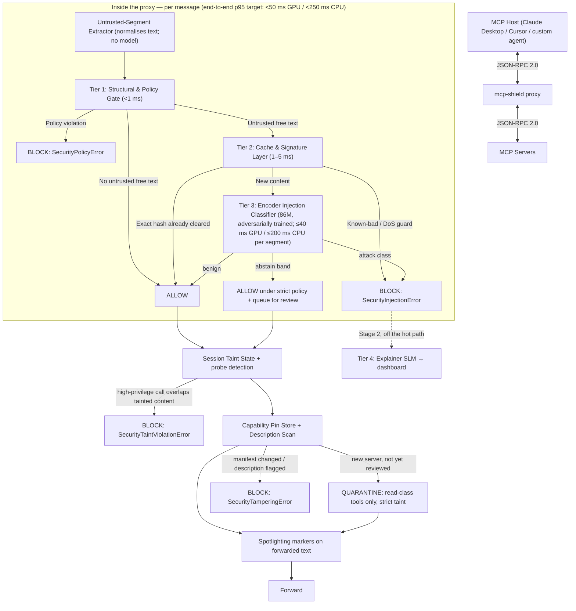
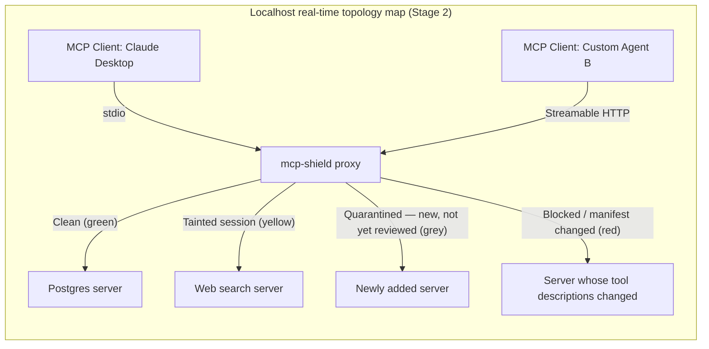

<div align="center">

# 🛡️ MCP-Shield

**Semantic LLM Firewall for Model Context Protocol (MCP) in Agent Networks** _(registered title: MCP-SHIELD: SEMANTIC LLM FIREWALL FOR MODEL CONTEXT PROTOCOL IN MULTI AGENT NETWORKS)_

_An inline, local firewall for MCP traffic: real-time defence against indirect prompt injection, tool-description poisoning and parameter-bound command injection — at the content layer, where protocol attestation cannot see_

[](https://python.org/) [](https://pypi.org/) [](LICENSE.md) [](#-benchmarks) [](https://arxiv.org/abs/2601.17549) [](https://modelcontextprotocol.io/specification/2026-07-28/changelog)

[Features](#-key-features) • [Architecture](#-hot-path-cascade) • [Quickstart](#-quickstart) • [Dashboard](#-localhost-admin-dashboard) • [Benchmarks](#-benchmarks) • [Roadmap](#-roadmap) • [Citation](#-base-paper--academic-citation)

</div>

---

## ⚡ Overview & Product Boundaries

### What MCP-Shield is (and isn't)

- **WE ARE BUILDING**: a local security proxy — `pip install mcp-shield-llm`, then `mcp-shield proxy` — that sits between an MCP host (Claude Desktop, Cursor, your own agent) and its MCP servers and inspects **both directions** of traffic: tool descriptions, tool results, resource contents, server input requests, and call arguments. A secondary `@shield` decorator hardens servers you write yourself.
- **WE ARE NOT BUILDING**: new AI agents. MCP-Shield wraps and protects _any existing_ agent framework or MCP server.
- **NOT RELATED TO** [`riseandignite/mcp-shield`](https://github.com/riseandignite/mcp-shield), a 2025 static scanner for installed MCP configs. MCP-Shield (this project) is an inline runtime firewall.

### The 2026 stateless MCP update & the gap it leaves

Spec revision **`2026-07-28`** made MCP stateless: protocol-level sessions and the `initialize` handshake are gone, every request self-describes in `_meta`, `Mcp-Method` / `Mcp-Name` headers are required on Streamable HTTP POSTs, and server-initiated requests (including the deprecated Sampling feature) are replaced by Multi Round-Trip Requests (MRTR).

- ⚠️ **It does not touch prompt injection.** The words inside a tool result or a tool description are exactly as dangerous as before, and MRTR `inputRequests` are the direct successor of the Sampling vector the base paper measured at 58–72% ASR.
- ⚡ **It helps MCP-Shield's Tier 1**: the headers let the proxy allowlist the tool before reading the body. The body is still parsed and must match the headers — a header-only check would be bypassable.

---

## 🎯 Target Users

**Primary — individual developers & small teams.** Anyone running MCP servers or agents who wants real protection without a security team or a cloud bill: `pip install`, zero infra, $0 by default, full protection on a CPU-only laptop.

**Secondary — enterprise SecOps & platform teams.** A basic enterprise set ships this semester (audit log + OTLP export, Docker / Kubernetes sidecar manifest, OAuth 2.1 validation with a policy map — Stage 1E); service-mesh, eBPF, SIEM connectors and IAM sync stay on the [Roadmap](#-roadmap). Basics are built *after* the core is benchmarked, so they never pull effort off the detection engine.

---

## 🔥 Key Features

- 🔀 **Local proxy, both directions**: `mcp-shield proxy` for wrapped stdio servers, non-OAuth HTTP servers, or servers you operate — no changes to your host or your servers. (Third-party OAuth-protected remote servers: Stage 2, see [Known Limitations](#-known-limitations).)
- 🚀 **Hot-path cascade under 50 ms on a GPU, under a quarter-second on CPU (targets)**: structural policy gate (<1 ms) → cache & signature layer (1–5 ms) → fine-tuned **86M-parameter encoder classifier** (≤40 ms per ≤512-token segment on GPU, ≤200 ms on CPU). Numbers are targets pending our benchmark — see [Benchmarks](#-benchmarks).
- 🧠 **Classifier on every untrusted segment**, not just "suspicious-looking" ones: tool results, resources, tool/prompt descriptions, MRTR input requests, free-text arguments. Four classes: `benign`, `indirect_injection`, `command_injection`, `description_poisoning`. Adversarially trained against attacks on its own checkpoints.
- 📌 **Capability pinning + description scan + quarantine**: SHA-256 pins per tool catch rug-pulls; the classifier reads descriptions at `tools/list` time to catch first-contact poisoning; a server with no pin yet starts **quarantined** — dangerous tools withheld, results under strict taint — until you review and accept its manifest.
- 🧭 **One-command coverage**: `mcp-shield install --host claude-desktop` routes every stdio and non-OAuth HTTP server in your host's MCP config through the proxy (backup kept, `uninstall` restores). OAuth-protected remote servers need the Stage 2 proxy-server pattern (see [Known Limitations](#-known-limitations)).
- 🔦 **Spotlighting + host rules**: forwarded tool text is wrapped in `[MCP-Shield: untrusted data …]` markers so the host can see exactly what is data, and `mcp-shield rules --print` gives you a versioned instruction set (`H-1…`) for your host's system prompt — an advisory layer that sits *below* the classifier, never in place of it.
- 🕶️ **No oracle**: a block sends nothing to the server and only an opaque `Request blocked by MCP-Shield policy (ref …)` to the host — no tier, class or probability. The reason lives in your dashboard, matched by the reference. To the injection's author, a block is indistinguishable from the model ignoring it; the proxy adds no identifying headers, so a server cannot tell it from the host.
- 🏢 **Enterprise basics (Stage 1E)**: JSONL audit log with OTLP export, Docker / Kubernetes sidecar manifest, OAuth 2.1 bearer validation with a basic policy map.
- 🧬 **Session taint state + probe detection**: untrusted content is remembered outside the LLM (decaying, 15-minute half-life); later `write` / `execute` / `egress` calls whose arguments overlap tainted content are blocked (or, Stage 2, sent to you for approval via MRTR). A streak of blocks escalates the session to `strict` and then quarantines the source, so an attacker gets no cheap feedback loop.
- 🛑 **Argument policy for command injection**: every string argument is scanned; a hit in a path-, command- or URL-typed field blocks (canonicalisation + root allowlists, scheme/host allowlists), a hit anywhere else forces `strict` policy for that call; shell-executing tools get `mode = "shell"` (operators allowed, every call strict). The realistic defence for the 43% of servers Equixly found vulnerable.
- 🎛️ **Localhost dashboard** with a flagged-request inspector (why, which tier, calibrated probability, one-click exact-hash override) — token-protected on every endpoint, because an unauthenticated localhost dashboard was CVE-2025-49596.
- 💰 **$0 by default, 100% local**: a ~300 MB ONNX model auto-downloaded from Hugging Face Hub; runs on CPU everywhere, faster with CUDA / DirectML / CoreML if present. Cloud APIs exist only as an opt-in, off-path explainer.

---

## 🏗️ Hot-Path Cascade



Full tier definitions, error types, and the canonical latency table live in [`02 - System Architecture & Technical Implementation.md`](02%20-%20System%20Architecture%20%26%20Technical%20Implementation.md).

---

## 💻 Quickstart

### 1. Install

```bash
pip install mcp-shield-llm
```

### 2. Check your machine

```bash
mcp-shield doctor
```

Prints the OS, event loop, ONNX Runtime execution provider (CPU / CUDA / DirectML / CoreML), cache directory, what was downloaded, a 5-segment self-test with p50/p95 latency for *this* machine, and any servers in your host config that are not routed through the proxy (including OAuth-protected remote entries it cannot front yet).

### 3. Run the proxy (Stage 1, primary)

```bash
# One command: route every server in your host's MCP config through the proxy (backup kept; `mcp-shield uninstall` restores)
mcp-shield install --host claude-desktop

# Or run the proxy by hand — a non-OAuth HTTP MCP server, or one you operate, behind it:
mcp-shield proxy --listen 127.0.0.1:8800 --upstream http://localhost:3000/mcp

# A local stdio server wrapped by the proxy — point your host at this command instead of the server
mcp-shield proxy -- npx -y @modelcontextprotocol/server-filesystem /workspace
```

Point your host's MCP config at `http://127.0.0.1:8800` (or at the wrapped command). Nothing else changes.

### 4. Give your host the rules (optional, advisory)

```bash
# Print the host prompt rules (H-1…H-24) to paste into Claude Desktop project instructions, Cursor rules, or your agent's system prompt
mcp-shield rules --print
mcp-shield rules --print --short     # compact form for hosts with tight instruction limits

# Or let `install` insert them where the host exposes an instructions file
mcp-shield install --host cursor --with-rules
```

Forwarded tool text is already wrapped in `[MCP-Shield: untrusted data …]` markers; the rules tell the host what the markers mean. This layer is advice to the model and ranks below the proxy's own checks — see [Known Limitations](#-known-limitations).

### 5. Optional: `@shield` decorator for servers you write (Stage 2)

```python
from mcp_shield import shield, SecurityConfig

@shield(config=SecurityConfig(taint_policy="strict"))
async def handle_mcp_request(json_rpc_payload: dict):
    # Core MCP server / tool execution logic
    return {"jsonrpc": "2.0", "result": {"resultType": "complete", "content": []}, "id": json_rpc_payload.get("id")}
```

The decorator receives an already-parsed payload, so it runs the Tier 1 argument policy and the classifier on free-text arguments. It protects **your** server's tool execution; it cannot see other servers or what the host does with results — use the proxy for that.

```python
# What the decorator catches: parameter-bound command injection
payload = {
    "jsonrpc": "2.0", "id": 1, "method": "tools/call",
    "params": {"name": "read_file", "arguments": {"path": "/workspace/report.pdf; cat /etc/passwd"}},
}
# -> raises mcp_shield.SecurityPolicyError (Tier 1: shell metacharacter in a path-typed field)
#    logged with that reason; what the host receives is only:
#    {"code": -32000, "message": "Request blocked by MCP-Shield policy (ref 7f3a92c1)"}
```

---

## 🎛️ Localhost Admin Dashboard

```bash
mcp-shield dashboard --port 8501
```

Open the one-time URL the command prints (`http://127.0.0.1:8501/?token=…`). The dashboard binds to `127.0.0.1` only and requires the token on **every** endpoint, including from localhost, with `Origin`/`Host` validation and no permissive CORS.

- 📊 **Live traffic & latency stream** (Stage 1): per-tier timings for every message.
- 🔍 **Flagged-request inspector** (Stage 1): full message (kept locally only, redacted for secret patterns, 7-day retention), tier, class, calibrated probability; *Allow this exact content* (SHA-256, scoped to server + tool, with TTL — never a similarity neighbourhood) or *Report false positive* (feeds the next training round). Each entry carries the reference ID from the host's opaque error.
- 📌 **Pin viewer** (Stage 1): per-server tool fingerprints, diffs on change, explicit re-pin.
- 🕸️ **Topology map, tool hub, model settings** (Stage 2).



---

## 🔧 Configuration

```python
from mcp_shield import SecurityConfig, ExplainerProvider

config = SecurityConfig(
    classifier_model="mcp-shield-clf",        # the single 86M classifier; version pinned via the model card
    taint_policy="standard",                  # "strict": every execute/egress call in a tainted session needs approval
    fpr_target=0.005,                         # picks the shipped operating threshold (FPR <= 0.5%)
    explainer=ExplainerProvider.NONE,         # Stage 2: OLLAMA | OPENAI | DEEPSEEK | ANTHROPIC — opt-in, own key, off the hot path
)
```

### OS & runtime detection

Stage 1 needs nothing beyond `pip install`: the classifier is one ~300 MB ONNX model and runs on CPU on every OS. `mcp-shield doctor` picks an accelerator if one exists; nobody is left in a degraded mode because of their hardware. (Event-loop selection — `uvloop` on macOS/Linux, `winloop` on Windows — is an implementation detail covered in `07`.)

|OS|Hot-path runtime|Acceleration if present|Explainer (Stage 2, optional)|
|:--|:--|:--|:--|
|**Windows**|ONNX Runtime, CPU int8|CUDA or DirectML (any DX12 GPU)|Ollama (installed only with explicit consent) or opt-in cloud|
|**macOS**|ONNX Runtime, CPU int8|CoreML where op coverage allows, else CPU|same|
|**Linux**|ONNX Runtime, CPU int8|CUDA|same|

Weights come from Hugging Face Hub's free file hosting (`rishikesh/mcp-shield-clf`), cached in the OS-appropriate directory via `platformdirs`, SHA-256 verified. An optional `HF_TOKEN` (free account) raises your download quota on shared networks; we never ship a shared token in the package. Full decision flow in [`07`](07%20-%20Model%20Distribution%2C%20PyPI%20Packaging%20%26%20Local%20Dashboard.md).

---

## 📊 Benchmarks

**Status: evaluation pending.** The numbers below are the problem baseline from the base paper and our targets — not measured MCP-Shield results. We will replace the target column with measured values (mean ± sd over 3 seeds) after running the held-out evaluation described in [`03`](03%20-%20Fine-Tuning%20%26%20Dataset%20Strategy.md) §9.

|Metric|Baseline (unprotected MCP, Maloyan & Namiot 2026)|MCP-Shield target|Status|
|:--|:--|:--|:--|
|**Attack Success Rate (ASR)** on held-out static suites (AgentDojo, MCPSecBench)|**52.8%**|< 10%|Pending|
|**ASR on adaptive red-team set**|—|reported, no target|Pending|
|**False Positive Rate (FPR)** on benign hard negatives, per document|—|< 0.5%|Pending|
|**Utility retained** (AgentDojo benign task success vs. undefended)|—|≥ 95%|Pending|
|**End-to-end p95 latency** (GPU, ≤512-token segments)|—|< 50 ms|Pending|
|**End-to-end p95 latency** (CPU-only, ≤512-token segments; standard 4-vCPU CI runner)|—|< 250 ms|Pending|
|**Baseline comparison**: Prompt Guard 2-86M on the same held-out sets (22M for reference)|—|reported|Pending|

Evaluation rules we hold ourselves to: benchmarks used for evaluation are never used for training or threshold selection; we report leave-one-source-out gaps (Fomin et al., 2026) and an adaptive attack set (Bhagwatkar et al., 2025), because static suites saturate. FPR is reported per document, not per chunk. The agent under attack is an open-weight local model (Qwen3 via Ollama) as the primary, with one budget-capped frontier-model run if funds allow — both named in the results.

For reference only: the base paper's own defence, **ATTESTMCP** — capability attestation and message signing, architecturally different from MCP-Shield — reduced ASR from 52.8% to 12.4% (76.5% reduction) at 8.3 ms cold / 2.4 ms warm per message. That number belongs to ATTESTMCP; the paper attributes the residual 12.4% "primarily" to indirect injection through legitimately-retrieved content, which is the surface MCP-Shield targets. The two are complementary.

---

## 🗺️ Roadmap

|Stage|Scope|
|:--|:--|
|**Stage 1 — Core (this semester, built first)**|`mcp-shield proxy` (stdio servers, non-OAuth HTTP servers, self-operated servers) · Tier 1–3 (Tier 3 adversarially trained, with abstain band) · untrusted-segment extractor · pinning + description scan + first-contact quarantine · session taint with overlap check + probe detection · MRTR provenance banner · Spotlighting markers + host prompt rules · `mcp-shield doctor` / `install` / `rules` · benchmark harness with CI CPU baseline · dashboard (traffic log + flagged inspector + pin viewer) · PyPI release|
|**Stage 1E — Enterprise Basics (this semester, built last)**|JSONL audit log + OTLP export · Dockerfile / docker-compose + Kubernetes sidecar manifest · OAuth 2.1 bearer validation + basic policy map · per-client config — cut first if validation runs late|
|**Stage 2**|`@shield` decorator + ASGI middleware · sliding-window state tracker (drift + loop breaker) · Tier 4 explainer (Ollama / opt-in cloud) · MRTR human approval · full dashboard · OAuth proxy-server pattern for third-party OAuth-protected remote servers · gated + rotated weight distribution (option)|
|**Future — Enterprise Advanced**|Envoy / service-mesh filter · eBPF interception · SIEM connectors (Splunk, Datadog, Sentinel) · IAM sync (Vault, Okta / Entra ID) · gVisor sandboxed execution · dashboard SSO · central policy server|

---

## ⚠️ Known Limitations

- **Pinning is trust-on-first-*review*, not zero-trust.** A new server starts quarantined until you accept its manifest, with the classifier's verdicts shown alongside — but a description whose malice neither you nor the classifier recognise is still accepted. The base paper names the same underlying limit (TOFU) for ATTESTMCP.
- **Bounded classifiers can be bypassed by adaptive attacks.** Controlled-release prompting (Fairoze et al., 2025) and distribution shift (Fomin et al., 2026) are real; our weights are open, so an attacker can optimise against them offline. We report adaptive-set ASR separately and rely on defence in depth (taint state, pinning, argument policy), not the classifier alone. Online probing is throttled — a streak of blocks escalates the session and then quarantines the source — and an abstain band raises the guard when the classifier is unsure, but offline optimisation against open weights remains possible. The classifier is adversarially trained — attacks generated against its own checkpoints are added to training for two to three rounds — which raises the cost of such an attack without removing the class.
- **Session taint catches verbatim and near-verbatim smuggling, not fully paraphrased intent.** That is why the classifier runs *before* content reaches the host; the principled fix is host-side control-flow separation (CaMeL), which a proxy cannot impose.
- **The host prompt rules are advice, not enforcement.** An injection is designed to override instructions; Spotlighting markers can be forged inside data (they mark *untrust* only, so a forged one confers nothing). That is why the rules rank below the proxy's own controls.
- **MCP-Shield is not hidden, and does not rely on being hidden.** The code is public, so assume an attacker knows it is there; a compromised host sees the markers by design. What the design guarantees instead is that a block is not an oracle: no message to the server, an opaque reference to the host, the reason only in the dashboard, and repeated blocks escalate (probe detection).
- **Latency scales with content length.** The latency targets are per ≤512-token segment; very large tool results are chunked and batched, and their p95 is reported separately.
- **The proxy protects only the servers routed through it.** `mcp-shield install` routes every stdio and non-OAuth HTTP server in the host config through the proxy and `doctor` warns about any added later, but a server the host reaches directly is invisible. In stdio mode there are no `Mcp-*` headers, so Tier 1 works from the parsed body alone.
- **The proxy is itself a local service and is hardened as one.** Following the spec's Security Best Practices, it binds to `127.0.0.1`, validates `Host`, rejects `Origin` headers not on its allowlist, and never spawns a process from a network or dashboard request — stdio commands come only from the CLI or the config file, confirmed in the terminal.
- **Third-party OAuth-protected remote servers cannot be proxied transparently in Stage 1.** The spec binds tokens to the server URL the host connects to and forbids servers from transiting other tokens, so a local proxy in front of a remote OAuth server would hold a token the upstream must reject. Stage 1 covers stdio servers, unauthenticated / API-key HTTP servers, and servers you operate (proxy at the server's own origin); the spec's "MCP proxy server" pattern with per-client consent is Stage 2.
- **Sessions are per host app, not per conversation.** Hosts do not tell the proxy which conversation a request belongs to; taint records decay (15-minute half-life) and `traceparent` is used when a host sends it, but two windows of the same host share state.
- **Images are not inspected.** Visual prompt injection through images returned by tools is out of scope for a text classifier; binary content is hashed, not classified.
- **Legitimate server updates trip the pin.** Any `npm update` changes descriptions; the dashboard shows the diff and the re-scan verdict and offers one-click re-pin, but it is still a prompt you will see.
- **MRTR replaced Sampling, it did not remove the vector.** Sampling is deprecated in `2026-07-28` (12-month window); server-authored `inputRequests` now carry the same risk and are classified like any other untrusted text. Servers still on `2025-11-25` send legacy `sampling/createMessage` / `elicitation/create` requests during the deprecation window; the proxy classifies those identically.

---

## 📚 Base Paper & Academic Citation

> **Breaking the Protocol: Security Analysis of the Model Context Protocol Specification and Prompt Injection Vulnerabilities in Tool-Integrated LLM Agents**
> _Narek Maloyan & Dmitry Namiot (arXiv:2601.17549, 2026)_

```bibtex
@article{maloyan2026breaking,
  title   = {Breaking the Protocol: Security Analysis of the Model Context Protocol Specification and Prompt Injection Vulnerabilities in Tool-Integrated LLM Agents},
  author  = {Maloyan, Narek and Namiot, Dmitry},
  journal = {arXiv preprint arXiv:2601.17549},
  year    = {2026}
}
```

The full, verified bibliography is in [`05 - Literature Survey & Research Papers.md`](05%20-%20Literature%20Survey%20%26%20Research%20Papers.md).

---

## 🧑‍💻 Authors & Acknowledgments

Developed by **Rishikesh Varma, Vineel Yerubandi, Shivatarak Reddy, ES Heron**
_Department of Computer Science & Engineering (AI & ML), Keshav Memorial Institute of Technology (KMIT)_

- **Project Track**: Major Final Year Project (Academic Year 2025–2026)
- **Domain**: Agentic AI Security, Protocol-Level Safety & Real-Time Injection Defense

---

<div align="center">

Distributed under the Apache 2.0 License. Designed for open-source AI agent safety.

</div>
