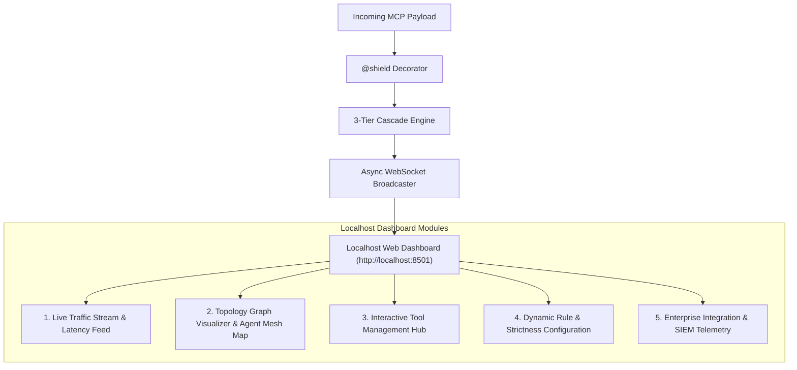
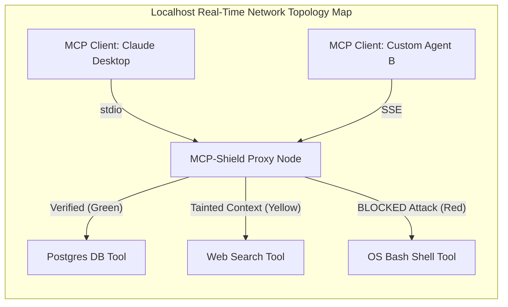
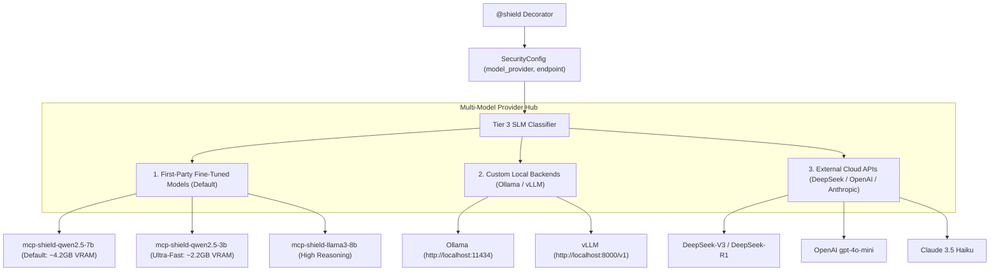
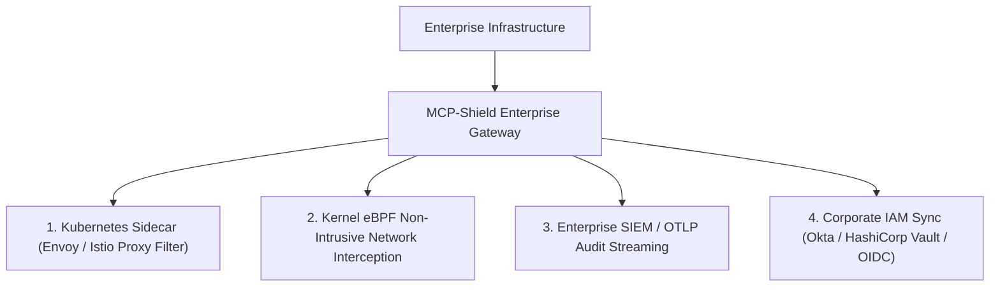

# 07 - Model Hosting, PyPI Deployment & Local Dashboard Architecture

> **Focus**: Zero-Cost Model Distribution, PyPI Package Deployment Pipeline, Local Inference Execution, and the Localhost Security Admin Dashboard.

---

## 1. Zero-Cost Model Distribution Strategy

### The Packaging Dilemma

- ❌ **Including Model Weights in PyPI Package**: PyPI limits package uploads to **100MB**. A 7B parameter SLM is **~4GB to 14GB** and cannot be bundled into a Python `.whl` wheel.
- ❌ **Hosted Cloud API (Hugging Face / OpenAI)**: Sending high-volume agent traffic to external APIs introduces massive latency (>1000ms), API rate-limiting (429 errors), and exponential cloud API costs ("Denial of Wallet").

### 🏆 The $0 Solution: Local Auto-Download from Hugging Face Hub

```
1. Model Weights (.safetensors / .gguf)  ──>  Uploaded to Hugging Face Model Hub (FREE, unlimited downloads)
2. Python Package (pip install mcp-shield-llm)  ──>  Published on PyPI (FREE, ~2MB lightweight code)
3. On First Run  ──>  Package automatically downloads weights from Hugging Face to local cache (~/.cache/mcp-shield)
4. Runtime  ──>  Runs 100% locally on user's GPU/CPU via Ollama / vLLM / ONNX (Zero API Cost, Zero Latency)
```

1. **Hugging Face Model Hub Hosting**:
    - Fine-tuned quantized model weights (`Qwen-2.5-7B-Instruct-Q4_K_M`, ~4.2GB) are hosted on Hugging Face Hub under `rishikesh/mcp-shield-qwen2.5-7b-gguf`.
    - Hugging Face provides **100% free, unlimited storage and unlimited bandwidth** for open-source model weights.
2. **Automated On-Demand Local Caching**:
    - When a developer installs `pip install mcp-shield-llm` and initializes `@shield`, the package checks `~/.cache/mcp-shield/`.
    - If the model weights are missing, it streams and caches the quantized GGUF weights directly from Hugging Face Hub once.
3. **Local On-Device Inference**:
    - Executes locally on the user's hardware via **vLLM**, **Ollama**, or **llama.cpp / ONNX Runtime**.
    - **Cost to Developer = $0**. **Cost to End-User = $0**. Zero cloud latency, zero external API keys.

---

## 2. PyPI Package Deployment Pipeline

Publishing open-source Python packages to **PyPI** (Python Package Index) is **100% free**.

### Repository & Package Structure

```
mcp-shield-llm/
├── mcp_shield/                  # Core Python Package
│   ├── __init__.py              # Exports @shield decorator & SecurityConfig
│   ├── cascade.py               # 3-Tier Hot-Path Decision Engine (Tier 1/2/3)
│   ├── taint_engine.py          # Cryptographic __tainted_source__ Taint Tracker
│   ├── capability_pinning.py    # SHA-256 Manifest Capability Hasher
│   ├── state_tracker.py         # Sliding-Window State Graph Tracker
│   └── dashboard/               # Embedded FastAPI + Web UI Dashboard
│       ├── app.py               # FastAPI Web Server & WebSocket Streams
│       └── static/              # Compiled Web UI Dashboard (React/HTML/CSS)
├── tests/                       # Unit tests & benchmark suites
├── pyproject.toml               # Package build metadata & dependencies
├── README.md                    # GitHub & PyPI Documentation
└── LICENSE                      # Open-Source License (Apache 2.0 / MIT)
```

### Publication Workflow

```bash
# 1. Install build tools
pip install build twine

# 2. Build lightweight source distribution and wheel (~2MB)
python -m build

# 3. Upload package to PyPI
twine upload dist/*
```

Once published, developers can protect their MCP servers worldwide using:

```bash
pip install mcp-shield-llm
```

---

## 3. Localhost Admin Dashboard Architecture

MCP-Shield includes an embedded **Localhost Security Dashboard** to provide real-time visibility into multi-agent traffic, attack classification, interactive tool management, and real-time topology graph rendering.

**Security note**: the dashboard binds to `127.0.0.1` only by default — it never listens on `0.0.0.0` out of the box. A lightweight bearer token is generated on first run (`~/.cache/mcp-shield/dashboard_token`) and required for any access beyond localhost, since a monitoring surface for a security product is itself worth protecting; this matters more than usual for our primary users, who are running this on personal dev machines without a corporate network boundary around them.

```
Developer Terminal  ──>  mcp-shield dashboard  ──>  Spins up FastAPI + Web UI on http://localhost:8501
```



### Key Dashboard Capabilities

1. **Live Traffic & Latency Stream**:
    - Displays real-time WebSocket feed of JSON-RPC transactions.
    - Shows microsecond latency metrics broken down by Tier 1 (Spec Check), Tier 2 (Vector/Entropy), and Tier 3 (Local SLM).
2. **Security Verdict Analytics**:
    - Visual pie charts and metric cards detailing total processed requests, Allowed vs Blocked traffic, and specific attack vector counts (Indirect Prompt Injection, Parameter Injection, Capability Poisoning).
3. **Dynamic Rule & Strictness Manager**:
    - Web UI controls to dynamically toggle `Strict Mode`, adjust `Max Latency Budget (e.g., 50ms)`, and manage custom keyword/IP bypass lists without restarting the host server.
4. **Interactive Documentation Sandbox**:
    - Built-in payload simulator to test custom JSON-RPC messages against the `@shield` decorator and inspect generated JSON Authorization Manifests in real time.
5. **Flagged Request Inspector**:
    - A dedicated queue of every request that Tier 2/3 flagged or blocked, showing the full payload, which tier caught it, the detected attack vector, and the confidence score.
    - One-click **Allow this pattern** / **Report false positive** actions feed directly back into the local vector database and dataset-review queue — this is the main lever against false-positive fatigue, since a developer who can see _why_ something was flagged (and override it in one click) is far less likely to just disable the tool.

### CLI Command Controls

```bash
# Check detected hardware and which cascade tiers/backends will run
mcp-shield doctor

# Launch the Localhost Security Dashboard
mcp-shield dashboard --port 8501

# Download or verify local SLM weights
mcp-shield pull-model --model qwen2.5-7b-gguf

# Run local benchmark suite against InjecAgent / AgentDojo
mcp-shield benchmark --suite injecagent
```

---

## 4. MCP Client Tracking & Topology Graph Visualizer

MCP-Shield intercepts standard MCP request/response traffic (`tools/call`, `tools/list`, `resources/list`, `prompts/list`) and continuously aggregates per-request identity metadata to map out the agent network in real time. Note: under the 2026-07-28 stateless spec there's no more `initialize` handshake to hook — every request now self-describes via `io.modelcontextprotocol/clientInfo` in `_meta`, so discovery has to be a rolling aggregation over recent requests, not a one-time event per connection.



### Topology Map Capabilities

- **Rolling Node Discovery**: Since the 2026-07-28 spec removed the `initialize` handshake, MCP-Shield derives each client's identity from the `clientInfo` metadata attached to _every_ request rather than a one-time handshake, and keeps a sliding window of recently-active clients/tools rendered as an interactive D3.js / Cytoscape graph on `http://localhost:8501`. A client that stops sending requests ages out of the "active" view after a configurable idle window instead of showing a stale "connected" state.
- **State Color-Coding**:
    - 🟢 **Green (Verified / Safe)**: Agent & tool nodes operating under clean context.
    - 🟡 **Yellow (Tainted Context)**: Nodes consuming external, unverified data streams (`__tainted_source__` active).
    - 🔴 **Red (Quarantined / Attack Blocked)**: Nodes flagged by Tier 3 SLM or Capability Pinning violations.
- **Data Flow Trajectory**: Clicking any directed edge opens the exact JSON-RPC payload history, microsecond latency breakdown, and sliding-window state graph.

---

## 5. Interactive Tool Management & Custom Plugin Hub

The dashboard provides a GUI to register, test, and enforce security policies on third-party MCP tools directly from the browser:

```
[ Localhost Tool Hub ]
├── 1. REGISTER NEW TOOL ──> Add stdio / SSE tool endpoints (GitHub, Slack, Custom API)
├── 2. SCHEMAS & TAINT ────> Toggle cryptographic taint tracking per tool
├── 3. PRIVILEGE SCOPING ──> Map tool capabilities to User RBAC roles
└── 4. LIVE PLAYGROUND ────> Send test inputs and preview JSON Authorization Manifests
```

### Features:

1. **Dynamic Tool Registry**: Connect and register new MCP servers via `stdio` commands or `SSE` HTTP endpoints directly through the web UI.
2. **Per-Tool Security Policies**:
    - Set granular latency caps (e.g. `20ms` for critical DB reads, `100ms` for web search).
    - Toggle **Taint Enforcement**: Select whether tool outputs should automatically inherit `__tainted_source__` flags.
3. **Hot-Reload Schema Pinning**: Modify or inspect SHA-256 capability hashes without taking down running Python processes.

---

---

## 6. Multi-Model Provider Hub & Dynamic Model Selection (Optional Feature)

MCP-Shield provides a **Plug-and-Play Model Provider Hub** allowing developers to switch between first-party fine-tuned SLMs or connect custom local/cloud inference backends directly via the `@shield` config or Localhost Dashboard.



### First-Party Fine-Tuned Model Family

Users can switch between three pre-built models hosted on Hugging Face Hub based on their hardware specs:

|Model ID|Base Model|VRAM Required|Primary Use Case|
|:--|:--|:--|:--|
|`mcp-shield-qwen2.5-7b` _(Default)_|`Qwen-2.5-7B-Instruct`|**~4.2 GB** (Q4_K_M)|Optimal balance of sub-40ms speed & high injection detection accuracy.|
|`mcp-shield-qwen2.5-3b`|`Qwen-2.5-3B-Instruct`|**~2.2 GB** (Q4_K_M)|Ultra-fast execution for low-resource hardware (e.g. RTX 3050 4GB Laptop).|
|`mcp-shield-llama3-8b`|`Llama-3-8B-Instruct`|**~5.1 GB** (Q4_K_M)|Maximum complex intent reasoning and multi-turn trajectory evaluation.|

### Code Configuration Example (`@shield`)

```python
from mcp_shield import shield, SecurityConfig, ModelProvider

# Option A: Using pre-tuned 3B model for low VRAM
@shield(config=SecurityConfig(
    model_provider=ModelProvider.FIRST_PARTY,
    model_name="mcp-shield-qwen2.5-3b"
))

# Option B: Connecting to a local Ollama instance
@shield(config=SecurityConfig(
    model_provider=ModelProvider.OLLAMA,
    model_endpoint="http://localhost:11434",
    model_name="qwen2.5-coder:7b"
))

# Option C: Using external DeepSeek cloud API
@shield(config=SecurityConfig(
    model_provider=ModelProvider.DEEPSEEK,
    api_key_env="DEEPSEEK_API_KEY",
    model_name="deepseek-chat"
))
async def handle_mcp_request(json_rpc_payload: dict, context: SessionContext):
    return await execute_tool(json_rpc_payload)
```

### Dashboard UI Model Switcher

On `http://localhost:8501`, the **Model Settings** tab enables:

1. **1-Click Model Swapping**: Switch active inference engines on the fly without restarting server code.
2. **Live Latency & Accuracy Benchmark**: Run a 5-payload diagnostic test to measure real-time latency (ms) and schema compliance for any selected model before locking it into production.

### Hardware Detection & Automatic Fallback

Our primary users (see [[MCP-Shield Documentation#Who Is This For?]]) are individual developers on whatever hardware they happen to own — not just the NVIDIA dev machines above. `mcp-shield doctor` runs a one-time startup check and picks a default mode rather than assuming CUDA is present:

|Detected Hardware|Default Mode|
|:--|:--|
|CUDA GPU, ≥5GB free VRAM|Full 3-Tier cascade, first-party model via vLLM/ONNX|
|Apple Silicon (Metal)|Full 3-Tier cascade, routed through Ollama automatically — no CUDA path exists here|
|No GPU / insufficient VRAM|**Tier 1 + Tier 2 only.** A startup warning states Tier 3 semantic classification is disabled for ambiguous cases, rather than silently falling back to multi-second CPU inference. Developer can opt into `ModelProvider.DEEPSEEK` / `OPENAI` / `ANTHROPIC` as a Tier 3 cloud fallback instead.|
|≥2 `@shield`-wrapped processes detected on one machine|Recommends (and can auto-configure via `mcp-shield dashboard`) a single shared Ollama/vLLM daemon on localhost, so N protected servers don't each load their own copy of the model into VRAM|

This is a startup-time, visible decision (printed to stdout and shown in the dashboard's Model Settings tab), not a silent runtime guess — a developer should always know which tiers are actually protecting them before traffic starts flowing.

---

## 7. Enterprise System Integration Blueprint (Future Enhancement Roadmap)

To deploy MCP-Shield inside Fortune 500 infrastructure and corporate SecOps environments, the architecture supports 4 enterprise integration paths:



### 1. Kubernetes & Service Mesh Sidecar (Envoy / Istio Filter)

- Deploy MCP-Shield as a lightweight sidecar container (`mcp-shield-sidecar`) inside Kubernetes pods.
- Intercepts inter-agent gRPC / HTTP SSE traffic at the container ingress/egress border using Envoy WASM filters.

### 2. Kernel-Level eBPF Traffic Interception

- For zero-code-change enterprise deployments, run MCP-Shield as an eBPF (Extended Berkeley Packet Filter) daemon on host servers.
- Automatically captures JSON-RPC socket traffic at the Linux kernel level without requiring Python code modifications.

### 3. Enterprise SIEM & SOC Telemetry Export

- Real-time streaming of security audit logs to **Splunk**, **Datadog**, **Elasticsearch**, and **Microsoft Sentinel**.
- Supports standard **OpenTelemetry (OTLP)** and Syslog formats, exporting detailed JSON-RPC attack traces, payload hashes, and SLM confidence scores for SOC incident response teams.

### 4. Corporate IAM & Key Management Integration

- Integrates natively with **HashiCorp Vault**, **AWS Secrets Manager**, and **Okta / Entra ID (OIDC / SAML)**.
- Automatically verifies user JWT tokens in JSON-RPC metadata against active enterprise LDAP / Active Directory permission matrices.

---

## 8. Summary Architectural Matrix

| Component                           | Host / Storage Location               | Cost       | Execution Mode                                     |
| :---------------------------------- | :------------------------------------ | :--------- | :------------------------------------------------- |
| **Python Core Library (`@shield`)** | PyPI (`mcp-shield-llm`)               | **$0.00**  | Installed locally via `pip` (~2MB wheel).          |
| **Fine-Tuned SLM Weights**          | Hugging Face Model Hub                | **$0.00**  | Auto-downloaded once to `~/.cache/mcp-shield/`.    |
| **Local Inference Runtime**         | User's Machine (vLLM / Ollama / ONNX) | **$0.00**  | Sub-50ms execution on local GPU/CPU.               |
| **Localhost Admin Dashboard**       | Embedded FastAPI in Python package    | **$0.00**  | Serves local Web UI on `http://localhost:8501`.    |
| **Topology Graph Visualizer**       | Web UI (D3.js / Cytoscape)            | **$0.00**  | Real-time map of clients, agents & tools.          |
| **Interactive Tool Hub**            | Web UI Tool Manager                   | **$0.00**  | GUI for registering & managing MCP tools.          |
| **Multi-Model Provider Hub**        | Config / Web UI Model Switcher        | **$0.00**  | Switch between 3B/7B/8B or Ollama/vLLM/Cloud APIs. |
| **Enterprise SIEM / K8s Mesh**      | OpenTelemetry / Envoy WASM Sidecar    | Enterprise | Production K8s & SOC integration roadmap.          |