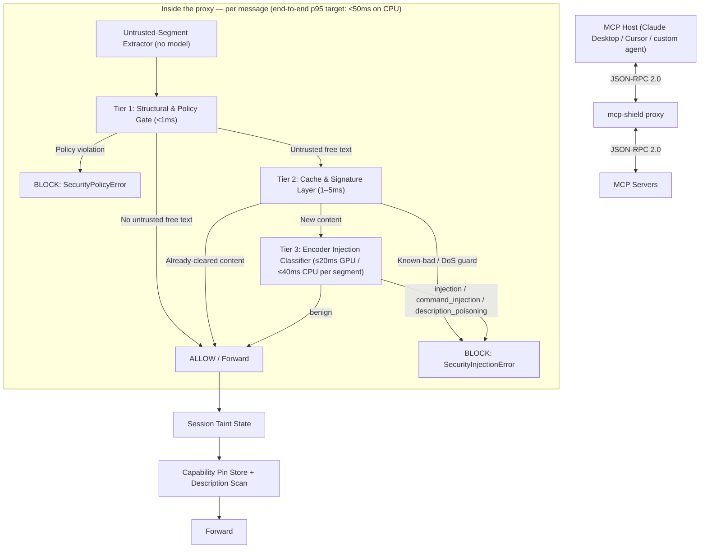
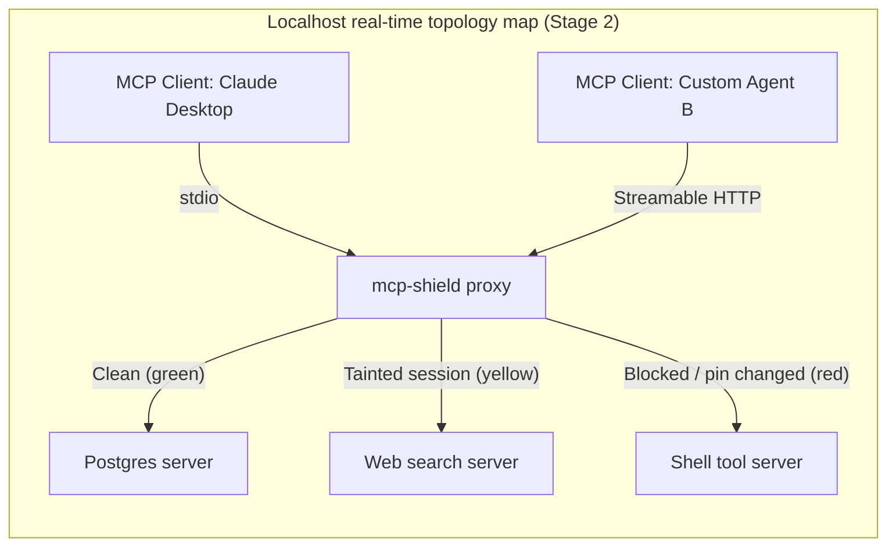

<div align="center">

# 🛡️ MCP-Shield

**Semantic LLM Firewall for Model Context Protocol (MCP) in Agent Networks**

_An Autonomous Inline Multi-Agent Firewall for Protocol-Level Safety & Real-Time Indirect Prompt Injection Defense_

[](https://python.org/) [](https://pypi.org/project/mcp-shield-llm/) [](LICENSE) [-yellow.svg)](#-benchmarks) [](https://arxiv.org/abs/2601.17549) [](https://modelcontextprotocol.io/specification/2026-07-28/changelog)

[Features](#-key-features) • [Architecture](#-hot-path-cascade) • [Quickstart](#-quickstart) • [Dashboard](#-localhost-admin-dashboard) • [Benchmarks](#-benchmarks) • [Roadmap](#-roadmap) • [Citation](#-base-paper--academic-citation)

</div>

---

## ⚡ Overview & Product Boundaries

### What MCP-Shield is (and isn't)

- **WE ARE BUILDING**: a local security proxy — `pip install mcp-shield-llm`, then `mcp-shield proxy` — that sits between an MCP host (Claude Desktop, Cursor, your own agent) and its MCP servers and inspects **both directions** of traffic: tool descriptions, tool results, resource contents, server input requests, and call arguments. A secondary `@shield` decorator hardens servers you write yourself.
- **WE ARE NOT BUILDING**: new AI agents. MCP-Shield wraps and protects _any existing_ agent framework or MCP server.
- **NOT RELATED TO** [`riseandignite/mcp-shield`](https://github.com/riseandignite/mcp-shield), a 2025 static scanner for installed MCP configs. MCP-Shield (this project) is an inline runtime firewall.

### The 2026 stateless MCP update & the gap it leaves

Spec revision **`2026-07-28`** made MCP stateless: protocol-level sessions and the `initialize` handshake are gone, every request self-describes in `_meta`, `Mcp-Method` / `Mcp-Name` headers are required on Streamable HTTP POSTs, and server-initiated requests (including the deprecated Sampling feature) are replaced by Multi Round-Trip Requests (MRTR).

- ⚠️ **It does not touch prompt injection.** The words inside a tool result or a tool description are exactly as dangerous as before, and MRTR `inputRequests` are the direct successor of the Sampling vector the base paper measured at 58–72% ASR.
- ⚡ **It helps MCP-Shield's Tier 1**: the headers let the proxy allowlist the tool before reading the body. The body is still parsed and must match the headers — a header-only check would be bypassable.

---

## 🎯 Target Users

**Primary — individual developers & small teams.** Anyone running MCP servers or agents who wants real protection without a security team or a cloud bill: `pip install`, zero infra, $0 by default, full protection on a CPU-only laptop.

**Secondary (roadmap) — enterprise SecOps & platform teams.** Kubernetes sidecar, eBPF interception, SIEM export, IAM sync — see [Roadmap](#-roadmap). Deliberately deferred so it never pulls effort off the core detection engine.

---

## 🔥 Key Features

- 🔀 **Local proxy, both directions**: `mcp-shield proxy` for Streamable HTTP upstreams or wrapped stdio servers — no changes to your host or your servers.
- 🚀 **Sub-50 ms hot-path cascade (target)**: structural policy gate (<1 ms) → cache & signature layer (1–5 ms) → fine-tuned **22M-parameter encoder classifier** (≤40 ms per ≤512-token segment on CPU). Numbers are targets pending our benchmark — see [Benchmarks](#-benchmarks).
- 🧠 **Classifier on every untrusted segment**, not just "suspicious-looking" ones: tool results, resources, tool/prompt descriptions, MRTR input requests, free-text arguments. Four classes: `benign`, `indirect_injection`, `command_injection`, `description_poisoning`.
- 📌 **Capability pinning + description scan**: SHA-256 pins per tool catch rug-pulls; the classifier reads descriptions at `tools/list` time to catch first-contact poisoning.
- 🧬 **Session taint state**: untrusted content is remembered outside the LLM; later `write` / `execute` / `egress` calls whose arguments overlap tainted content are blocked (or, Stage 2, sent to you for approval via MRTR).
- 🛑 **Argument policy for command injection**: path canonicalisation + root allowlists, shell-metacharacter rejection, URL allowlists — the realistic defence for the 43% of servers Equixly found vulnerable.
- 🎛️ **Localhost dashboard** with a flagged-request inspector (why, which tier, calibrated probability, one-click exact-hash override) — token-protected on every endpoint, because an unauthenticated localhost dashboard was CVE-2025-49596.
- 💰 **$0 by default, 100% local**: a ~25 MB ONNX model auto-downloaded from Hugging Face Hub; runs on CPU everywhere, faster with CUDA / DirectML / CoreML if present. Cloud APIs exist only as an opt-in, off-path explainer.

---

## 🏗️ Hot-Path Cascade



Full tier definitions, error types, and the canonical latency table live in [`02 - System Architecture & Technical Implementation.md`](02%20-%20System%20Architecture%20%26%20Technical%20Implementation.md).

---

## 💻 Quickstart

### 1. Install

```bash
pip install mcp-shield-llm
```

### 2. Check your machine

```bash
mcp-shield doctor
```

Prints the OS, event loop, ONNX Runtime execution provider (CPU / CUDA / DirectML / CoreML), cache directory, what was downloaded, and a 5-segment self-test with p50/p95 latency for *this* machine.

### 3. Run the proxy (Stage 1, primary)

```bash
# A Streamable HTTP MCP server behind the proxy
mcp-shield proxy --listen 127.0.0.1:8800 --upstream https://tools.example.com/mcp

# A local stdio server wrapped by the proxy — point your host at this command instead of the server
mcp-shield proxy -- npx -y @modelcontextprotocol/server-filesystem /workspace
```

Point your host's MCP config at `http://127.0.0.1:8800` (or at the wrapped command). Nothing else changes.

### 4. Optional: `@shield` decorator for servers you write (Stage 2)

```python
from mcp_shield import shield, SecurityConfig

@shield(config=SecurityConfig(strict_mode=True))
async def handle_mcp_request(json_rpc_payload: dict):
    # Core MCP server / tool execution logic
    return {"jsonrpc": "2.0", "result": {"resultType": "complete", "content": []}, "id": json_rpc_payload.get("id")}
```

The decorator receives an already-parsed payload, so it runs the Tier 1 argument policy and the classifier on free-text arguments. It protects **your** server's tool execution; it cannot see other servers or what the host does with results — use the proxy for that.

```python
# What the decorator catches: parameter-bound command injection
payload = {
    "jsonrpc": "2.0", "id": 1, "method": "tools/call",
    "params": {"name": "read_file", "arguments": {"path": "/workspace/report.pdf; cat /etc/passwd"}},
}
# -> raises mcp_shield.SecurityPolicyError (Tier 1: shell metacharacter in a path-typed field)
```

---

## 🎛️ Localhost Admin Dashboard

```bash
mcp-shield dashboard --port 8501
```

Open the one-time URL the command prints (`http://127.0.0.1:8501/?token=…`). The dashboard binds to `127.0.0.1` only and requires the token on **every** endpoint, including from localhost, with `Origin`/`Host` validation and no permissive CORS.

- 📊 **Live traffic & latency stream** (Stage 1): per-tier timings for every message.
- 🔍 **Flagged-request inspector** (Stage 1): full message, tier, class, calibrated probability; *Allow this exact content* (SHA-256, scoped to server + tool, with TTL — never a similarity neighbourhood) or *Report false positive* (feeds the next training round).
- 📌 **Pin viewer** (Stage 1): per-server tool fingerprints, diffs on change, explicit re-pin.
- 🕸️ **Topology map, tool hub, model settings** (Stage 2).



---

## 🔧 Configuration

```python
from mcp_shield import SecurityConfig, ClassifierModel, ExplainerProvider

config = SecurityConfig(
    classifier_model=ClassifierModel.SMALL,   # default 22M model; ClassifierModel.BASE = 86M (Stage 2)
    taint_policy="standard",                  # "strict": every execute/egress call in a tainted session needs approval
    fpr_target=0.005,                         # picks the shipped operating threshold (FPR <= 0.5%)
    explainer=ExplainerProvider.NONE,         # Stage 2: OLLAMA | OPENAI | DEEPSEEK | ANTHROPIC — opt-in, own key, off the hot path
)
```

### OS & runtime detection

Stage 1 needs nothing beyond `pip install`: the classifier is a small ONNX model and runs on CPU on every OS. `mcp-shield doctor` picks an accelerator if one exists; nobody is left in a degraded mode because of their hardware.

|OS|Event loop|Hot-path runtime|Acceleration if present|Explainer (Stage 2, optional)|
|:--|:--|:--|:--|:--|
|**Windows**|`winloop`|ONNX Runtime, CPU int8|CUDA or DirectML (any DX12 GPU)|Ollama (installed only with explicit consent) or opt-in cloud|
|**macOS**|`uvloop`|ONNX Runtime, CPU int8|CoreML (Apple Silicon)|same|
|**Linux**|`uvloop`|ONNX Runtime, CPU int8|CUDA|same|

Weights come from Hugging Face Hub's free file hosting (`rishikesh/mcp-shield-clf-small`), cached in the OS-appropriate directory via `platformdirs`, SHA-256 verified. An optional `HF_TOKEN` (free account) raises your download quota on shared networks; we never ship a shared token in the package. Full decision flow in [`07`](07%20-%20Model%20Distribution%2C%20PyPI%20Packaging%20%26%20Local%20Dashboard.md).

---

## 📊 Benchmarks

**Status: evaluation pending.** The numbers below are the problem baseline from the base paper and our targets — not measured MCP-Shield results. We will replace the target column with measured values (mean ± sd over 3 seeds) after running the held-out evaluation described in [`03`](03%20-%20Fine-Tuning%20%26%20Dataset%20Strategy.md) §9.

|Metric|Baseline (unprotected MCP, Maloyan & Namiot 2026)|MCP-Shield target|Status|
|:--|:--|:--|:--|
|**Attack Success Rate (ASR)** on held-out static suites (AgentDojo, MCPSecBench)|**52.8%**|< 10%|Pending|
|**ASR on adaptive red-team set**|—|reported, no target|Pending|
|**False Positive Rate (FPR)** on benign hard negatives|—|< 0.5%|Pending|
|**Utility retained** (AgentDojo benign task success vs. undefended)|—|≥ 95%|Pending|
|**End-to-end p95 latency** (CPU-only, ≤512-token segments)|—|< 50 ms|Pending|
|**Baseline comparison**: Prompt Guard 2-22M / 86M on the same held-out sets|—|reported|Pending|

Evaluation rules we hold ourselves to: benchmarks used for evaluation are never used for training or threshold selection; we report leave-one-source-out gaps (Fomin et al., 2026) and an adaptive attack set (Bhagwatkar et al., 2025), because static suites saturate.

For reference only: the base paper's own defence, **ATTESTMCP** — capability attestation and message signing, architecturally different from MCP-Shield — reduced ASR from 52.8% to 12.4% (76.5% reduction) at 8.3 ms cold / 2.4 ms warm per message. That number belongs to ATTESTMCP; the paper attributes the residual 12.4% "primarily" to indirect injection through legitimately-retrieved content, which is the surface MCP-Shield targets. The two are complementary.

---

## 🗺️ Roadmap

|Stage|Scope|
|:--|:--|
|**Stage 1 — MVP (this semester)**|`mcp-shield proxy` (HTTP + stdio) · Tier 1–3 · untrusted-segment extractor · pinning + description scan · session taint with overlap check · `mcp-shield doctor` · benchmark harness · dashboard (traffic log + flagged inspector + pin viewer) · PyPI release|
|**Stage 2**|`@shield` decorator + ASGI middleware · sliding-window state tracker (drift + loop breaker) · Tier 4 explainer (Ollama / opt-in cloud) · MRTR human approval · full dashboard · `clf-base` model|
|**Future / Enterprise**|gVisor sandboxed execution · OAuth-claim privilege scoping / RBAC · Kubernetes Envoy sidecar · eBPF interception · OTLP / SIEM export (Splunk, Datadog, Sentinel) · IAM sync (Vault, Okta / Entra ID)|

---

## ⚠️ Known Limitations

- **Capability pinning is trust-on-first-use (TOFU).** Pinning catches changes after first contact; the description scan narrows first-contact risk but a poisoned description the classifier misses is pinned as-is — the same limitation the base paper names for ATTESTMCP.
- **Bounded classifiers can be bypassed by adaptive attacks.** Controlled-release prompting (Fairoze et al., 2025) and distribution shift (Fomin et al., 2026) are real; our weights are open, so an attacker can optimise against them offline. We report adaptive-set ASR separately and rely on defence in depth (taint state, pinning, argument policy), not the classifier alone.
- **Session taint catches verbatim and near-verbatim smuggling, not fully paraphrased intent.** That is why the classifier runs *before* content reaches the host; the principled fix is host-side control-flow separation (CaMeL), which a proxy cannot impose.
- **Latency scales with content length.** The sub-50 ms target is per ≤512-token segment; very large tool results are chunked and batched, and their p95 is reported separately.
- **MRTR replaced Sampling, it did not remove the vector.** Sampling is deprecated in `2026-07-28` (12-month window); server-authored `inputRequests` now carry the same risk and are classified like any other untrusted text.

---

## 📚 Base Paper & Academic Citation

> **Breaking the Protocol: Security Analysis of the Model Context Protocol Specification and Prompt Injection Vulnerabilities in Tool-Integrated LLM Agents**
> _Narek Maloyan & Dmitry Namiot (arXiv:2601.17549, 2026)_

```bibtex
@article{maloyan2026breaking,
  title   = {Breaking the Protocol: Security Analysis of the Model Context Protocol Specification and Prompt Injection Vulnerabilities in Tool-Integrated LLM Agents},
  author  = {Maloyan, Narek and Namiot, Dmitry},
  journal = {arXiv preprint arXiv:2601.17549},
  year    = {2026}
}
```

The full, verified bibliography is in [`05 - Literature Survey & Research Papers.md`](05%20-%20Literature%20Survey%20%26%20Research%20Papers.md).

---

## 🧑‍💻 Authors & Acknowledgments

Developed by **Rishikesh Varma, Vineel Yerubandi, Shivatarak Reddy, ES Heron**
_Department of Computer Science & Engineering (AI & ML), Keshav Memorial Institute of Technology (KMIT)_

- **Project Track**: Major Final Year Project (Academic Year 2025–2026)
- **Domain**: Agentic AI Security, Protocol-Level Safety & Real-Time Injection Defense

---

<div align="center">

Distributed under the Apache 2.0 License. Designed for open-source AI agent safety.

</div>
