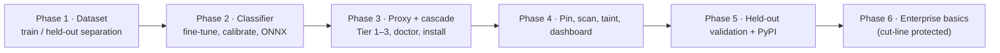
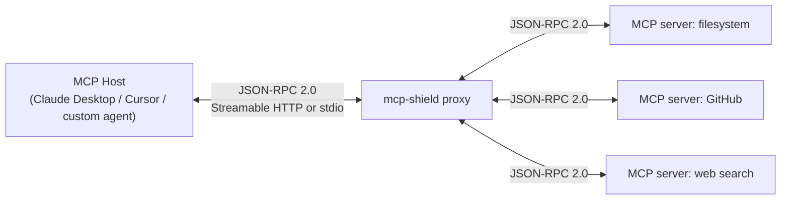
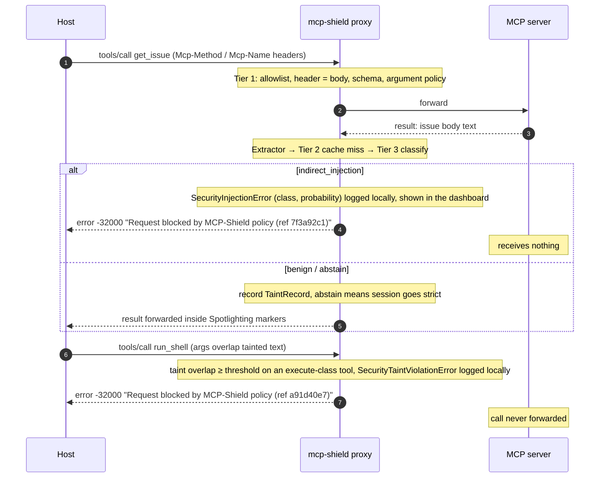
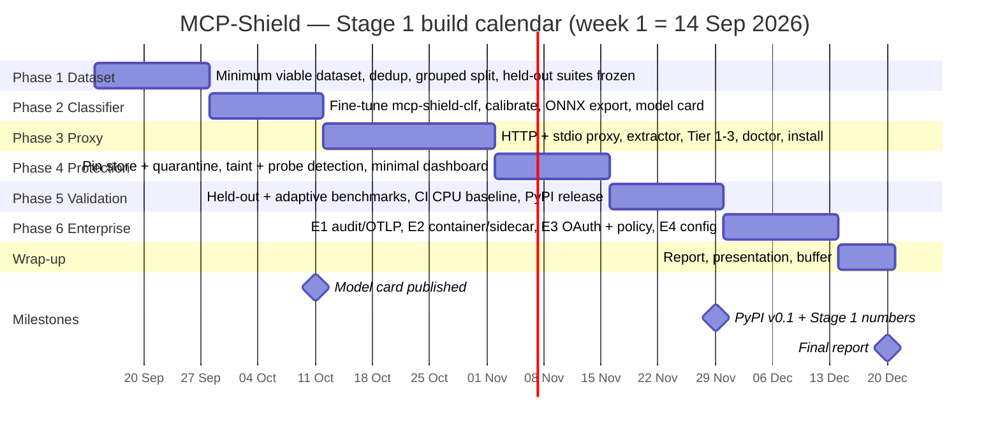

# Review-2 — Presentation Content

> **Purpose**: slide-by-slide content for the Review-2 deck, in the seven components the department asked for. Every claim is taken from the canonical docs ([[02 - System Architecture & Technical Implementation]] for architecture, [[05 - Literature Survey & Research Papers]] for citations, [[00 - Master Architecture & Overview]] §5 for scope and calendar). Bracketed numbers like [5] are bibliography entries in `05`.
> **How to use**: one `###` heading = one slide. "On the slide" is what goes on it; "Speaker notes" is what you say. Tables can be pasted as-is or turned into SmartArt. Diagrams: the Mermaid blocks render in Obsidian — screenshot them, or use the PNGs in the vault root (the cascade diagram plus the four `Review-2 - Fig N` exports).
> **Since Review-1** lines flag what changed from the material the panel already saw.

---

## 0. Opening

### Slide 0.1 — Title

**On the slide**
- MCP-Shield: Semantic LLM Firewall for Model Context Protocol in Agent Networks
- (Registered title: MCP-SHIELD: SEMANTIC LLM FIREWALL FOR MODEL CONTEXT PROTOCOL IN MULTI AGENT NETWORKS)
- Major Project Review-2 · Department of CSE (AI & ML), KMIT · 2025–2026
- Team: Rishikesh Varma · Vineel Yerubandi · Shivatarak Reddy · ES Heron
- Base paper: Maloyan & Namiot, *Breaking the Protocol* (arXiv:2601.17549, 2026)

### Slide 0.2 — What changed since Review-1 (one slide, say it once)

**On the slide**

| Area | Review-1 | Now |
|:--|:--|:--|
| Where the firewall sits | `@shield` decorator inside the tool server | **Local proxy** between the host and every server (both directions); decorator kept as a Stage 2 extra |
| Detection model | Fine-tuned 7B generative SLM, claimed 15–40 ms | **One 86M encoder classifier** (`mcp-shield-clf`); ≤40 ms GPU / ≤200 ms CPU per segment |
| What gets classified | Only traffic a vector score marked "suspicious" | **Every untrusted segment**; cache is a cache, not a gate |
| Taint tracking | Tags injected into strings | **Proxy-held session state** + argument-overlap check |
| Tool poisoning | Pin on first sight | Pin + classifier scan + **first-contact quarantine** |
| Evaluation | Trained and tested on the same benchmarks | **Held-out suites**, leave-one-source-out, adaptive red-team set, CI CPU baseline |
| Scope | One undifferentiated feature list | **Stage 1 Core → Stage 1E Enterprise Basics → Stage 2 → Future**, with a cut-line |
| Bibliography | 13 entries, 5 unverifiable or mis-cited | **29 verified entries** |

**Speaker notes**: A design review between the two reviews found contradictions a security reviewer would catch: the decorator could not see other servers, the 7B model could not meet its own latency claim, and most traffic never reached the semantic classifier. Every one of those is now fixed in the design, and the rest of this deck is built on the corrected version.

### Slide 0.3 — Design audit trail (optional, recommended)

**On the slide**

| Pass | Findings | Outcome |
|:--|:--|:--|
| Design review of the Review-1 vault | 28 (4 critical, 8 high, 10 medium, 6 low) | All fixed; the four critical ones became the architecture decisions on slide 0.2 |
| Deep dive after the rewrite | 6 | All fixed (e.g. tool annotations treated as untrusted, proxy hardened per the spec's Security Best Practices) |
| Planning-phase limitations | 13 | Designed out (first-contact quarantine, probe detection, abstain band, `install`, Stage 1E) |
| Final implementer-level audit | 26 | 22 designed out, 4 stated as permanent limitations |
| Follow-up design additions (14–17 Sep) | 4 | Adversarial training rounds; Spotlighting + host prompt rules; diagram re-sync; no-oracle block errors |
| **Total** | **77** | Every item traceable to a document and section |

**Speaker notes**: We treated the design like code: reviewed it, wrote down every finding with a severity, and fixed or explicitly accepted each one. The four we accepted — OAuth-protected third-party servers until Stage 2, sessions per host app, images not inspected, legitimate updates tripping the pin — are on the last slide, in our words, before anyone asks.

---

## i. Updated Literature Survey

### Slide i.1 — Base paper and what it gives us

**On the slide**
- **[1] Maloyan & Namiot (2026)** — first formal security analysis of the MCP specification
- Three protocol-level vulnerabilities: (1) no capability attestation, (2) sampling without origin authentication, (3) implicit trust propagation across servers
- PROTOAMP: 847 attack scenarios, 5 server implementations → **52.8% ASR**; MCP amplifies attacks by **23–41%** over non-MCP integrations; sampling attacks **58–72%**
- Their fix, ATTESTMCP: attestation + message signing → **12.4% ASR**, 8.3 ms cold / 2.4 ms warm overhead; pinning is trust-on-first-use
- **The residual 12.4% "primarily reflects indirect injection through legitimately-retrieved content"** — content attestation cannot see. That residual is our target.

**Speaker notes**: We are not competing with ATTESTMCP; we are complementary. They answer *who* a server is; we answer *what the content flowing through a legitimate connection is trying to make the host do*.

### Slide i.2 — MCP-specific research (2025–2026)

**On the slide**

| # | Work | What it contributes | How we use it |
|:--|:--|:--|:--|
| [2] | MCPSecBench — Yang, Wu & Chen, 2025 | 17 attack types across 4 MCP surfaces; evaluation playground | **Held-out** evaluation suite |
| [3] | MCP-Bench — Wang et al., 2025 | 28 servers / 250 tools; capability benchmark, no security focus | Source of realistic benign traffic only |
| [4] | MCP-Guard — Xing et al., 2025 | Static scan → E5 detector (96.01%) → LLM arbitrator; MCP-AttackBench (70k samples) | Closest academic architecture; we keep the LLM *off* the decision path |
| [5] | CASCADE — Turgut & Gümüş, 2026 | Layered local defence; review LLM ran on 32.6% of requests at **2.51 s** each and changed no outcomes; FPR 11.7% vs 1.5% depending on counting | Evidence for an encoder-only hot path and for precise FPR reporting |
| [6] | MCP-DPT — Rostamzadeh et al., 2026 | Defence-placement taxonomy; host-orchestration and transport layers under-served | Justifies the intermediary (proxy) placement |

### Slide i.3 — Prompt-injection defences and benchmarks

**On the slide**

| # | Work | Contribution | Role for us |
|:--|:--|:--|:--|
| [7] | Greshake et al., AISec 2023 | Defines indirect prompt injection | Threat definition |
| [8] | InjecAgent — Zhan et al., ACL 2024 | 1,000+ indirect-injection cases | **Training** pool only |
| [9] | AgentDojo — Debenedetti et al., NeurIPS 2024 | Dynamic agent environment, 629 cases | **Held-out** ASR + utility |
| [10] | CaMeL — Debenedetti et al., 2025 | Control/data-flow separation; 77% of AgentDojo tasks with provable security | The principled taint solution; ours is the deployable approximation |
| [11] | Spotlighting — Hines et al., 2024 | Host-side marking of untrusted content | Complementary to proxy-side classification |
| [12][13] | LlamaFirewall + Prompt Guard 2 — Meta, 2025 | 22M / 86M DeBERTa injection classifiers; 92.4 ms per 512 tokens (86M, A100) | Same model class as our Tier 3; our **baseline** |
| [14] | Bhagwatkar et al., 2025 | Simple filters saturate public benchmarks | Mandates our adaptive red-team set |
| [15] | Fomin et al., 2026 | Pooled CV over-reports AUC by 8–16.5 points vs leave-one-dataset-out | Mandates LOSO reporting |
| [16] | Fairoze et al., 2025 | Controlled-release prompting bypasses bounded filters | Named in our limitations |
| [17][18] | Agent-SafetyBench 2024; Lupinacci et al. 2025 | Multi-turn safety; chained-tool takeover | Motivates the Stage 2 state tracker |
| [27]–[29] | Madry et al. 2018; HotFlip (Ebrahimi et al. 2018); TextFooler (Jin et al. 2020) | Adversarial training; gradient-guided and synonym-substitution text attacks | The method and the attack generators for our adversarial training rounds |

### Slide i.4 — Industry, specification and tooling sources

**On the slide**
- **[19] MCP specification revision 2026-07-28** — stateless core, `Mcp-Method`/`Mcp-Name` headers, `ttlMs`, MRTR replaces server-initiated requests, Sampling deprecated
- **[20] MCP Security Best Practices** — confused deputy, token passthrough, *stdio transport security in proxy scenarios*, local-server DNS rebinding
- **[21] Equixly (Mar 2025)** — 43% of tested MCP servers command-injectable, 22% path traversal, 30% unrestricted URL fetch
- **[22] HackerOne 9th HPSR (Oct 2025)** — valid prompt-injection reports up **540%** YoY
- **[23] CVE-2025-49596** — MCP Inspector's unauthenticated localhost server; the reason our dashboard and proxy authenticate every request
- **[24]–[26] Tools**: Invariant `mcp-scan`, `riseandignite/mcp-shield` (unrelated static scanner — name collision disclosed), Cisco `mcp-scanner`

### Slide i.5 — What changed in the survey since Review-1

**On the slide**

| Change | Entries |
|:--|:--|
| **Corrected** | Base paper first author (Narek Maloyan) and full title; MCP-Guard → Xing et al., arXiv:2508.10991 (was "Kumar, 2504.11200"); Equixly year 2025 (was 2026); MCP-Bench described as a capability benchmark, as the base paper itself does; base paper's three vulnerabilities stated as the paper states them |
| **Removed (could not be verified)** | "Securing the Mesh…" (2026), "Towards a Science of AI Agent Reliability" (2026), "The Rise of Agentic Testing" (ICSE 2026) — no authors, no identifiers; "88% incident rate (TechStories)"; a Unit 42 report whose cited title could not be confirmed |
| **Added (16)** | CASCADE [5], MCP-DPT [6], CaMeL [10], LlamaFirewall [12], Prompt Guard 2 card [13], Bhagwatkar [14], Fomin [15], Fairoze [16], MCP spec 2026-07-28 [19], Security Best Practices [20], HackerOne [22], CVE-2025-49596 [23], the three scanners [24–26], adversarial-training references [27–29] |
| **Consolidated** | Three disagreeing reference lists (05, presentation §5, §9) → one canonical bibliography, 29 entries, every one checked at its source |

**Speaker notes**: The survey went from 13 entries, five of which would not survive a citation check, to 29 verified entries — and, more importantly, the new 2026 work (CASCADE, MCP-DPT, Fomin) directly shaped three design decisions, which the next section shows.

---

## ii. Research Gap Identification

### Slide ii.1 — What the literature and the tools leave open

**On the slide**

| Existing approach | What it does | Gap |
|:--|:--|:--|
| ATTESTMCP (base paper) | Attests *who* a server is; signs messages | Blind to *content*: residual 12.4% ASR is indirect injection through legitimate data |
| Static scanners (`mcp-scan`, `riseandignite/mcp-shield`, Cisco) | Scan installed configs and tool descriptions once | Nothing at request time; no results, no session state |
| Inline guardrails (Prompt Guard 2 / LlamaFirewall) | Fast encoder classifier | Protocol-agnostic: no MCP message awareness, no pinning, no taint, no description scanning at listing time |
| MCP-Guard (academic) | Multi-stage with an LLM arbitrator | LLM on the decision path; research prototype; no pinning or taint |
| CASCADE (academic) | Layered local defence | Its own audit: the review LLM cost 2.51 s and changed nothing |
| Cloud LLM guardrails / WAFs / DLP / IAM | Each covers one layer | Protocol-blind, ingress-only, slow, or validates *who* not *what* |

### Slide ii.2 — The gap, stated

**On the slide**
> **No existing system is, at the same time:** MCP-aware at the message level (both directions, 2026-07-28 spec), local and sub-second on ordinary hardware, semantic (a classifier on *every* untrusted segment), stateful (pinning + session taint), **and** evaluated on held-out suites with adaptive attacks.

Six content-level blind spots it must cover:
1. Tool-description poisoning (first-contact and rug-pull)
2. Indirect injection via results, resources, and MRTR input requests
3. Multi-turn state drift (split injections)
4. Context-length denial of service
5. Parameter-bound command injection (43% of servers, Equixly)
6. Header / body desync against header-only filters (`HeaderMismatchError`)

**Speaker notes**: The spec change made two of these worse, not better: MRTR is the deprecated Sampling vector in a new shape, and the new routing headers create a header-only-filter bypass that the spec itself warns about.

---

## iii. Proposed Methodology

### Slide iii.1 — Six phases, core first, enterprise last

**On the slide**


![[Review-2 - Fig 1 Methodology Phases.png]]
_Figure 1: Six-phase pipeline — Phases 1–5 are Stage 1 Core, Phase 6 is Stage 1E._ · PNG in the vault root — right-click → copy image to paste into the deck.
- Phases 1–5 = **Stage 1 Core** (must be benchmarked before submission)
- Phase 6 = **Stage 1E Enterprise Basics** — starts only after Phase 5 numbers exist; dropped in the order E4 → E3 → E2 if time runs out
- Stage 2 (decorator, drift tracker, explainer, human approval, full dashboard, OAuth proxy-server pattern for third-party remote servers) begins next semester

**Since Review-1**: the pipeline had five stages with "SLM fine-tuning" and "sandbox (gVisor)" in them; the model changed, gVisor moved to the enterprise roadmap, and Phase 6 was added.

### Slide iii.2 — Evaluation protocol (what we will actually report)

**On the slide**

| Metric | Target | Where measured |
|:--|:--|:--|
| Attack success rate, static held-out | **< 10%** (baseline 52.8%) | AgentDojo, MCPSecBench — never used in training |
| ASR, adaptive red-team set | reported, no target | Attacks written against the trained classifier |
| False-positive rate | **< 0.5%** | Benign replay with hard negatives |
| Utility retained | **≥ 95%** of undefended | AgentDojo benign tasks |
| End-to-end p95 latency | **< 50 ms GPU · < 250 ms CPU** | Consumer GPU; standard 4-vCPU CI runner |
| Baseline | reported | Prompt Guard 2-86M on the same sets |

Rules: benchmarks used for evaluation never touch training or threshold selection; leave-one-source-out gap reported; three seeds, mean ± sd. FPR is reported per document, not per chunk. Agent under attack: an open-weight local model (Qwen3 via Ollama) as primary, one budget-capped frontier-model run if funds allow.

**Speaker notes**: Fomin et al. showed pooled cross-validation over-reports by 8–16 AUC points and Bhagwatkar et al. showed simple filters saturate the public benchmarks — so we hold out whole suites and add an adaptive set whose numbers will look worse. That is the honest picture, and we would rather present it than a saturated one.

---

## iv. System Architecture

### Slide iv.1 — Deployment: a proxy that sees both directions

**On the slide**


![[Review-2 - Fig 2 Deployment Topology.png]]
_Figure 2: Deployment: the proxy sits between the host and every MCP server._ · PNG in the vault root — right-click → copy image to paste into the deck.
- Host → server: `tools/call` arguments, allowlists, header ↔ body consistency
- Server → host: tool results, resource contents, **tool descriptions**, MRTR input requests, notification text
- `mcp-shield install --host …` routes every stdio and non-OAuth HTTP server through the proxy in one command; third-party OAuth-protected remote servers need the Stage 2 proxy-server pattern (the spec binds tokens to the URL the host connects to)
- Secondary integration (Stage 2): `@shield` decorator / ASGI middleware for people who write servers — stacks with the proxy; the proxy never trusts a server's claim that it already scanned something

**Since Review-1**: the decorator was the product; it could not see other servers' descriptions or results, which is where the attacks live.

### Slide iv.2 — The hot-path cascade

**On the slide**: use `Multi-Shield-Solution-Architecture.png` (vault root) — it is the render of the canonical diagram in `02` §2.

- **Tier 1 — Structural & Policy Gate (<1 ms)**: header allowlist, header ↔ body check, schema, every string argument scanned; typed fields block, others force `strict`
- **Tier 2 — Cache & Signature Layer (1–5 ms)**: exact-hash fast-accept scoped by `ttlMs`, known-bad fast-reject, DoS guard — never a gate
- **Tier 3 — Encoder Injection Classifier**: one 86M model, four classes (`benign`, `indirect_injection`, `command_injection`, `description_poisoning`); ≤40 ms GPU / ≤200 ms CPU per ≤512-token segment; abstain band
- **Around it**: session taint state + overlap check + probe detection; capability pinning + description scan + first-contact quarantine; MRTR provenance banner; Spotlighting markers on forwarded text + a versioned host prompt rule set (`H-1`–`H-24`) as an advisory layer below the checks
- **Off the hot path (Stage 2)**: Tier 4 explainer SLM → dashboard

### Slide iv.3 — Why these numbers, and what they mean

**On the slide**

| Stage | Target | Note |
|:--|:--|:--|
| Tier 1 | < 1 ms | deterministic |
| Tier 2 | 1–5 ms | in-process cache |
| Tier 3 | ≤ 40 ms GPU / ≤ 200 ms CPU | per ≤512-token segment, ONNX |
| End-to-end p95 | < 50 ms GPU · < 250 ms CPU | under a tenth of a 500–2000 ms agent turn |

- Meta's figure for the same 86M lineage: 92.4 ms / 512 tokens on an A100 in unoptimised PyTorch [13]
- CASCADE's local review LLM: 2.51 s per call and changed nothing [5] — why no generative model sits on the hot path
- All numbers are **targets pending Phase 5**; nothing is measured yet

### Slide iv.4 — Errors and the four security mechanisms

**On the slide**

| Mechanism | Stage | Raises |
|:--|:--|:--|
| Tier 1 policy (headers, schema, arguments) | 1 | `SecurityPolicyError` |
| Tier 2/3 detection (signatures, DoS guard, classifier — including the description scan at list time) | 1 | `SecurityInjectionError` (class + probability, recorded locally) |
| Session taint + probe detection | 1 (approval flow 2) | `SecurityTaintViolationError` |
| Pinning + quarantine (manifest changed after pinning) | 1 | `SecurityTamperingError` |

- Error views by audience: the **host** receives one opaque stub for all four (`Request blocked by MCP-Shield policy (ref …)`); the **dashboard / audit log** get tier, class, probability and segment; the **server** gets nothing. A block is never an oracle — the design does not rely on being hidden, only on not being informative.

---

## v. Module Design

### Slide v.1 — Package layout and responsibilities

**On the slide**

| Module | Responsibility | Stage |
|:--|:--|:--|
| `cli.py` | `doctor` · `install` / `uninstall` · `rules` · `proxy` · `dashboard` · `pull-model` · `pin` · `benchmark` | 1 |
| `proxy/http.py` | ASGI reverse proxy; header allowlist before body parse; `Host` check + `Origin` allowlist; optional bearer token; `2025-11-25` pass-through (`initialize`, `Mcp-Session-Id`) | 1 |
| `proxy/stdio.py` | Spawns the wrapped server from CLI/config only; frames JSON-RPC over stdio | 1 |
| `cascade/extractor.py` | Untrusted-segment extractor: `(context_prefix, text)` pairs from any message | 1 |
| `cascade/tier1_policy.py` | Header ↔ body, schema vs pinned `inputSchema`, argument policy, privilege classes | 1 |
| `cascade/tier2_cache.py` | Exact-hash cleared-content cache (`ttlMs`-scoped), signature set, DoS guard | 1 |
| `cascade/tier3_classifier.py` | ONNX session (CPU/CUDA/DirectML/CoreML) in a worker thread; chunking, batching, per-document calibration, block + abstain thresholds; fail-closed | 1 |
| `taint.py` | Session store (`clientInfo` + peer + `traceparent`), decaying taint records, overlap check, probe counters | 1 |
| `pinning.py` | SHA-256 pin store (SQLite), quarantine state, description-scan hook, known manifests | 1 |
| `spotlight.py`, `host_rules.md` | Wraps forwarded untrusted text in provenance markers; the versioned host rule set emitted by `mcp-shield rules --print` / inserted by `install --with-rules` | 1 |
| `dashboard/` | FastAPI + WebSocket; traffic log, flagged inspector, pin viewer; token on every endpoint | 1 (min) / 2 (full) |
| `audit.py`, `auth.py` | JSONL audit (raw local, redacted, 7-day retention) + OTLP export of hashes/verdicts; JWKS validation + policy map | 1E |
| `state_tracker.py`, `decorator.py`, `explainer/` | Drift + loop breaker; `@shield`; Tier 4 providers | 2 |
| `benchmarks/` | Held-out harness, adaptive set, CI latency baseline | 1 |

### Slide v.2 — Data contracts and one request's path

**On the slide**
- `Segment(context_prefix, text, field_path, server, tool)` — what the extractor yields
- `Verdict(tier, cls, probability, action ∈ {allow, block, abstain})` — what every tier returns
- `TaintRecord(server, tool, sha256, shingles, embedding, ts)` — what a session remembers
- `Pin(server, tool, sha256, status ∈ {quarantined, accepted, changed})`



![[Review-2 - Fig 3 Request Path Sequence.png]]
_Figure 3: One request's path through the cascade, taint state and pin store._ · PNG in the vault root — right-click → copy image to paste into the deck.

**Speaker notes**: Everything the classifier does not need to predict — transaction IDs, tool names, arguments — is attached by the runtime; the model only answers "is this segment trying to hijack the host, and how sure are we".

### Slide v.3 — Configuration surface

**On the slide**
```python
SecurityConfig(
    classifier_model="mcp-shield-clf",   # the single 86M classifier, version-pinned
    taint_policy="standard",             # "strict": every execute/egress call in a tainted session needs approval
    fpr_target=0.005,                    # shipped operating threshold (FPR <= 0.5%)
    explainer=ExplainerProvider.NONE,    # Stage 2: OLLAMA | OPENAI | DEEPSEEK | ANTHROPIC (opt-in)
)
```
- Same fields in `mcp-shield.toml`; per-tool `[tools.<name>]` sections carry privilege class, root allowlist and `mode = "shell"` (operators allowed, every call strict); Stage 1E adds `[audit]`, `[auth]`, `[policies.<role>]`, `[clients.<name>]`
- Dashboard binds `127.0.0.1`, token on every endpoint, `Origin`/`Host` validated — CVE-2025-49596 is the cautionary tale

---

## vi. Dataset & Technology Stack

### Slide vi.1 — Dataset

**On the slide**

| Item | Plan |
|:--|:--|
| Task | 4-class sequence classification of one untrusted segment with a context prefix |
| Classes | `benign` ~85% (≥ 25% hard negatives) · `indirect_injection` ~8% · `command_injection` ~4% · `description_poisoning` ~3% |
| Training sources | Synthetic MCP-shaped generation (frontier models, structured output, benign twins) · InjecAgent · captured benign traffic from reference servers, ToolBench / xLAM traces · MCP-AttackBench **if released** (bonus, not prerequisite) |
| Hard negatives | Security docs, shell commands in code-review output, innocent uses of "ignore" / "system prompt", **benign imperative tool descriptions**, **host-authored arguments that read like instructions** |
| Licences & ethics | Licence recorded per source; synthetic data from an open-weight generator (Qwen3, Apache-2.0); adaptive attacks released to researchers only; sandbox accounts for captured traffic |
| Minimum viable dataset | **≥ 20,000 segments** from sources we control |
| Held-out (never trained on) | AgentDojo · MCPSecBench · adaptive red-team set · benign replay |
| Leakage control | Global dedup (MinHash + cosine > 0.92) **before** a grouped, stratified 80/10/10 split; augmentation on train only |
| Calibration | Temperature scaling; block threshold at FPR 0.5%; abstain threshold at FPR ≈ 2%; **per-document** calibration (max-pooled chunk score vs a length-adjusted threshold), FPR reported per document |
| Adversarial training | 2–3 rounds of attacks generated against our own checkpoints (gradient-guided substitutions, LLM paraphrase against the score, obfuscation transforms), validity-filtered, added with benign twins; per-document FPR re-verified each round; adaptive *evaluation* set kept disjoint |

**Since Review-1**: the plan trained a generative model to emit a JSON "authorization manifest" with a hand-written confidence score, on the same benchmarks it evaluated on. Both problems are gone.

### Slide vi.2 — Technology stack

**On the slide**

| Layer | Choice |
|:--|:--|
| Language / runtime | Python ≥ 3.10; `asyncio` with `uvloop` (macOS/Linux) / `winloop` (Windows) |
| Proxy | ASGI app served by `uvicorn`; `httpx` to upstream Streamable HTTP; `asyncio.subprocess` for stdio wrapping; classifier inference in a worker thread |
| Protocol support | `2026-07-28` primary; `2025-11-25` hosts/servers passed through during the deprecation window, legacy sampling/elicitation classified like MRTR; Stage 1 fronts stdio, non-OAuth HTTP and self-operated servers |
| Model | `microsoft/mdeberta-v3-base` (MIT) → fine-tuned with `transformers` + `datasets`; exported with `optimum` → ONNX; fp16 on GPU, int8 on CPU |
| Inference | `onnxruntime` with CUDA / DirectML / CoreML execution providers; CPU int8 everywhere, an accelerator only when `doctor`'s self-test shows it beats the CPU |
| Tier 2 & taint | Hashing + exact signatures; embeddings reuse the Tier 3 encoder's pooled vector (no second model); MinHash shingles (`datasketch`) |
| Storage | SQLite for pin store and audit; in-process LRU for the cache |
| Dashboard | FastAPI + WebSocket + static HTML/JS (D3 / Cytoscape in Stage 2) |
| Config / packaging | `mcp-shield.toml` (`tomllib`); `pyproject.toml`, `build`, `twine`, PyPI Trusted Publishing; `huggingface_hub` + `platformdirs` |
| Enterprise basics (1E) | `opentelemetry-sdk` + OTLP exporter; `PyJWT` with JWKS; Docker, docker-compose, Kubernetes sidecar manifest |
| Testing / CI | `pytest`; GitHub Actions (4-vCPU runner = canonical CPU-only latency baseline) |
| Data generation | Frontier models via API with `instructor` / `outlines` for structured output |
| Hardware | RTX 5060 Ti (training, GPU latency), RTX 3050 4 GB laptop (4 GB training path), CI runner (CPU baseline) |
| Footprint (estimates, measured in Phase 5) | ≈ 0.6 GB disk CPU-only (≈ 300 MB int8 weights + dependencies) · ≈ 1 GB RAM peak per proxy, 2 GB free minimum · ≥ 2 GB VRAM for fp16 acceleration · Python 3.10–3.12 |

---

## vii. Gantt Chart / Project Timeline

### Slide vii.1 — 14-week build calendar (Stage 1 Core + 1E)

**On the slide**


![[Review-2 - Fig 4 Gantt Timeline.png]]
_Figure 4: Stage 1 build calendar (dates indicative — re-cut against the official semester calendar)._ · PNG in the vault root — right-click → copy image to paste into the deck.

### Slide vii.2 — Timeline table with ownership

**On the slide**

| Weeks | Dates | Phase | Deliverable | Split |
|:--|:--|:--|:--|:--|
| 1–2 | 14 Sep – 27 Sep | 1 · Dataset | ≥ 20k segments, dedup + grouped split, held-out suites frozen | 2 data · 2 proxy skeleton |
| 3–4 | 28 Sep – 11 Oct | 2 · Classifier | `mcp-shield-clf` fine-tuned + 2–3 adversarial rounds, calibrated, ONNX, model card | 2 model · 2 Tier 1/2 |
| 5–7 | 12 Oct – 1 Nov | 3 · Proxy + cascade | HTTP + stdio proxy (both protocol revisions), Tier 1–3 wired, `doctor`, `install` | all |
| 8–9 | 2 Nov – 15 Nov | 4 · Protection | Pin store + quarantine, taint + probe detection, minimal dashboard | 2 + 2 |
| 10–11 | 16 Nov – 29 Nov | 5 · Validation | Held-out + adaptive benchmarks, CI CPU baseline, PyPI v0.1 | all |
| 12–13 | 30 Nov – 13 Dec | 6 · Enterprise basics | E1 → E2 → E3 → E4 (cut in reverse order if late) | 2 E1/E2 · 2 E3/E4 |
| 14 | 14 Dec – 20 Dec | Buffer | Report, presentation, slack | all |

- **Review-2**: Saturday 19 Sep 2026 (week 1) · **Fixed rules**: core before enterprise; Phase 6 drops before Phase 5 does
- Dates are indicative and will be re-cut against the official semester calendar

---

## Closing (recommended, two slides)

### Slide C.1 — What MCP-Shield does not stop (and says so)

**On the slide**
- Offline adaptive attacks against open classifier weights — mitigated by defence in depth and probe detection and by adversarial training rounds (raise the cost, do not close the class); adaptive-set ASR reported
- Fully paraphrased intent that no longer overlaps tainted text — Tier 3 runs before content reaches the host; principled fix (CaMeL) is host-side
- A first review that accepts a poisoned description neither the reviewer nor the classifier recognises (trust-on-first-review, not zero-trust)
- Clean-looking strings executed by a careless server; MRTR as a live channel; latency scaling with content length
- Third-party OAuth-protected remote servers are a Stage 2 item (token audience binding); sessions are per host app, not per conversation; images are not inspected; legitimate server updates trip the pin

**Speaker notes**: Every mechanism in the defence matrix carries a residual-risk column. We would rather the panel hear these from us.

### Slide C.2 — Ask / next steps

**On the slide**
- Confirm the semester end date for the calendar (Review-2 itself: 19 Sep 2026, week 1)
- Faculty decision on the product name (`riseandignite/mcp-shield` collision disclosed; `mcp-shield-llm` and `mcp-shield` are free on PyPI)
- Phase 1 starts 14 Sep: dataset assembly and proxy skeleton in parallel
